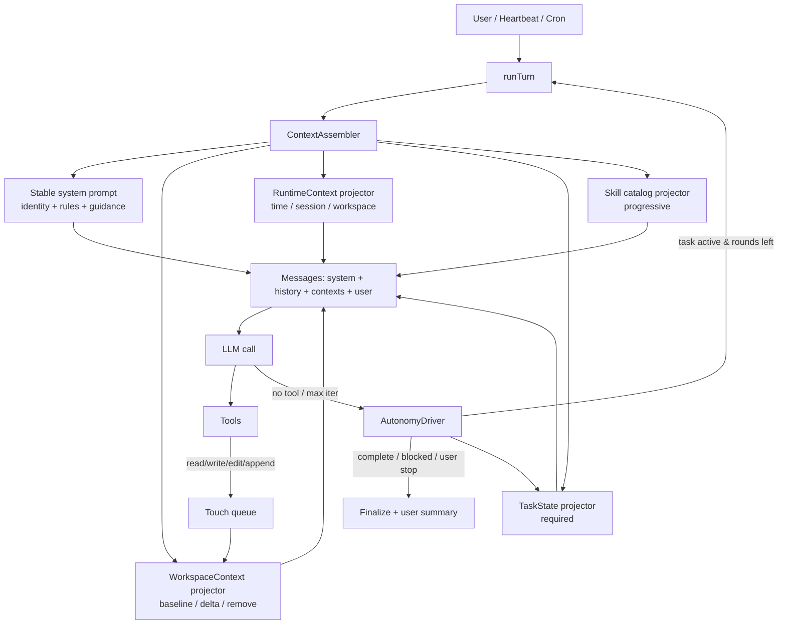

# Agent 工作区上下文与自主连续性改进计划

> 状态：提案（Proposal）  
> 日期：2026-10-28  
> 适用仓库：Chagent（`pkg/agent`、`pkg/config`、`pkg/providers`、`pkg/session`、`pkg/commands`、`pkg/tools`）  
> 关联文档：
> - [Prompt 设计规范与 DSH Prompt 适配](agent-workspace-context-prompts.zh.md)
> - [详细任务书](agent-workspace-context-task-book.zh.md)
> - DSH 参考仓库：`../../deepseek-harness/`（外部仓库，本文以相对链接引用其文档与源码）
> - Chess 参考仓库：`../../chess/`（外部仓库，尤其 `client/`）

> **需求变更（v0.2，2026-10-28）**
>
> Chagent 的交付目标已收敛为 **chess 项目的基础 agent**，不再以“通用多通道 agent”为第一目标。由此新增四条硬约束：
>
> 1. **通信/启动/关闭必须兼容 `chess/client`**：`gateway` 子命令、`CHAGENT_HOME/WORKSPACE/CONFIG`、`.chagent.pid`、`/health`、`/pico/ws`、SIGTERM 优雅退出等契约不能破坏（详见 §2.6）。
> 2. **最小外部配置**：只有 `model_list`（模型/密钥/协议）和 `channels.pico.token` 是外部必需；workspace、gateway、tools、hooks、heartbeat、session、新上下文/自主字段全部有合理默认。
> 3. **删除 chess 不需要的代码/文档/前端/脚本**：非 pico 通道、硬件/音频/设备、非 chess CLI 命令、营销资源、翻译文档、不再需要的构建脚本等可以硬删除（git 已备份）。
> 4. **自主运行是产品目标**：默认开启自主续跑，只有完成、用户停止、持续阻塞、资源上限允许停止（详见 §1.1、§6.5）。

---

## 1. 结论摘要

Chagent 当前把“身份、工作区文件、技能目录、记忆、时间/会话信息、摘要”全部压进一条 system message，再由 `ContextBuilder` 在每次请求前重建。这个模型简单、兼容性好，但在长会话和自主运行场景下有三个结构性问题：

1. **工作区扫描范围过窄**：只读取 workspace 根目录的 `AGENT.md` / `AGENTS.md` / `SOUL.md` / `USER.md` / `IDENTITY.md`，没有项目根发现、祖先链、嵌套目录发现、用户级指令、本地覆盖文件，也没有内容去重、字节预算、更新/删除通知。
2. **动态内容与稳定前缀混在一起**：时间、会话、发送者、记忆、技能目录都在 system prompt 内；任何文件或时间变化都会改写 system prompt，破坏 provider 的 KV Cache 前缀，也无法把“上下文变化”作为可回放的历史事实。
3. **没有自主连续性状态**：模型不调用工具、达到 `max_tool_iterations`、上下文压缩、进程重启或 heartbeat 的 `NoHistory` 都会让任务提前结束；系统没有持久目标、任务清单、轮次、阻塞原因和恢复机制。

DSH 的做法是把“稳定提示”和“动态上下文”分开：

- **system prompt** 只放稳定身份、规则、能力和值无关的指导；
- **工作区指令** 在首次 pre-step 作为一条持久的 user-role `<system-reminder>` 注入，之后由成功的 `read` / `write` / `edit` 工具触碰驱动增量发现、替换和删除；
- **运行时上下文**（时间、工作目录、checkout/GUI URL 等）作为“变化才追加”的 durable snapshot 追加在历史之后，绝不改写 system prompt；
- **目标/任务/待办**有持久状态、工具和自动续跑驱动，只有“验证完成、用户停止、持续阻塞、资源上限”才允许停止。

本计划据此提出三条工作流：

| 工作流 | 目标 | 关键结果 |
|---|---|---|
| A. 工作区上下文 | 让模型在正确的位置看到正确的工作区规则 | 项目根/祖先链/嵌套发现、预算、去重、刷新、删除、恢复 |
| B. 自主连续性 | 让任务在长会话、压缩、重启后仍持续推进 | 持久 TaskState、`todo_write`/`task_*` 工具、续跑驱动、停止判定 |
| C. Prompt 与工具扩展 | 用可组合的 prompt/context 源替代硬编码拼接 | `PromptRegistry` 扩展 context 交付、`skill` 加载器、`/context` 诊断、Prompt 规范 |

预期效果：

- 首次请求即可获得项目级/目录级指令，减少“读错目录、违反项目约定”；
- 嵌套指令只在触碰相关目录后出现，减少 token 噪声；
- 工作区指令有预算、去重、更新/删除通知，避免上下文膨胀和过期规则；
- system prompt 在无变更时保持字节稳定，提升 KV Cache 命中；
- 任务状态、待办和阻塞原因可回放、可恢复，自主运行不再因空响应/轮次上限/压缩而无声停止；
- 通过 `/context` 和事件可观察“加载了什么、占了多少、何时刷新”。

### 1.1 产品要求：自主运行不中断

Chagent 的产品目标是**无人值守地持续执行，直到任务完成**。因此本计划把“不提前停止”作为与工作区扫描同等重要的验收目标：

- 模型不得因为“一个步骤结束”“工具没有新信息”“不知道下一步”而停止；
- 空响应、无 tool call、达到 `max_tool_iterations`、上下文压缩、进程重启都**不是完成**；
- 只有以下情况允许停止：任务状态为 `complete` 且有证据；用户显式停止/暂停/替换任务；同一具体阻塞条件连续 3 轮无法解决；配置的资源/轮次上限到达并记录检查点；
- 停止必须可见：最终消息、事件、日志都要说明原因；
- 自主续跑必须可被用户消息、steering、`/stop` 立即打断；
- 任务状态（目标、待办、轮次、阻塞、证据）必须在压缩/重启后可恢复；
- 任何上下文扫描/刷新/持久化异常都不得让 turn 崩溃或静默结束：保留 last-good、记录 checkpoint，下一轮继续或进入有原因的 blocked；
- **模型可见 Prompt 使用中文**：新增/改造的 system prompt、context 模板、工具描述使用中文；现有 Chagent 英文 Prompt 在 T4.6 翻译为中文；代码标识符、协议字段、文件路径、工具名保持原样。

这条产品要求直接决定了第 6.5 节的 TaskState/续跑设计，以及 Prompt 规范中的 P-01/P-09/P-10/P-11/P-18/P-19。

---

## 2. 背景与约束

### 2.1 Chagent 的设计目标

Chagent 的定位是轻量、安全、可自主运行的 agent 基础设施：

- **轻量**：面向 64 MB RAM 级设备，避免常驻 watcher、重型依赖和频繁全量扫描；
- **安全**：文件/命令默认限制在 workspace，敏感数据过滤、隔离与审批是既有能力；
- **自主**：无人值守地持续推进任务，直到任务完成或出现不可恢复的阻塞；
- **多通道/多 provider**：一条 system message 兼容 Anthropic、Codex、OpenAI-compatible 等适配器；
- **向后兼容**：现有 `AGENT.md`、`AGENTS.md`、`SOUL.md`、`USER.md`、`IDENTITY.md` 语义不能破坏。

### 2.2 当前上下文装配路径

```text
AgentInstance
  └─ ContextBuilder
       ├─ BuildSystemPromptParts()
       │    ├─ kernel.identity
       │    ├─ instruction.workspace   ← LoadBootstrapFiles()
       │    ├─ capability.skill_catalog
       │    ├─ context.memory
       │    └─ context.output_policy
       └─ BuildMessagesFromPrompt()
            ├─ static system prompt（可缓存）
            ├─ dynamic context（time/session/sender）
            ├─ summary
            ├─ history
            └─ current user message
```

关键代码位置：

- `ContextBuilder.BuildSystemPromptParts`：[`pkg/agent/context.go:227`](../../pkg/agent/context.go#L227)
- 工作区 bootstrap 读取：[`pkg/agent/context.go:738`](../../pkg/agent/context.go#L738)
- 动态时间/会话上下文：[`pkg/agent/context.go:795`](../../pkg/agent/context.go#L795)
- 单一 system message 组装：[`pkg/agent/context.go:842`](../../pkg/agent/context.go#L842)
- system prompt 缓存与失效：[`pkg/agent/context.go:335`](../../pkg/agent/context.go#L335)、[`pkg/agent/context.go:617`](../../pkg/agent/context.go#L617)
- turn 初始化（先 Assemble，再 BuildMessages）：[`pkg/agent/pipeline_setup.go:16`](../../pkg/agent/pipeline_setup.go#L16)
- 主循环与 steering 注入：[`pkg/agent/turn_coord.go:92`](../../pkg/agent/turn_coord.go#L92)、[`pkg/agent/turn_coord.go:151`](../../pkg/agent/turn_coord.go#L151)
- 轮次上限的兜底响应：[`pkg/agent/turn_coord.go:268`](../../pkg/agent/turn_coord.go#L268)、[`pkg/agent/agent.go:123`](../../pkg/agent/agent.go#L123)

### 2.3 当前工作区扫描的真实行为

- `loadAgentDefinition` 只做 workspace 根目录的固定文件名查找，优先 `AGENT.md`，回退 `AGENTS.md`，再读 `SOUL.md` / `USER.md` / `IDENTITY.md`（[`pkg/agent/definition.go:80`](../../pkg/agent/definition.go#L80)）。
- `LoadBootstrapFiles` 只把这些根文件的正文拼进 system prompt，不做预算、去重、优先级说明或转义（[`pkg/agent/context.go:738`](../../pkg/agent/context.go#L738)）。
- `sourcePaths` 只跟踪 definition 文件和 `memory/MEMORY.md`；技能目录另做递归快照（[`pkg/agent/context.go:531`](../../pkg/agent/context.go#L531)）。
- `sourceFilesChangedLocked` 每次请求都重新读取 definition（`LoadAgentDefinition`），并 `WalkDir` 全部技能根做文件快照（[`pkg/agent/context.go:617`](../../pkg/agent/context.go#L617)、[`pkg/agent/context.go:681`](../../pkg/agent/context.go#L681)）。这在技能较多或嵌入式存储上是明显的热路径开销。
- 缓存失效用“全局最大 mtime”作为基准：`cachedAt` 是所有被跟踪路径的最大 mtime，`fileChangedSince` 用每个文件的 mtime 与它比较（[`pkg/agent/context.go:652`](../../pkg/agent/context.go#L652)）。如果某个文件被 `cp -p`、解压、版本控制 checkout 或粗粒度文件系统写入，mtime 可能小于全局最大值，变化会被漏判。应改为逐文件 version（size + mtime + inode）精确比较，必要时用 digest 兜底。
- 缓存失效是“全有或全无”：任何一个被跟踪文件变化，整条 system prompt 重建；没有“变化消息”“删除消息”“预算通知”。

### 2.4 当前自主运行的停止路径

| 停止路径 | 当前行为 | 对自主任务的后果 |
|---|---|---|
| 模型返回无 tool calls | `Pipeline.CallLLM` 直接 `ControlBreak`，随后 `Finalize` | 即使任务未完成，也会结束当前 turn |
| 达到 `max_tool_iterations` | `runTurn` 用 `toolLimitResponse` 结束，并提示用户改配置 | 长任务被硬截断，没有检查点/续跑 |
| 上下文压缩 | 旧 turn 被摘要/丢弃，指令和任务状态可能一起消失 | 模型忘记目标或规则，行为漂移 |
| 进程重启 | 只恢复 session history，没有持久目标/轮次/阻塞原因 | 无法判断“做到哪一步、下一步是什么” |
| Heartbeat | `ProcessHeartbeat` 使用 `NoHistory: true`，每次独立 | 多轮自主任务没有累积历史，无法持续 |
| 用户停止/取消 | 当前 turn 停止 | 没有“暂停/恢复”语义，任务状态丢失 |

关键代码：

- `ProcessHeartbeat`：[`pkg/agent/agent_message.go:70`](../../pkg/agent/agent_message.go#L70)
- heartbeat prompt 构造：[`pkg/heartbeat/service.go:222`](../../pkg/heartbeat/service.go#L222)
- 压缩入口：[`pkg/agent/context_legacy.go:115`](../../pkg/agent/context_legacy.go#L115)、[`pkg/agent/context_legacy.go:172`](../../pkg/agent/context_legacy.go#L172)
- turn 边界只认 `role == "user"`：[`pkg/agent/context_budget.go:20`](../../pkg/agent/context_budget.go#L20)

### 2.5 约束

1. **provider 兼容**：仍应保持“一条 system message + history”的最终请求形态；新增上下文以 user-role 消息追加，不能引入第二套 provider 专用字段。
2. **轻量**：不引入 chokidar 类常驻 watcher；扫描以“首次 + 工具触碰 + 显式刷新”为主。
3. **安全**：默认不跟随指向 workspace 外的指令文件符号链接；读取有上限；内容必须转义 frame 结束标记。
4. **不破坏现有语义**：`AGENT.md` / `SOUL.md` / `USER.md` / `IDENTITY.md` 仍是 persona/definition；根 `AGENTS.md` 在作为 legacy definition 时不得重复注入。
5. **可回放**：新增上下文消息必须带类型化来源元数据，能从 session history 重放；压缩丢弃后能重新生成。
6. **无异常不中断**：上下文扫描/刷新失败不能导致 turn 失败；应保留 last-good 状态、记录日志、继续执行。
7. **不解析 shell 导航**：与 DSH 一致，只根据结构化文件工具（`read_file` / `write_file` / `edit_file` / `append_file`）的触碰发现嵌套指令；不解析 `exec` 的 `cd`。

### 2.6 Chess 集成契约（硬约束）

Chagent 作为 chess 基础 agent，必须保持与 `chess/client` 现有启动/关闭/通信方式兼容。以下契约来自 chess 源码，属于**不可破坏**范围：

| 契约 | Chess 侧行为 | Chagent 要求 |
|---|---|---|
| 启动命令 | `chagent gateway --name <agent>`（`--name` 可省略） | 必须保留 `gateway` 子命令；接受并忽略 `--name` 不报错 |
| 工作目录 | `cmd.Dir = workspacePath` | 必须能在任意 workspace 下运行，不依赖安装目录 |
| 环境变量 | `CHAGENT_HOME`、`CHAGENT_WORKSPACE`、`CHAGENT_CONFIG` | 必须支持；旧 `PICOCLAW_*`/`DDMCCLAW_*` 不兼容（2026-11-02 重命名决策，外部按新名称对接） |
| 配置路径 | `$CHAGENT_CONFIG` 指向 `<workspace>/config.json` | 必须优先读取该路径；缺省时回退 `$HOME/.chagent/config.json` |
| 配置版本 | chess 生成 v2：`channels.pico.token`、`gateway`、`model_list` | 必须接受 v2；v2→v3 迁移只在内存进行，**不得在启动时把 `channels` 重写为 `channel_list`**（chess 读取 `channels`） |
| 配置键兼容 | `model_list[*].api_key`（单数）、`agents.defaults.workspace` | 接受 `api_key` 别名；workspace 可用环境变量替代 |
| PID 文件 | 等待 `.chagent.pid`（15s），读取 `pid/token/version/port/host` | 必须在监听器打开后、`/health` 就绪前写入；退出时删除；路径优先 `agents.defaults.workspace`，否则进程 cwd |
| 端口发现 | `pid.port → config.gateway.port → 17590`；`gateway.port=0` 由 OS 分配 | 必须支持 port=0，并把实际端口写入 pid；host 默认 127.0.0.1 |
| 健康检查 | `GET http://host:port/health` 期望 200 | 必须保留 `/health`；`/ready` 可选；`/reload` 不应破坏 |
| Pico 通信 | `ws://host:port/pico/ws?session_id=...`，`Authorization: Bearer <channels.pico.token>` | 必须保留 `/pico/ws`、Bearer 校验、`session_id` query；token 为空时启动应明确报错 |
| Pico 协议 | `message.send` / `message.create` / `message.update` / `typing.start|stop` / `ping` / `pong` / `error` | 必须保持 payload 键兼容；`message_id`、`reply_to_message_id`、`context_usage`、`usage` 不得改名 |
| 关闭 | SIGTERM（等 5s）→ SIGINT（3s）→ SIGKILL（2s），并清理 pid | 必须捕获 SIGTERM/SIGINT，5s 内退出，删除 pid，关闭 WS/通道；不产生孤儿 |
| 重启 | client 自动重启（最多 3 次） | 单例检查基于 pid；异常退出的 stale pid 必须可清理 |
| 配置热更新 | client 收到 `agent_config_changed` 后重写 `config.json`；`hot_reload=false` | 不要求 Chagent 原地热加载；但下次启动必须读取新配置；`/reload` 不能因旧 schema 崩溃 |

**关键兼容风险（必须修）**：

1. **v2→v3 迁移写回**：Chagent 当前只在内存迁移；但任何 `SaveConfig` 路径若把 `channels` 写成 `channel_list`，chess client 会读不到 pico token。要求：保留加载时的键风格；或 chess 侧同时读取 `channel_list`（跨仓库改动需评审）。
2. **`api_key` 单数**：chess model_list 使用 `api_key`；Chagent v3 使用 `api_keys`。要求 v2 加载时归一化，避免密钥丢失。
3. **默认 model**：chess 可能清空 `agents.defaults.provider`/`model_name`；若 `model_name` 为空，Chagent 应从 `model_list` 首个可用条目推断，而不是启动失败。
4. **workspace/pid 位置**：若 `agents.defaults.workspace` 被省略，必须用 `CHAGENT_WORKSPACE` 或 cwd，保证 pid 落在 chess 搜索的目录。
5. **legacy 环境变量**：chess 的 `chagent` agent type 仍设置 `CHAGENT_*`；需要别名，否则 legacy 启动拿不到 config/workspace。
6. **`channels.pico.token` 空值**：chess 总是注入；若缺失，Chagent 应返回可诊断错误（不要静默启动无认证 pico）。
7. **单例进程名**：Linux 下 `pkg/pid/isChagentProcess` 只识别 `comm` 含 `chagent`；chess 二进制名是 `chagent`，会被误判为“非 chagent”并删除活 pid，导致同 workspace 双实例。必须同时识别 `chagent`/`chagent`，或用 pid 文件中的可执行路径校验。

对应 chess 源码：

- 启动/停止/健康/pid：[chagent_agent.go](../../../chess/client/internal/aiagent/chagent_agent.go)、[chagent.go](../../../chess/client/internal/aiagent/chagent.go)
- pid/端口发现：[gateway_pidfile.go](../../../chess/client/internal/aiagent/gateway_pidfile.go)
- 配置读取：[config_parser.go](../../../chess/client/internal/aiagent/config_parser.go)
- pico 协议/客户端：[pico/client.go](../../../chess/client/internal/pico/client.go)、[pico/protocol.go](../../../chess/client/internal/pico/protocol.go)
- 客户端主循环/命令：[cmd/client/main.go](../../../chess/client/cmd/client/main.go)

---

## 3. DSH 设计分析

DSH 的实现细节分布在以下文档/源码中，本节把它们还原成可执行的规则：

- [agent-instructions README](../../../deepseek-harness/packages/context/agent-instructions/README.md)
- [agent-instructions/files.ts](../../../deepseek-harness/packages/context/agent-instructions/src/files.ts)
- [agent-instructions/render.ts](../../../deepseek-harness/packages/context/agent-instructions/src/render.ts)
- [agent-instructions/state.ts](../../../deepseek-harness/packages/context/agent-instructions/src/state.ts)
- [system-prompt 子系统](../../../deepseek-harness/docs/subsystems/system-prompt.md)
- [working-directory 子系统](../../../deepseek-harness/docs/subsystems/working-directory.md)
- [agent-lifecycle](../../../deepseek-harness/docs/agent-lifecycle.md)
- [runtime-context.ts](../../../deepseek-harness/packages/core/agent-loop/src/runtime-context.ts)
- [goal 子系统](../../../deepseek-harness/docs/subsystems/goal.md)
- [goal-round-driver](../../../deepseek-harness/packages/goal/goal-round-driver/README.md)
- [todo 子系统](../../../deepseek-harness/docs/subsystems/todo.md)
- [tool-goal](../../../deepseek-harness/packages/goal/tool-goal/README.md)
- [tool-todo](../../../deepseek-harness/packages/todo/tool-todo/README.md)
- [tool-skill](../../../deepseek-harness/packages/skill/tool-skill/README.md)

**文档/源码映射**：

| 设计面 | DSH 文档 | 关键源码 | 本文对应 |
|---|---|---|---|
| system prompt 组装/上下文抑制 | [system-prompt.md](../../../deepseek-harness/docs/subsystems/system-prompt.md)、[system-prompt README](../../../deepseek-harness/packages/core/system-prompt/README.md) | `packages/core/system-prompt/src/index.ts` | 3.1、6.6 |
| 运行时上下文快照 | [agent-lifecycle.md](../../../deepseek-harness/docs/agent-lifecycle.md) | `packages/core/agent-loop/src/runtime-context.ts` | 3.1、6.4 |
| 工作区指令发现 | [agent-instructions README](../../../deepseek-harness/packages/context/agent-instructions/README.md) | `src/files.ts`、`src/config.ts` | 3.2、6.2 |
| baseline/delta 渲染 | 同上 Model Experience | `src/render.ts` | 3.3、3.5、6.2.5 |
| 触碰/reconcile/恢复 | 同上 Main flow | `src/state.ts`、`src/index.ts` | 3.4、6.3 |
| 工作目录/时间 | [working-directory.md](../../../deepseek-harness/docs/subsystems/working-directory.md)、[time-context README](../../../deepseek-harness/packages/context/time-context/README.md) | `packages/session/working-directory`、`packages/context/time-context` | 3.6、6.4 |
| 技能渐进披露 | [skills.md](../../../deepseek-harness/docs/subsystems/skills.md)、[tool-skill README](../../../deepseek-harness/packages/skill/tool-skill/README.md) | `packages/skill/*` | 3.6、6.12、T4.3 |
| 目标/续跑 | [goal.md](../../../deepseek-harness/docs/subsystems/goal.md)、[goal-round-driver README](../../../deepseek-harness/packages/goal/goal-round-driver/README.md) | `packages/goal/*` | 3.7、6.5 |
| 待办 | [todo.md](../../../deepseek-harness/docs/subsystems/todo.md)、[tool-todo README](../../../deepseek-harness/packages/todo/tool-todo/README.md) | `packages/todo/*` | 3.7、6.5.2 |

### 3.1 两层上下文模型：稳定 system prompt + 动态 durable context

DSH 把每个 step 的模型输入拆成两类贡献：

| 类型 | 注册接口 | 最终形态 | 变化策略 |
|---|---|---|---|
| `PromptSection` | `ctx.systemPrompt.section()` | system prompt 文本 | 前缀稳定；变化时按 surface 规则替换/追加 |
| `PromptContext` | `ctx.systemPrompt.context()` | user-role durable snapshot | 只在内容变化时追加；支持 `required`、`suppressRuntimeContext()` |

`PromptContext` 的关键语义（见 [system-prompt.md](../../../deepseek-harness/docs/subsystems/system-prompt.md)）：

- `required: true` 的 context 在可选运行时上下文被抑制时仍保留；
- `refreshContext()` 在 admission 前重新读取已注册的运行时事实，但不重新组装 sections/tools；
- context 由 loop materialize 成 user-role 消息，追加在历史之后；只有变化或压缩移除时才写新快照；
- system prompt 本身作为 `system/message` surface node 管理，支持 in-history 更新；值无关的指导留在 system prompt，值放进 runtime context，从而跨进程/端口/checkout 保持前缀稳定。

`RuntimeContextProjection`（[runtime-context.ts](../../../deepseek-harness/packages/core/agent-loop/src/runtime-context.ts)）的逻辑：

```text
retained = 最近一条仍可见的 runtime-context 消息
current  = 本次 assembly 渲染出的动态上下文
if retained == undefined && current == "": 不注入
if retained.text == current:              不注入
else:                                    追加一条 user/message（或 "none" 清除快照）
```

这条设计解决了三个问题：

1. **缓存**：动态值不进入 system prompt，前缀不因时间/端口变化而失效；
2. **可回放**：快照是普通历史消息，resume/replay/compaction 都能处理；
3. **可解释**：模型看到的是“当前快照”，而不是散落在 system prompt 里的隐式状态。

### 3.2 工作区指令扫描：发现规则

`agent-instructions` 的 baseline 发现顺序（见 [files.ts](../../../deepseek-harness/packages/context/agent-instructions/src/files.ts)）：

1. **用户级链**（顺序固定）：
   - `$DSH_HOME/AGENTS.md`（默认 `~/.dsh/AGENTS.md`）
   - `$DSH_AGENTS_HOME/AGENTS.md`（默认 `~/.agents/AGENTS.md`）
   - 两者构成一个 candidate group：trim 后内容相同则只渲染更靠前的一份。
2. **项目根发现**：
   - 从 session 当前目录向上走，第一个包含 `projectRootMarkers`（默认 `.git`）的目录即项目根；
   - 找不到 marker 时使用当前目录本身；
   - marker 探测遇到权限/IO 错误时**失败**，不会悄悄选择更上层目录。
3. **项目链**：
   - 从项目根到当前目录，按“宽 → 具体”顺序遍历每一级目录；
   - 每级加载 `instructionFileCandidates`（默认 `AGENTS.md`、`CLAUDE.md`），再加载 `localInstructionFileCandidates`（默认 `AGENTS.local.md`、`CLAUDE.local.md`）；
   - 所有存在的候选都参与，后续按 candidate group 做 trim 内容去重。
4. **去重**：
   - 同一 group 内（同一项目目录，或两个用户级根合并为一组）trim 后字节相同的内容只保留最早一份；
   - 不同 group 即使内容相同也不合并。
5. **符号链接**：
   - 最终组件是符号链接时解析目标并读取；DSH 在文档中明确提示这会把仓库外的内容带入为低优先级 workspace guidance，需要用 sandbox/fs policy 约束。
6. **读取上限**：
   - 单文件 `maxSourceBytes` 默认 1 MiB，超过则忽略；
   - baseline 渲染另有每链 `maxBytes` 预算。

### 3.3 Baseline 注入：一条 durable user-role 消息

在会话第一次 eligible `agent/pre-step`，插件把 baseline 折进本次进入的消息批次，位置在 claimed user 消息之后。模型看到一条完整的 `<system-reminder>`：

```markdown
<system-reminder>
The following workspace instructions may be relevant to your work. Use them as guidance when applicable. More specific instructions take precedence over broader ones. They do not override system, developer, or direct user instructions.

Instructions from: ~/.dsh/AGENTS.md

...

Instructions from: AGENTS.md

...
</system-reminder>
```

实现要点：

- **插件拥有完整 frame**：session 不再包一层；内容里的 `</system-reminder>` 会被转义为 `<\/system-reminder>`，防止仓库内容提前关闭 frame；
- **类型化来源**：`source.kind = 'agent-instructions'`、`form = 'instructions'`、`baseline = true`、`baselineIdentity`、`changes[]`；模型可见文本里没有隐藏标记；
- **durable**：这是普通 `user/message`，会 replay/compact/resume；
- **baseline identity**：由发现/优先级/项目根/预算配置派生；resume 时只有 identity 兼容才复用可见 baseline，否则追加一条“完整替换”baseline，并为旧 scope 生成 removal。

### 3.4 增量刷新：触碰驱动、按 scope 对账

DSH 不在每个请求全量扫描，而是：

1. **记录触碰**：成功的 first-party `read` / `write` / `edit` 调用携带 `file_path`；`tools/result` 把触碰冒泡到父执行 token；
2. **等到 step 持久化**：如果 step 还开着，先挂在 `stepTouches`，`step/end` 后再投影；否则直接排队；
3. **发现后代目录**：`descendantDirsBetween(cwd, touchedPath)` 找出 cwd 与被触碰文件父目录之间的目录，只对这些目录补扫候选；
4. **对已有 scope 对账**：baseline scope（项目链 + 用户级）每轮都重新探测；新触碰目录加入本轮 scope 集合；
5. **metadata fast path**：provider 给出的 `version` 未变且之前已渲染且 digest 一致时，不读内容；
6. **digest 比较**：内容变了 → `replace`；文件消失 → `remove`；新文件 → `set`；
7. **去重动态化**：如果后出现的候选与组内更早内容相同，生成 removal 并保留 metadata，以便 winner 变化/消失时 promotion；
8. **预算遗漏**：被预算丢弃的候选不进入 reconciliation；只有在 baseline 重建或后续触碰时才可能重新出现；
9. **无 watcher**：外部编辑在下次成功文件工具、resume 或 pre-step 恢复 baseline 时才可见；
10. **不解析 shell**：`bash`/`exec` 里的 `cd` 不触发嵌套发现，因为 shell 语法和每次调用的进程状态不是可靠的文件系统 seam。

模型看到的增量文本（DSH 原文）：

```markdown
<system-reminder>
Additional instructions from: packages/app/AGENTS.md

These instructions apply to work under `packages/app`. Use them as guidance when relevant; more specific instructions take precedence. They do not override system, developer, or direct user instructions.

...
</system-reminder>
```

```markdown
<system-reminder>
Updated instructions from: packages/app/AGENTS.md

This file changed after it was loaded. Use the following content instead of the previously loaded instructions from this file.

...
</system-reminder>
```

```markdown
<system-reminder>
Instructions removed: packages/app/AGENTS.md

The previously loaded instructions from this file no longer apply.
</system-reminder>
```

### 3.5 预算与渲染：每链独立、宽文件先丢、UTF-8 安全

DSH 的 `maxBytes` 是**每条链**（user-global、project）的预算，因此一条同时包含两链的消息最多是 `2 * maxBytes`。算法：

1. 先尝试整条链完整渲染；能放下就结束；
2. 放不下时，从最宽（数组开头）开始整文件丢弃，直到后缀能放下；记录 `omitted`；
3. 如果只剩最具体文件仍放不下，二分查找可保留的 UTF-8 字节数，截断该文件并记录 `truncated`；
4. 仍放不下时，退化为 compact intro、只有 marker 的空 heading、最后只有 marker；
5. 两条链都存在且发生省略/截断时，分别按各自预算渲染，再合并为一个 frame；合并结果超过 `2 * maxBytes` 时回退到单预算渲染；
6. 预算提示形如：

```text
Workspace instruction budget 32768 bytes: omitted packages/app/AGENTS.md; truncated AGENTS.md from 40000 to 12000 bytes
```

7. 截断按 UTF-8 码点边界回退，不会切出半个字符；
8. `maxSourceBytes` 限制单文件读取，`maxBytes` 限制渲染；两者独立。

### 3.6 运行时上下文与其他 context 来源

DSH 的 context group 把不同事实拆成独立来源，各有自己的变化策略：

| 来源 | 注入形态 | 变化策略 | 关键点 |
|---|---|---|---|
| `time-context` | 每 step 的 user-role 读数 | 默认 10 分钟最小间隔；`0` 表示每 step | 三行：时间戳+时区、浏览器时区策略、距上一条可见消息/上一条时间上下文的耗时 |
| `working-directory` | 必需 user context | 初始值 + 每次变更 | `Current working directory: "<abs path>".`；不进 system prompt；可选运行时上下文被抑制时仍保留 |
| `harness-dev-context` | 2 条 system section + 2 行 runtime context | 值变化才追加 | checkout/GUI URL 不进入 system prompt，跨 checkout/端口保持前缀稳定 |
| `file-reference-local` | 一条稳定 system section + UI 候选 | 工具活动后索引标脏、后台重建 | 只做 `@` 补全，不读取文件内容；不跟目录符号链接 |
| `session-reference` | 有界只读快照 | 引用时注入 | 其他 session 的内容作为有界上下文 |
| `skill` catalog | durable user-role catalog + `skill` 工具 | 成员/描述/可见性变化时整表替换 | 渐进披露：catalog 只给 name+description，正文按需加载 |

DSH 的时间上下文原文（见 [time-context README](../../../deepseek-harness/packages/context/time-context/README.md)）：

```markdown
Time sampled while preparing turn <turn>, step 1: <timestamp>
Browser time zone for this request: <iana-zone-or-mixed-or-unavailable-policy>.
Elapsed since the preceding model-visible message: <duration-or-unavailable>.
```

工作目录原文（见 [working-directory README](../../../deepseek-harness/packages/session/working-directory/README.md)）：

```markdown
Current working directory: "<JSON-quoted absolute path>".
```

### 3.7 自主连续性：goal + round driver + todo

DSH 把“持续推进”拆成三个独立部件：

1. **goal（持久目标）**：每个 session 一个当前 goal，`active | paused | blocked | complete` 四态；`goal/change` 事件持久化；`maxGoalRounds` 限定轮次。
2. **goal-round-driver（续跑驱动）**：agent idle 且 goal active 且还有轮次时，排队一条 goal-round prompt，开始新一轮；只有真正进入模型历史的 round 消耗额度；完成/暂停/阻塞停止续跑；轮次耗尽记录 `round-limit` blocker；resume/fork 后不自动复活，需要人类显式 resume。
3. **goal tools（模型控制面）**：`get_goal` / `create_goal` / `update_goal`；`create/edit/pause/resume` 需要直接人类请求；`complete/blocked` 也允许在自主 round 中；blocked 必须同一阻塞条件持续至少 3 个 round。

DSH 的 round prompt 原文（[goal-round-driver/src/prompt.ts](../../../deepseek-harness/packages/goal/goal-round-driver/src/prompt.ts)）：

```markdown
<goal_round>
Objective: "<objective>"
Round: <n>/<maxGoalRounds>

Continue working toward the objective in this same session. Treat the current workspace, tool results, and durable session state as authoritative; inspect them instead of assuming earlier narration is still current. Make concrete progress and verify the result. Before claiming completion, gather evidence that the whole objective is achieved, read the current goal, and mark it complete. If work remains, leave the goal active for the next round. Follow the configured goal-tool policy before reporting a blocker.
</goal_round>
```

DSH 的 goal policy 原文（[tool-goal README](../../../deepseek-harness/packages/goal/tool-goal/README.md)）：

```markdown
create_goal may infer goal intent from a direct human request in any language. After session resume or fork, an active goal is disarmed: when a human asks to continue or resume in any wording or language, use update_goal action resume to rearm it. Mark complete only when the objective is actually achieved. Mark blocked only after the same blocking condition persists for at least 3 consecutive goal rounds, and report that concrete condition in blocked_reason; difficulty, uncertainty, or useful remaining work is not blocked.
```

DSH 的 todo 工具描述（[tool-catalog](../../../deepseek-harness/docs/tool-catalog.md)）：

```markdown
Record and update a task list to plan multi-step work and show progress; skip it for trivial single-step tasks. Add one todo per concrete step before you start. While work remains, keep the todos being worked on `in_progress`, several only when work runs in parallel. Mark each todo `completed` as soon as it is done.
```

这三者给 Chagent 的直接启示：

- **目标状态必须持久**，不能只存在于 system prompt 或模型叙述里；
- **续跑必须以“轮次”为单位**，每轮结束有检查点，轮次上限和阻塞阈值防止无限循环；
- **完成/阻塞需要证据和阈值**，不能由模型一句“完成了”决定；
- **任务清单是模型可写的计划面**，不是 UI 装饰；
- **用户停止优先**，自主续跑必须能被用户消息、steer、stop 立即打断。

### 3.8 DSH 设计规则提炼

| # | 规则 | 说明 |
|---|---|---|
| R1 | 稳定前缀与动态后缀分离 | 值无关的指导进 system prompt，值/文件内容进 durable context |
| R2 | 上下文是历史事实 | 注入用普通 user-role 消息，带类型化 source，可 replay/resume |
| R3 | 变化才追加 | baseline 一次；delta 只在 set/replace/remove 时出现；不变不重复 |
| R4 | 发现是有序的 | 用户级 → 项目根 → 祖先链宽到具体 → 同目录 base → local overlay |
| R5 | 去重按 candidate group | trim 后内容相同只渲染一次；跨 group 不合并 |
| R6 | 预算是每链的 | 宽文件先丢、最具体文件可截断、总有可见 notice |
| R7 | 刷新由结构化工具触碰驱动 | 不解析 shell；不依赖 watcher；失败保留 last-good |
| R8 | 删除也是上下文 | 文件消失或变成重复时，必须告诉模型“旧指令不再适用” |
| R9 | 失败有语义 | 缺失=absent，权限/IO=unavailable，二者不能混淆 |
| R10 | 内容不可信 | 转义 frame 结束标记；大小上限；符号链接需边界策略 |
| R11 | 完成/阻塞有证据与阈值 | 不能无证据 complete；同一 blocker 至少 3 轮才 blocked |
| R12 | 停止必须显式 | 只有完成、用户停止、持续阻塞、资源上限允许停止；空响应/轮次上限不是完成 |

---

## 4. Chagent 差距分析

### 4.1 当前 system prompt 的组成

`buildSystemPromptParts` 当前产出：

| Part | 内容 | 变化频率 | 问题 |
|---|---|---|---|
| `kernel.identity` | 身份、workspace 路径、规则 | 低 | 稳定，适合 system |
| `instruction.workspace` | 根目录 `AGENT.md`/`AGENTS.md`/`SOUL.md`/`USER.md`/`IDENTITY.md` | 中 | 只有根目录、无预算/去重/优先级/转义 |
| `capability.skill_catalog` | 全部技能一行一个 | 中 | 全量进 system；技能多时膨胀；无分页/渐进披露 |
| `context.memory` | `MEMORY.md` + 最近 3 天 daily notes | 高 | 记忆一变就重建 system prompt |
| `context.output_policy` | 分条输出规则 | 低 | 稳定 |
| `context.runtime` | 时间、平台、session、sender | **每请求** | 破坏前缀缓存；不应进 system |
| `context.summary` | 压缩摘要 | 中 | 放 system；压缩变化会重写前缀 |
| `capability.active_skills` | 主动技能正文 | 请求级 | 放 system；技能正文可能很大 |

### 4.2 差距矩阵

| 维度 | DSH | Chagent 现状 | 影响 | 优先级 |
|---|---|---|---|---|
| 项目根发现 | `.git` marker，向上查找 | 无 | 在子目录运行时拿不到项目级规则 | P0 |
| 祖先链 | 项目根 → cwd 全链 | 只 workspace 根 | monorepo/子项目规则缺失 | P0 |
| 嵌套发现 | 文件工具触碰后补扫后代目录 | 无 | 进入子目录后看不到目录级 AGENTS.md | P0 |
| 用户级指令 | `~/.dsh/AGENTS.md` + `~/.agents/AGENTS.md` | 无 | 个人偏好无法跨项目复用 | P1 |
| 本地覆盖 | `AGENTS.local.md` / `CLAUDE.local.md` | 无 | 本地覆盖/机密配置无统一入口 | P1 |
| 去重 | trim 内容同组去重 | 无 | 重复内容浪费 token、冲突 | P0 |
| 预算 | 每链 `maxBytes`，可截断 + notice | 无 | 大文件可能撑爆上下文或静默截断 | P0 |
| 更新/删除 | `replace` / `remove` 通知 | 无 | 模型继续遵循过期规则 | P0 |
| 转义 | 转义 `</system-reminder>` | 无 frame | 内容可提前结束/伪造 reminder | P0 |
| 类型化上下文 | source + changes + baseline identity | history 只有 role/content | 无法对账/resume 去重 | P0 |
| 压缩/恢复 | baseline 丢失时重建；resume 兼容 identity | 压缩可能丢掉全部指令 | 长会话行为漂移 | P0 |
| 动态上下文 | 变化才追加 snapshot | 每请求进 system | KV Cache 失效；时间不刷新 | P0 |
| 技能 | 渐进披露 catalog + `skill` 工具 | 全量 catalog + 手动 read | token 膨胀；模型不知道按需加载 | P1 |
| 任务/目标 | goal + round driver + todo | 无持久状态 | 自主运行提前停止/失忆 | P0 |
| 工具 | `todo_write`、`get_goal`/`update_goal`、`skill`、`working_directory` | 无 | 自主规划/恢复/加载能力不足 | P0/P1 |
| 诊断 | `/context` + 事件 | 有 `/context` 但无工作区上下文明细 | 用户无法解释“为什么模型没看到规则” | P1 |

### 4.3 根因

1. **架构根因**：`ContextBuilder` 只有“system parts”一种交付形态，没有“context message”概念；`PromptPart` 的 `Stable`/`Cache` 只影响 system 内缓存，不影响“是否进入历史”。
2. **数据根因**：`providers.Message` 没有上下文来源元数据；history 无法区分“用户说的话”和“插件注入的上下文”，压缩/摘要会一视同仁。
3. **扫描根因**：`LoadBootstrapFiles` 是“固定根文件读取”而不是“项目发现 + scope 对账”；没有 scope/digest/version 的概念。
4. **自主根因**：`runTurn` 的退出条件是“模型不再调工具”或“达到迭代上限”，而不是“任务状态为 complete/blocked”；没有持久 TaskState 和续跑驱动。
5. **性能根因**：缓存校验每次读 definition 内容并递归 walk 技能目录；没有 metadata-only fast path。

### 4.4 方案比较：为什么不只扩展 `LoadBootstrapFiles`

| 方案 | 做法 | 优点 | 缺点 | 结论 |
|---|---|---|---|---|
| A. 只扩展根文件扫描 | 在 `LoadBootstrapFiles` 里加祖先链/嵌套候选，仍拼进 system prompt | 改动最小、见效快 | 任何文件变化重写 system prompt；无刷新/删除/预算/恢复；嵌套发现仍需触碰逻辑；缓存前缀失效 | 只能作为临时验证，不作为目标 |
| B. durable context（本计划） | 扫描/渲染库 + context 消息 + 对账/恢复 | 缓存友好、可刷新、可恢复、可预算 | 需要改压缩/turn 边界；需要新增元数据；实现量中等 | **推荐** |
| C. 完整 DSH 事件溯源 | 独立 context 事件、projection、surface node | 语义最完整 | 对 Chagent 过重，需要重构 session/event/compaction；与轻量目标冲突 | 不作为当前范围 |

选择 B 的关键理由：Chagent 已经有 session JSONL 和 `providers.Message`，只要增加类型化元数据，就能以较小代价获得 DSH 的核心收益；不需要引入第二套事件日志或 projection 框架。

### 4.5 约束下的取舍

- **不引入 cwd 工具**：chess workspace 固定，扫描以 workspace 为 cwd、向上找项目根、向下按触碰发现；不支持 session 级 `cd`。这避免改动所有文件工具和 sandbox 语义。
- **不立即替换 memory/skills**：先把工作区指令和运行时上下文迁出 system prompt；memory/skills 可作为后续 context source 迁移，避免一次改动过大。
- **不引入独立事件存储**：复用 session JSONL + `SessionMeta`；上下文消息带元数据即可，TaskState 放 `SessionMeta`，避免第二套持久化。
- **自主续跑默认开启但带守卫**：chess 产品目标是持续执行；用 `max_rounds`、3 轮 no-progress、用户 stop、`resume_on_start=false` 控制风险，保留 `autonomy.enabled=false` 回退。

---

## 5. 改进目标与验收指标

### 5.1 目标

| 目标 | 描述 |
|---|---|
| G1 可发现 | 首次请求加载项目根到 workspace 的完整指令链；用户级默认关闭，仅显式开启时加载 |
| G2 可增量 | 成功文件工具触碰后，下一轮加载深层目录指令；文件变化/删除有通知 |
| G3 有界 | 每链预算、单文件源上限、去重、UTF-8 截断、可见 notice |
| G4 缓存友好 | 无变更时 system prompt 字节稳定；工作区/运行时上下文只追加 |
| G5 可恢复 | 压缩/重启/resume 后 baseline 或 TaskState 可重建，不重复、不丢 |
| G6 自主连续 | 任务在空响应、轮次上限、压缩、重启后仍能继续，直到完成/阻塞/用户停止 |
| G7 可观测 | `/context`、事件、日志能说明加载了哪些文件、多少字节、何时刷新、为何停止 |
| G8 工具补齐 | `todo_write`、`task_get`/`task_update`、`skill` 加载器；诊断用用户 `/context`，不新增模型工具 |

### 5.2 验收指标

| 指标 | 验收方式 |
|---|---|
| 首次 baseline 覆盖 | fixture：项目根 + 2 层子目录 + 用户级；首次请求包含全部 baseline 文件、顺序正确 |
| 嵌套发现 | fixture：读取 `packages/app/foo.go` 后，下一轮出现 `packages/app/AGENTS.md` |
| 更新/删除 | 修改/删除已加载文件后，下一轮出现 `Updated`/`Removed` 通知，旧内容不再生效 |
| 去重 | `AGENTS.md` 与 `CLAUDE.md` 内容相同 → 只渲染一份；删除 winner 后 duplicate 可 promotion |
| 预算 | 构造超预算文件，渲染 ≤ 2*maxBytes，notice 包含 omitted/truncated 路径 |
| 转义 | 指令内容含 `</system-reminder>`，输出被转义，frame 不被提前关闭 |
| 缓存 | 连续 5 轮无文件/时间变化，system prompt hash 不变；只有 runtime snapshot 按变更追加 |
| 恢复 | 压缩丢弃 baseline 后下一轮重建；重启后不重复注入相同 baseline |
| 自主连续 | 脚本化 provider 在任务未完成时返回空响应/达到迭代上限，驱动继续下一轮；完成后停止 |
| 阻塞阈值 | 同一 blocker 连续 3 轮才允许 blocked；不足 3 轮被工具拒绝 |
| 性能 | 缓存校验不读取文件内容、不 `WalkDir` 技能根；基准测试 p95 开销有上限 |
| Chess 兼容 | `gateway` 启动 → `.chagent.pid` 端口 → `/health` 200 → `/pico/ws` Bearer 对话 → SIGTERM 5s 内退出/pid 清理 |
| 最小配置 | 仅 `model_list` + `channels.pico.token` + `gateway` 可启动；旧完整 v2 配置也可启动且磁盘不被改写 |
| 裁剪 | 删除非 pico 通道/硬件/音频/营销资源后构建/测试/E2E 通过；二进制体积与依赖下降 |
| 兼容 | 现有 `go test ./pkg/...` 全绿；旧 session 可加载；provider 线格式不变 |

### 5.3 非目标

- 本计划不实现 DSH 的 worktree、browser-use、computer-use、session-reference 全量能力；
- 不实现 session 级 `cd` / working-directory 工具；
- 不引入常驻文件 watcher；
- 不重构所有 provider 适配器，只保证新增 Message 字段不出现在线格式；
- 不把 `AGENT.md` 完全废弃；`AGENT.md` 仍是首选 definition，`AGENTS.md` 仍兼容。

---

## 6. 目标设计

### 6.1 总体架构



### 6.2 组件一：WorkspaceContext 扫描与渲染

建议新增独立包 `pkg/agent/workspacecontext`，避免继续膨胀 `pkg/agent/context.go`：

```text
pkg/agent/workspacecontext/
  types.go        Config, Candidate, Scope, Change, Rendered, Stats
  discovery.go    FindProjectRoot, AncestorChain, Discover, ReadBounded
  render.go       RenderBaseline, RenderChanges, budget, escape
  projector.go    Compose, ScanVisible, baseline identity
  *_test.go
```

#### 6.2.1 发现规则（Chagent 版）

| 项 | 默认值 | 说明 |
|---|---|---|
| `enabled` | `true`（默认） | 关闭则完全回退现有行为 |
| `max_bytes` | `32768` | 每条链（user-global / project）的渲染预算 |
| `max_source_bytes` | `1048576` | 单文件读取上限 |
| `project_root_markers` | `[".git"]` | 从 workspace 向上找项目根 |
| `instruction_files` | `["AGENTS.md", "CLAUDE.md"]` | 每目录基础候选 |
| `local_instruction_files` | `["AGENTS.local.md", "CLAUDE.local.md"]` | 每目录本地覆盖 |
| `user_global` | `false` | chess 默认不读 `~/.chagent`/`~/.agents`，避免多 agent 串扰；需要时显式开启 |
| `follow_symlinks` | `false` | 默认不跟随；开启时要求解析后仍在允许根内 |

**关键兼容规则**：

- `AGENT.md` / `SOUL.md` / `USER.md` / `IDENTITY.md` 继续由 `LoadBootstrapFiles` 作为 persona/definition 注入，不进入 instruction chain。
- 根 `AGENTS.md` 如果是当前 legacy definition（`definition.Source == AgentDefinitionSourceAgents`），从 chain 中排除，避免重复；如果存在 `AGENT.md`，根 `AGENTS.md` 作为普通 workspace instruction 加载。
- 嵌套目录的 `AGENTS.md` 一律作为 instruction，不改变 agent definition。
- 用户级根目录固定为 `config.GetHome()`（`~/.chagent`）与 `~/.agents`；用户级只读 `AGENTS.md`，不读 local overlay。
- 项目根之外（祖先目录）的候选只在“项目根到 workspace”链上加载，不继续向文件系统根扩展。

#### 6.2.2 scope 与显示路径

- scope key = `directory + "\x00" + candidateName`，避免 `AGENTS.md` 与 `AGENTS.local.md` 冲突；
- 项目目录 scope 用项目根相对路径：`.`、`packages/app`；
- 用户级 scope 用保留目录名：`user-chagent`、`user-agents`（内部 key），显示路径用 `~/.chagent/AGENTS.md` / `~/.agents/AGENTS.md`；
- 项目目录名恰好叫 `user-chagent` 时，显示路径加 `./` 前缀，避免与用户级 scope 混淆；
- 显示路径统一 `/`，不暴露绝对路径（除用户级 home 显示）。

#### 6.2.3 baseline 发现算法

```text
discoverBaseline(workspace, cfg):
  projectRoot = findProjectRoot(workspace, markers)   // 失败则返回错误，不猜测
  files = []
  if cfg.userGlobal:
    for root in [chagentHome, agentsHome]:
      probe(root/AGENTS.md) -> add if present
  for dir in ancestorChain(projectRoot, workspace):    // 宽 -> 具体
    for name in instructionFiles + localInstructionFiles:
      probe(dir/name) -> add if present
  exclude active definition path
  dedupe by candidate group (trim digest)
  return files
```

#### 6.2.4 嵌套发现算法

```text
touchedScopes(workspace, touchedPaths):
  scopes = []
  for path in touchedPaths:
    targetDir = dirname(abs(path))
    if targetDir inside workspace:
      for dir in pathFrom(workspace, targetDir):      // 不含 workspace 本身
        for name in candidates:
          scopes.add(scopeKey(relative(projectRoot, dir), name))
  return scopes
```

只对 `read_file` / `write_file` / `edit_file` / `append_file` 的成功调用记录触碰；不记录 `list_dir`、`exec`、失败调用、hook respond。`list_dir` 可以看到目录，但 DSH 也只用 read/write/edit 作为 seam；保持一致，避免“列目录就注入一堆规则”的噪声。

已知限制：外部进程在**尚未触碰**的深目录新建 `AGENTS.md`，不会被立即发现；要等到该目录被文件工具触碰、baseline identity 变化或进程重启后的 baseline 探测。这与 DSH 的“无 watcher、触碰驱动”一致；如果需要接近实时，可后续增加可选的目录 mtime 探测，但不作为当前范围目标。

#### 6.2.5 渲染

Baseline frame 与 DSH 一致；Delta frame 分 `Additional` / `Updated` / `Removed`；预算 notice 放在 frame 内。实现要求：

- 插件拥有完整 frame，内容中的 `</system-reminder>` 转义；
- 预算按 user-global / project 两链分别计算；合并结果 ≤ `2*maxBytes`；
- 截断按 UTF-8 rune 边界；
- 空 baseline 替换时输出 “No workspace instructions are currently active.”，让模型知道旧 baseline 失效；
- 所有渲染结果带 `Changes []ContextChange`，便于持久化与对账。

### 6.3 组件二：durable context message 与 projector

#### 6.3.1 消息元数据

在 `providers.Message` 增加内部字段（只影响 session JSON，不影响 provider 线格式）：

```go
type Message struct {
    // ... existing fields
    Context *ContextMeta `json:"context,omitempty"`
}

type ContextMeta struct {
    Kind             string          `json:"kind"`              // workspace-instructions | runtime-context | task-state | skill-catalog
    Form             string          `json:"form,omitempty"`    // instructions | snapshot | state
    Baseline         bool            `json:"baseline,omitempty"`
    BaselineIdentity string          `json:"baseline_identity,omitempty"`
    Changes          []ContextChange `json:"changes,omitempty"`
    Sections         []ContextSection `json:"sections,omitempty"`
}

type ContextChange struct {
    Action string `json:"action"` // set | replace | remove
    Scope  string `json:"scope"`
    Path   string `json:"path"`
    Digest string `json:"digest,omitempty"`
}
```

审计要求：

- `pkg/providers/common.SerializeMessages` 及所有适配器都显式挑字段，新增字段不得进入线格式；
- Web/Gateway 的 JSON 透传允许额外字段，但需补类型/测试；
- 旧 session 没有该字段时按普通消息处理；
- `CreatedAt`、`ModelName` 等现有字段不受影响。

#### 6.3.2 可见状态扫描

```go
type VisibleState struct {
    Baseline *BaselineInfo
    Scopes   map[string]ContextChange // last-write-wins
}

func ScanVisible(history []providers.Message) VisibleState
```

规则：

- 从旧到新扫描 `Message.Context.Kind == "workspace-instructions"`；
- 每条消息的 `Changes` 依次应用；`remove` 删除 scope；
- 记录最近一条 baseline 的 identity；
- 扫描不需要额外状态文件，压缩/重启后仍能从 history 重建；
- 如果 history 被摘要/截断到没有 baseline，下一次 `Compose` 生成完整 baseline。

#### 6.3.3 `Compose` 算法

```text
Compose(history, touchedPaths):
  if !enabled: return nil
  visible = ScanVisible(history)
  identity = baselineIdentity(cfg, projectRoot, workspace)
  if visible.Baseline == nil || visible.Baseline.Identity != identity:
     files = discoverBaseline()
     rendered = renderBaseline(files, replace = visible.Baseline != nil)
     removals = oldScopes - newScopes
     return one baseline message (with removals if replace)
  scopes = baselineScopes + visibleScopes + touchedScopes
  for each scope in scopes:
     probe metadata
     if unavailable: keep last-good group; skip
     if absent && visible: emit remove
     if version unchanged && digest visible matches: skip read
     read bounded
     if digest changed: emit set/replace
  dedupe by group; emit removals for duplicates
  rendered = renderChanges(items)
  if empty: return nil
  return one delta message
```

预算排除：被 `maxBytes` 省略的 scope 记入本轮 `excluded`，后续对账不反复探测，直到 baseline 重建或该目录被触碰。这与 DSH 的“预算遗漏不进入 reconciliation”一致。

#### 6.3.4 注入点

| 时机 | 位置 | 处理 |
|---|---|---|
| turn 初始（`SetupTurn`） | 在 `ContextManager.Assemble` 之后、`BuildMessagesFromPrompt` 之前 | `Compose(history, nil)`；把新消息 append 到 `history`，并持久化到 session；再 BuildMessages |
| 工具循环下一轮 | `ExecuteTools` 返回 `ToolControlContinue` 后、下一次 `CallLLM` 前 | 用 `exec.messages` + `touches` 调 `Compose`；append 到 `exec.messages` 并持久化 |
| 压缩后 | `Compact` 之后重新 Assemble | 重新 `Compose`；若 baseline 被丢弃则重建 |
| resume | 下一次 turn 初始 | `ScanVisible` 检查 identity；不重复；必要时替换 |
| heartbeat/autonomous | 独立 session 或持久任务 session | 同 turn 初始，但 `NoHistory` 需要重新设计（见 6.5） |

顺序建议：`system → history（含旧 context） → 新 context → 当前 user / <task_round>`。这样 context 总在“下一步输入”之前，且 durable 后成为后续请求的前缀。

> 与 DSH 的差异：DSH 把 baseline 折在 claimed user 消息**之后**（直接 prompt 先出现），再追加 driver-owned runtime context。Chagent 的 `BuildMessagesFromPrompt` 是“system + history + current user”的单一组装点，Chagent 选择在 history 与 current user 之间插入，改动最小、media 起点计算不变。两者都是 append-only durable，缓存效果一致；若要与 DSH 完全一致，可在 T2.2 把插入点改为 current user 之后，并同步调整持久化顺序。

#### 6.3.5 与压缩/摘要的配合

- `parseTurnBoundaries` 只把**真实 user 消息**和 **`task-round`** 当 turn 起点；`workspace-instructions` / `runtime-context` / `task-state` / `skill-catalog` 等 context 消息跳过。这样既不会把 context 当成人类 turn，也不会在自主轮次中间切一刀。
- `isSafeBoundary` 使用同一判定（真实 user 或 task-round）。
- `summarizeSession` 跳过所有 context 消息（包括 task-round），避免把大段指令塞进摘要；任务目标由 TaskState 持久化，不依赖摘要。
- `forceCompression` 可以丢弃 context 消息；下一轮 `Compose` 会发现 baseline 缺失并重建。
- `trimHistoryToFitContextWindow` 在裁剪后重新 `Compose`，确保 baseline 不因裁剪而永久丢失。
- 上下文消息的 token 计入 `isOverContextBudget`，因为它们在 messages/history 中；`EstimateSystemTokens` 不再为工作区指令预留固定 300 字符。

### 6.4 组件三：运行时上下文快照

把当前 `buildDynamicContext` 的内容从 system prompt 移到 durable snapshot：

- 内容：当前时间（含 offset/IANA zone）、平台、workspace/project root、session channel/chat、sender；
- 变化策略：只在文本变化时追加；时间可按 `refresh_interval_seconds`（默认 600）节流；
- `required: true`：即使未来支持“关闭可选运行时上下文”，时间/工作目录等操作事实仍保留；
- system prompt 只保留一段值无关的指导：

```markdown
Current time, workspace, and session facts arrive as runtime context snapshots. Treat the most recent snapshot as current; do not infer them from earlier narration.
```

收益：system prompt 不再因每分钟时间变化而失效；时间在长 turn 中可更新；快照可回放。

### 6.5 组件四：TaskState 与自主续跑

#### 6.5.1 数据结构

建议单会话一个 TaskState（Chagent 的“最小概念”取舍；DSH 的 goal/todo 分离可作为未来扩展）：

```go
type Phase string

const (
    PhaseActive   Phase = "active"
    PhasePaused   Phase = "paused"
    PhaseBlocked  Phase = "blocked"
    PhaseComplete Phase = "complete"
)

type Todo struct {
    Content string `json:"content"`
    Status  string `json:"status"` // pending | in_progress | completed
}

type BlockedReason struct {
    Code    string `json:"code"`    // round-limit | no-progress | model-reported
    Message string `json:"message"`
}

type State struct {
    Version            int            `json:"version"`
    Objective          string         `json:"objective"`
    Phase              Phase          `json:"phase"`
    Todos              []Todo         `json:"todos,omitempty"`
    Round              int            `json:"round"`
    MaxRounds          int            `json:"max_rounds"`
    LastProgressAt     time.Time      `json:"last_progress_at,omitempty"`
    NoProgressRounds   int            `json:"no_progress_rounds,omitempty"`
    BlockerFingerprint string         `json:"blocker_fingerprint,omitempty"`
    BlockerRounds      int            `json:"blocker_rounds,omitempty"`
    BlockedReason      *BlockedReason `json:"blocked_reason,omitempty"`
    Evidence           []string       `json:"evidence,omitempty"`
    UpdatedAt          time.Time      `json:"updated_at"`
}
```

存储：`SessionMeta.TaskState *taskstate.State`（JSONL 的 `<session>.meta.json`），通过可选接口 `session.TaskStateStore` 读写；`SessionManager` 也实现内存版，保证测试/legacy 路径可用。

#### 6.5.2 工具

| 工具 | 作用 | 关键约束 |
|---|---|---|
| `todo_write(todos)` | 整表替换待办；返回计数 | 只允许当前 session；空内容/重复内容拒绝；`in_progress` 数量按配置 |
| `task_get()` | 读取当前 TaskState | 无副作用 |
| `task_update(action, ...)` | `start` / `pause` / `resume` / `complete` / `block` | `start` 需要直接人类/调度器来源；`complete` 需要 evidence；`block` 需连续 3 轮同一条件 |
| `skill(name)` | 按需加载技能正文 | 渐进披露；catalog 只给 name+description |

工具描述与 prompt 原文见 [Prompt 设计规范](agent-workspace-context-prompts.zh.md) 的 P-12、P-13、P-14。

#### 6.5.3 续跑驱动

不建议在 `runTurn` 内无限循环；建议在 `runAgentLoop` 结束后由 `AutonomyDriver` 调度下一轮（与 DSH goal-round-driver 同构）：

```text
after turn ends:
  state = taskState.Load(session)
  if state.Phase != active: stop
  if user stop/cancel: state.Phase = paused; stop
  if state.Round >= state.MaxRounds: state.Block("round-limit"); stop
  if noProgressRounds(state) >= 3: state.Block("no-progress"); stop
  if pending user input/steering: stop (human priority)
  schedule next round:
    delay = backoff
    prompt = renderTaskRound(state, state.Round+1)
    queue as user-role message with source task-autonomy
    SendResponse = false (intermediate)
    NoHistory = false
```

停止条件（必须全部显式）：

| 条件 | 行为 |
|---|---|
| `phase == complete` | 发送最终总结，停止 |
| `phase == blocked` | 发送阻塞原因与已尝试动作，停止 |
| 用户 `/stop`、cancel、steering 新指令 | `phase = paused`，停止自动续跑 |
| 轮次耗尽 | `blocked("round-limit")`，发送检查点 |
| 连续 3 轮无进展 | `blocked("no-progress")`，发送检查点 |
| provider/persistence 持续错误且重试耗尽 | 记录 checkpoint，保留 active/paused，等待恢复；不静默 complete |
| 空响应 | 不是完成；记录 checkpoint，进入下一轮 |
| 达到 `max_tool_iterations` | 不是完成；记录 checkpoint，进入下一轮（而不是返回 `toolLimitResponse`） |

#### 6.5.4 与 heartbeat 的关系

当前 heartbeat 用 `NoHistory: true`，每次独立（[`pkg/agent/agent_message.go:70`](../../pkg/agent/agent_message.go#L70)）。自主任务需要：

- heartbeat 检测到长任务时，创建/续跑一个**持久 session**（如 `autonomy:heartbeat`），而不是无历史的一次性调用；
- 短检查类任务仍可 `NoHistory`；
- 同一 workspace 的多个自主 session 要避免并发写同一文件；用 session 级 TaskState + 文件锁/工作区锁保护；
- `HEARTBEAT.md` 仍是任务来源，但 prompt 应引用 TaskState，而不是每次重新解释全部任务。

#### 6.5.5 无进展判定

简化实现（避免昂贵 diff）：

- 记录每轮结束时的 `todoDigest`（todos 内容的 hash）、`evidenceCount`、`LastProgressAt`（只在 objective/todos/evidence 发生实质变化时更新，轮次递增不算进展）、`successfulSideEffectTools` 数量；
- 如果连续 3 轮这些都没有变化，且模型没有报告新的阻塞原因，标记 `no-progress`；
- 不把“模型说了不同的话”算作进展；
- 允许配置阈值（默认 3），与 DSH 的 blocked threshold 一致。

### 6.6 组件五：Prompt/Context 扩展机制

Chagent 已有 `PromptRegistry` / `PromptContributor`（[`pkg/agent/prompt.go:321`](../../pkg/agent/prompt.go#L321)），但所有 part 都进 system。建议扩展为两种交付：

```go
type Delivery string

const (
    DeliverySystem  Delivery = "system"
    DeliveryContext Delivery = "context"
)

type PromptPart struct {
    // ... existing
    Delivery  Delivery
    Required  bool
    Context   *providers.ContextMeta // context 交付时使用
}
```

或者更清晰的新接口：

```go
type ContextSource interface {
    ContextSource() PromptSourceDescriptor
    ContributeContext(ctx context.Context, req PromptBuildRequest) ([]ContextContribution, error)
}

type ContextContribution struct {
    Text     string
    Meta     providers.ContextMeta
    Required bool
    Order    int
}
```

推荐后者：system prompt 与 context 的排序/持久化/去重语义不同，混在 `PromptPart` 里容易误用。`PromptRegistry` 同时注册 contributors 与 context sources；`ContextBuilder` 分别渲染。这样插件/hook 可以贡献：

- 运行时快照；
- 技能 catalog；
- 任务状态；
- 项目指令（内置 source）；
- 未来的 session reference / file reference。

所有 context source 统一遵守：`Order`、`Required`、`OnlyOnChange`、`Escape`、`Budget`、`Source`。

### 6.7 配置

建议新增到 `agents.defaults`：

```json
{
  "agents": {
    "defaults": {
      "workspace_context": {
        "enabled": true,
        "max_bytes": 32768,
        "max_source_bytes": 1048576,
        "project_root_markers": [".git"],
        "instruction_files": ["AGENTS.md", "CLAUDE.md"],
        "local_instruction_files": ["AGENTS.local.md", "CLAUDE.local.md"],
        "user_global": false,
        "follow_symlinks": false
      },
      "runtime_context": {
        "mode": "snapshot",
        "refresh_interval_seconds": 600,
        "include_sender": true
      },
      "autonomy": {
        "enabled": true,
        "max_rounds": 20,
        "round_delay_ms": 1000,
        "no_progress_rounds": 3,
        "resume_on_start": false,
        "send_intermediate": false,
        "allow_parallel_in_progress": false
      }
    }
  }
}
```

默认策略（面向 chess 基础 agent）：

- `workspace_context.enabled` 默认 `true`；`user_global=false`，避免同一机器上多个 chess agent 共享 `~/.chagent/AGENTS.md` 造成串扰；
- `runtime_context.mode` 默认 `"snapshot"`（值变化才追加）；需要旧行为时设 `"system"` 回退；
- `autonomy.enabled` **默认 `true`**（产品目标是持续执行）；`resume_on_start=false`，进程重启后需人类 resume，避免无人值守时意外复活旧任务；开启后仍受 `max_rounds`/stop 约束；
- 所有预算/阈值有硬上限，非法值在加载时拒绝或回退默认，不静默接受负数。

### 6.8 失败语义

| 失败 | 行为 |
|---|---|
| 项目根 marker 权限/IO 错误 | 记录 warning，跳过本次发现，保留 last-good baseline；不猜测上层目录 |
| 单个候选不可读 | 该 group 保留 last-good；不删除已有 context |
| 文件消失 | 生成 `remove`（这是确定事实） |
| 内容超 `max_source_bytes` | 跳过该文件；记入 stats/日志；不生成半截内容 |
| 预算放不下 | 按算法省略/截断 + notice；不静默丢弃 |
| context 持久化失败 | 记录 warning；本次请求仍使用内存中的 context；下次重新生成 |
| 压缩丢弃 context | 下一次 `Compose` 重建 baseline |
| TaskState 读/写失败 | 记录 warning，保留内存 last-good；继续当前 turn，不标记 complete；下一轮重试持久化 |
| pico token 缺失 | 启动失败，错误含 `channels.pico.token is required for chess client`；不启动无认证 WS |
| 单例进程名不匹配 | 识别 `chagent`/`chagent`；不误删活 pid，避免同 workspace 双实例 |
| provider 不支持 user-role context | 所有 provider 都支持 user 消息；无需特殊分支 |
| 工具触碰无法解析 | 忽略该触碰，不影响 turn |

### 6.9 安全

- 指令文件读取默认只限制在 chess workspace / project root 链；`~/.chagent`、`~/.agents` 仅在 `workspace_context.user_global=true` 时读取（chess 默认 `false`，避免多 agent 串扰）；
- 默认 `follow_symlinks=false`；开启时用 `EvalSymlinks` 校验目标在允许根内，否则跳过并告警；
- 所有内容做 frame 逃逸；预算 notice 同样逃逸；
- 不把文件内容写日志（只写路径、字节数、digest 前缀）；
- 读取用 `io.LimitReader`，先 stat 再限定读取，避免 TOCTOU 大文件；
- `restrict_to_workspace` 仍然约束工具；上下文读取是只读的，不扩大写权限；
- 用户级 `AGENTS.md` 属于用户自己的配置，但仍按同样上限和转义处理。

### 6.10 可观测性

- 事件：`agent.context.injected`，payload 包含 `kind`、`baseline`、`files`、`changes`、`bytes`、`omitted`、`truncated`、`reason`；
- 日志：debug 级别记录 baseline/delta 的路径与字节；warn 记录读取失败、预算截断、符号链接跳过；
- `/context` 扩展：显示工作区指令文件数、各链字节、预算、最近刷新、是否有 omitted/truncated；TaskState 显示 objective/phase/round/todos 计数/blocker；
- `StartupInfo` 可选显示当前加载的 context source 列表。

### 6.11 性能与缓存

- **去掉每请求内容读取**：缓存校验只做 `stat`（size/mtime/inode），definition 内容只在变化时重读；
- **去掉技能递归 walk**：技能 loader 只支持直接子目录 `SKILL.md`，缓存校验用根目录 mtime + 已知 skill 目录/文件的 stat，不再 `WalkDir` 全树；
- **workspace context**：baseline 每 turn 只探测 baseline scope（stat），有 `version` 且 digest 未变就不读内容；嵌套 scope 只在触碰时探测；
- **持久化写入**：context 消息只在发生变化时写一条；不重复写；
- **基准**：为 `BuildSystemPromptWithCache`、`Compose`、`ScanVisible` 加 `go test -bench`，目标是无文件变化时 O(files) 次 stat、无内容读取。

### 6.12 工具补齐

| 工具 | 优先级 | 理由 | 依赖 |
|---|---|---|---|
| `todo_write` | P0 | 自主任务需要可见计划；DSH 已有成熟 schema/prompt | TaskState 或独立 todo 存储 |
| `task_get` / `task_update` | P0 | 目标/阶段/轮次/阻塞/证据的模型控制面 | SessionMeta TaskState |
| `skill` | P1 | 渐进披露，避免全量技能正文进 system；替代手动 `read_file SKILL.md` | 现有 `SkillsLoader` |
| `context` 诊断（用户命令） | P1 | 让用户看到加载了哪些工作区指令/预算/TaskState；**不新增模型工具** | 现有 `/context` 扩展 |

**明确不实现**（chess 不需要或已有更合适路径）：

- `working_directory` / `cd`：chess workspace 固定，文件工具与 sandbox 不需要 session 级 cwd；
- `grep` / `glob`：chess 已有 `exec`，新增工具会扩大维护面；
- `context_inspect` 模型工具：用户侧 `/context` 足够，避免模型把上下文诊断当任务；
- 非 pico 通道、硬件/音频/设备工具、营销资源：见 §6.14 裁剪清单。

工具设计原则：

- 所有工具返回小而稳定的文本/JSON；失败信息可操作；
- 工具 schema 前缀稳定，避免 KV Cache 抖动；
- 工具结果进入普通 tool history，不额外注入 system；
- 有权限边界的工具（`task_update`）在 `Execute` 时校验来源/状态，不能只靠 prompt。

---

### 6.13 最小配置与默认值

面向 chess 的配置原则：**只有外部无法推断的才写进 `config.json`；其余全部有默认值，且默认值就是 chess 期望的行为。**

#### 6.13.1 外部必需

| 配置 | 为什么必需 | 来源 |
|---|---|---|
| `model_list[*]`：`model_name`、`model`、`api_key`/`api_keys`、`api_base`（按协议）；`provider` 可空、可从 model 推断 | 模型与密钥无法由 Chagent 推断 | chess server 的模型关联 |
| `channels.pico.token` | chess client 用它做 WS Bearer 认证；Chagent 不能凭空知道 | chess server 生成 |

可选外部配置（不写就默认）：

| 配置 | 默认 | 何时需要写 |
|---|---|---|
| `agents.defaults.workspace` | `CHAGENT_WORKSPACE` → `CHAGENT_CONFIG` 所在目录 → 进程 cwd → `$HOME/.chagent/workspace` | 仅当 env/config/cwd 都不是期望 workspace |
| `gateway.host` / `gateway.port` | `127.0.0.1` / `0`（OS 自动分配） | 需要固定端口时 |
| `tools.mcp.servers` | 空，MCP 关闭 | 该 agent 绑定 MCP server |
| `hooks.processes` | 空 | 需要 langfuse/自定义 hook |
| `tools.*` 覆盖 | 见 6.13.2 | 需要关闭/开启某工具 |
| `agents.defaults.*` 调参 | 见 6.13.2 | 需要覆盖模型参数/迭代上限等 |
| `channels.pico.*` 覆盖 | ping/read/write/max_connections 默认 | 需要调 WS 参数 |
| 新 `workspace_context` / `runtime_context` / `autonomy` | 见 6.13.2 | **chess server 不需要写**；只有需要关闭/调整时才覆盖 |

#### 6.13.2 默认值（chess profile）

| 字段 | 默认 | 说明 |
|---|---|---|
| `agents.defaults.workspace` | env → config 目录 → cwd → home | 保证 pid 落在 chess 搜索目录 |
| `agents.defaults.provider` | `""`（从 model / model_list 推断） | 兼容 chess 迁移清空 provider |
| `agents.defaults.model_name` | `model_list[0].model_name` | 避免“无默认模型”启动失败 |
| `agents.defaults.max_tokens` | `32768` | 轻量默认；chess 可覆盖为 166000 |
| `agents.defaults.max_tool_iterations` | `300` | 面向长任务；配合 autonomy 轮次/无进展守卫 |
| `agents.defaults.steering_mode` | `"all"` | 与 chess 生成配置一致 |
| `agents.defaults.max_parallel_turns` | `20` | 与 chess 生成配置一致；按设备可下调 |
| `agents.defaults.restrict_to_workspace` | `true` | 安全默认 |
| `agents.defaults.allow_read_outside_workspace` | `false` | 安全默认 |
| `session.dm_scope` | `per-peer` | 与 chess 生成配置一致 |
| `gateway.host` / `port` | `127.0.0.1` / `0` | pid 上报实际端口 |
| `gateway.log_level` / `hot_reload` | `fatal` / `false` | 与 chess 生成配置一致 |
| `channels.pico.enabled` | `true` | chess 唯一入口 |
| `channels.pico.token` | **无默认，必填** | 空值启动失败并给出诊断 |
| `channels.pico.ping_interval` / `read_timeout` / `write_timeout` / `max_connections` | `30` / `60` / `10` / `100` | 与现有默认一致；chess 可覆盖 |
| `tools.exec` / `skills` / `read_file` / `write_file` / `edit_file` / `append_file` / `list_dir` / `spawn` / `spawn_status` / `subagent` / `message` | enabled | chess 默认使用 |
| `tools.send_file` / `cron` / `mcp` / `web_fetch` | disabled | chess 默认关闭；MCP 按 agent 绑定开启；硬件工具已裁剪 |
| `tools.web` | enabled | chess 可通过关联关闭 |
| `heartbeat.enabled` / `interval` | `true` / `30` | 与 chess 生成配置一致 |
| `hooks.enabled` | `true`，defaults 500/5000/60000 | 与 chess 生成配置一致 |
| `workspace_context` | enabled=true, user_global=false, max_bytes=32768, max_source_bytes=1MiB, markers=[.git], files=[AGENTS.md,CLAUDE.md], local=[AGENTS.local.md,CLAUDE.local.md], follow_symlinks=false | 只扫 chess workspace |
| `runtime_context` | mode=snapshot, interval=600, include_sender=true | 值变化才追加 |
| `autonomy` | enabled=true, max_rounds=20, delay=1000ms, no_progress=3, resume_on_start=false, send_intermediate=false, allow_parallel=false | 自主运行默认开启 |

#### 6.13.3 最小配置示例

```json
{
  "version": 2,
  "model_list": [
    {
      "model_name": "glm-5.3",
      "model": "glm-5.3",
      "provider": "zhipu",
      "api_base": "https://open.bigmodel.cn/api/paas/v4",
      "api_key": "enc://..."
    }
  ],
  "channels": {
    "pico": {
      "enabled": true,
      "token": "<chess-server-issued-token>"
    }
  },
  "gateway": {
    "host": "127.0.0.1",
    "port": 0
  }
}
```

这四段足以启动 chess 基础 agent。以下内容**不要求**外部提供：

- `agents.defaults.workspace`（由 `CHAGENT_WORKSPACE`/cwd 提供）；
- `agents.defaults.provider` / `model_name`（从 `model_list` 推断）；
- `tools` 全量布尔值（默认已按 chess 设置）；
- `hooks` / `heartbeat` / `session` / `gateway.log_level` / `build_info` / `bindings`；
- 新的 `workspace_context` / `runtime_context` / `autonomy`（默认即 chess 行为）。

#### 6.13.4 兼容旧配置

- 旧 chess 生成的完整 v2 配置仍然有效；未知字段忽略，缺失字段填默认；
- `channels` 与 `channel_list` 都能读；加载 v2 时**不要在启动阶段写回磁盘**，避免 chess client 读不到 `channels.pico.token`；
- `api_key` 单数归一化为 `api_keys`；`api_keys` 也接受；
- `agents.defaults.model` 旧字段继续映射到 `model_name`；
- `CHAGENT_*` 环境变量作为 `CHAGENT_*` 的别名（legacy chess agent type）。

### 6.14 裁剪清单（Chess 不需要的部分）

> 前提：git 已备份；删除前用 T7.1 的兼容基线保护启动/通信，用 T7.3 的 inventory 审计确认 chess 侧没有依赖。

#### 6.14.1 Keep（必须保留）

| 区域 | 保留内容 | 理由 |
|---|---|---|
| 核心 | `pkg/agent`、`pkg/config`、`pkg/session`、`pkg/memory`、`pkg/state`、`pkg/bus`、`pkg/events`、`pkg/hooks`、`pkg/logger`、`pkg/routing`、`pkg/utils`、`pkg/tokenizer`、`pkg/fileutil`、`pkg/credential`、`pkg/auth`（按 provider 需要）、`pkg/constants`、`pkg/identity`、`pkg/media` | agent 运行/配置/会话/事件/媒体 |
| 网关 | `pkg/gateway`、`pkg/health`、`pkg/pid`、`pkg/netbind`、`pkg/isolation` | 启动/端口发现/健康/安全 |
| 通道 | `pkg/channels` 基础 manager + `pkg/channels/pico` | chess 唯一通道 |
| 模型 | `pkg/providers` 中 chess `CHAGENT_PROTOCOLS` 列出的协议：openai/azure/bedrock/litellm/lmstudio/gpt4free/openrouter/groq/zhipu/nvidia/venice/gemini/minimax/anthropic/anthropic-messages/anthropic-bearer/alibaba-coding-anthropic/antigravity/claude-cli/codex-cli/github-copilot | chess 模型关联可能用到 |
| 工具 | `pkg/tools` 的 fs（read/write/edit/append/list_dir）、exec、skills（find/install）、spawn/spawn_status/subagent、message；新增 `todo_write`/`task_*`/`skill` | chess 默认工具 + 自主运行 |
| 其他 | `pkg/skills`、`pkg/mcp`（按 agent 绑定）、`pkg/heartbeat`（chess 默认开启）、`cmd/chagent` 的 `gateway`/`version` | 功能依赖 |

#### 6.14.2 Delete（chess 不需要）

> 下面按**当前仓库实际存在的目录**列出；不存在的“web/”等不要臆造。

| 区域 | 删除内容 | 前置审计 |
|---|---|---|
| 营销资源 | `assets/` 下截图/横幅/GIF（arch.jpg、fui_*.jpg、logo.*、wechat.png、wecom-qr-binding.jpg、chagent_*.gif 等） | 确认 README/文档不引用；保留 LICENSE 所需除外 |
| 通道 | `pkg/channels/telegram`、`pkg/channels/wecom`、`pkg/channels/weixin`；保留 `pkg/channels` 基础 manager + `pkg/channels/pico` | 确认 chess server 不把非 pico channel 注入 agent config；chess UI 的 channel 关联须在 server 侧处理 |
| 硬件/设备 | `pkg/tools/hardware`、`pkg/devices`、`pkg/tools/hardware_facade.go` 及相关配置/命令/文档 | chess 无硬件工具关联 |
| 音频/语音 | `pkg/audio`（asr/tts）、voice 相关配置/工具/文档；gateway 中 transcriber/tts 初始化 | chess 未使用语音 |
| 微信 | `pkg/weixin` 及 `pkg/channels/weixin` 相关 CLI/文档 | chess 侧 server 有独立 weixin，agent 不需要 |
| 进化/自更新/迁移 | `pkg/evolution`、`pkg/agent/evolution_bridge.go`、`pkg/updater`、`pkg/migrate`（openclaw 迁移） | chess client 负责版本/配置分发 |
| CLI | `cmd/chagent/internal/agent`、`cron`、`mcp`、`model`、`skills`、`status`；`cmd/membench`；保留 `gateway`、`version`、`helpers` | chess 只调用 `gateway` |
| Provider（未用） | `pkg/providers` 下 chess allowlist 之外的适配器；先按 `CHAGENT_PROTOCOLS` 对照实际目录（anthropic、anthropic_messages、azure、bedrock、cli、httpapi、oauth、openai_compat、openai_responses_common 等），逐个确认 chess 是否会写该 provider | 保留 openai-compatible 通用路径；不得删掉 `CHAGENT_PROTOCOLS` 中任何协议 |
| 文档 | `docs/channels/`、`docs/migration/`、`docs/project/*.fr/.ja/.pt-br/.vi/.ms/.it/.ko/.id`、`docs/guides` 中非 pico/非 chess 指南、`docs/security` 中与 chess 无关内容 | 保留 `docs/architecture`、`docs/reference/configuration`、`docs/operations` 中排错、本三份设计文档 |
| 脚本/构建 | `scripts/build-macos-app.sh`、`scripts/setup.iss`、`scripts/test-irc.sh`、`scripts/test-docker-mcp.sh`、`scripts/icon.icns`、`docker/` 多通道/多发行版、`examples/`、`integration/` 中已删功能测试、`Makefile` 中 web/channel 目标 | 保留 build/test/lint/chess-e2e |
| 依赖 | 上述代码移除后 `go mod tidy` 清掉的依赖 | 用 `go mod why` 确认无残留 |

#### 6.14.3 Conditional（先审计再决定）

| 区域 | 决策问题 | 建议 |
|---|---|---|
| MCP | chess agent 是否绑定 MCP server？ | 保留；默认关闭，按配置启用 |
| Cron | chess 是否使用 agent 内置 cron？ | 当前 chess 默认关闭；先保留但默认关闭，后续可删 |
| Heartbeat | chess 是否依赖 HEARTBEAT.md？ | 当前配置开启；保留，简化文档 |
| Hooks | chess 是否使用 langfuse hook？ | 保留，默认空 processes |
| `pkg/seahorse` | chess 是否使用 seahorse context manager？ | 审计后若未用可删 |
| `pkg/commands` | pico 通道是否需要 `/help` 等命令？ | 保留最小命令集；删除与 web/channel 绑定的命令 |
| `send_file` / `web_fetch` / `web` | chess 是否会开启？ | 默认关闭；若 UI 可关联则保留 |
| Voice | chess 是否使用语音？ | 当前无；删除语音依赖与配置字段 |

#### 6.14.4 删除验收

- `go build ./cmd/chagent` 通过；
- `go test ./pkg/...` 通过；`-race` 目标包通过；
- `go mod tidy` 后依赖数量/二进制体积下降（记录基线）；
- chess client E2E：start → health → pico chat → config refresh → stop/restart；
- 启动时间、常驻内存不高于基线（目标下降）；
- 删除清单在任务执行报告/最终报告中逐项勾选，禁止“顺手删”未审计的 provider/tool。

---

## 7. 执行顺序（不是人日/阶段门禁）

> 下表是**逻辑执行顺序**，用于说明依赖和风险，不是人日排期、阶段交付或评审门禁。实际执行以 [任务书](agent-workspace-context-task-book.zh.md) 的连续队列为准：由 agent 按依赖连续执行，直到全部任务和测试通过。

| 执行块 | 目标 | 主要任务 | 退出标准 | 风险/回滚 |
|---|---|---|---|---|
| **C0 Chess 兼容基线** | 锁定启动/关闭/通信契约 | T7.1 | chess client 能 start/health/chat/stop；日志/端口/pid 断言通过 | 低；只加测试 |
| **C1 最小配置** | 只要求 model_list + pico token | T7.2 | 最小 config 可启动；旧完整 config 仍可启动 | 中；默认值可回退 |
| A 基础 | 元数据/配置/事件/基准 | T0.1–T0.4 | 旧测试全绿；Message JSON 往返；事件可观察 | 低；可独立合并 |
| B 工作区扫描/渲染库 | 纯函数、可单测 | T1.1–T1.5 | fixture 覆盖发现/预算/去重/转义 | 低；未接入主路径 |
| C 持久注入 | baseline 进入 history | T2.1–T2.5 | 首次 baseline、resume、压缩、删除测试通过 | 中；可用 `enabled=false` 回退 |
| D 增量刷新 | 工具触碰驱动 | T3.1–T3.5 | 嵌套/更新/删除/去重 promotion 测试通过 | 中；触碰记录可关闭 |
| E Prompt/工具 | 运行时快照、`skill`、`/context` | T4.1–T4.5 | system prompt 稳定；技能按需加载 | 中；`runtime_context.mode=system` 回退 |
| F 自主连续性 | TaskState + 工具 + 续跑 | T5.1–T5.7 | 空响应/轮次上限/重启/压缩后继续；完成/阻塞正确 | 高；`autonomy.enabled=false` 回退 |
| **C2 代码裁剪** | 删除 chess 不需要的代码/依赖 | T7.3 | 构建/测试通过；体积/依赖下降；无 chess 回归 | 中；git 备份可回滚 |
| **C3 前端/文档/脚本裁剪** | 删除 Web/多语言/多渠道文档与脚本 | T7.4 | 仓库只保留 chess 所需文档/构建 | 低 |
| G 加固/文档/发布 | 安全、性能、文档、灰度 | T6.1–T6.5 | 全量测试、race、手动场景、文档 | 中；分阶段开关 |
| **C4 Chess E2E** | 客户端真实启动/关闭/配置刷新/重启 | T7.5–T7.6 | E2E 全绿；启动时间/内存/体积达标 | 中；兼容基线保护 |

**建议顺序**：C0 → C1 → A → B → C → D → E（可与 F 并行）→ F → C2 → C3 → C4 → G。若只能做一件事，先做 C0+C1：它保证“换了基础 agent 后 chess 还能正常启动、对话、停止”；C2/C3 在 C0 通过后再做，避免边删边猜。

---

## 8. 兼容与迁移

### 8.1 旧 session

- 旧消息没有 `Context` 字段，按普通消息处理；
- 第一次在新版本打开旧 session 时，`ScanVisible` 找不到 baseline，会在下一次 turn 初始注入 baseline；
- 如果旧 session 的 system prompt 已包含根 `AGENTS.md`，新 baseline 会排除当前 definition，避免重复；
- 压缩后的旧 session 若丢失 baseline，下一次 `Compose` 重建。

### 8.2 配置迁移

- 新字段全部有默认值，旧 `config.json` 不需要改动；
- `workspace_context.enabled=false` 完全回退现有行为；
- `runtime_context.mode="system"` 保持现有时间/会话在 system prompt 的行为；
- `autonomy.enabled` 默认 `true`；设为 `false` 可完全回退为“每轮结束即停”的行为；
- v2 `channels` 与 v3 `channel_list` 都可读；加载时**不自动写回磁盘**，避免 chess client 读不到 `channels.pico.token`；
- `model_list[*].api_key` 单数归一化为 `api_keys`；`agents.defaults.model` 映射到 `model_name`；
- 旧 `PICOCLAW_*`/`DDMCCLAW_*` 不兼容（2026-11-02 重命名决策）；
- 非法候选名（含 `/`、`..`、空）在加载时过滤/报错，不进入扫描。

### 8.3 降级

- 新版本写入的 `Context` 字段对旧版本是未知 JSON 字段；旧版本反序列化会忽略，消息仍可读；
- 但旧版本不会对账，可能重复注入；升级/降级应在同一 workspace 内避免频繁切换；
- 降级开关：关闭 `workspace_context` 后，新消息不再生成；历史中的 context 消息仍作为普通 user 消息存在，可能被旧逻辑当作 turn 起点——因此 T2.3 的 `parseTurnBoundaries` 兼容必须在同一版本内完成。

### 8.4 文档（裁剪后只保留 chess 所需）

保留：

- `docs/chess-integration.md`（启动/关闭/通信/最小配置/排错）；
- `docs/architecture/agent-refactor/context.md`（更新 context 边界）；
- `docs/reference/configuration.md`（只列最小配置 + 可选覆盖）；
- `pkg/agent/workspacecontext/README.md`；
- 本计划、Prompt 规范、任务书（`docs/design/`）。

删除：

- 多语言翻译（`.fr/.ja/.pt-br/.vi/.ms/.it/.ko/.id` 等）；
- 各非 pico channel 文档、Chagent Web UI 文档、硬件/音频/evolution 文档；
- 营销性 `ROADMAP.md` / 多渠道 README 段落（保留构建与 chess 集成所需部分）；
- web 构建、channel release、docker 多通道、examples 脚本。

---

## 9. 验证策略

### 9.1 单元测试

- 项目根发现：marker 在父目录、无 marker、权限错误；
- 候选顺序：用户级 → 项目根 → 子目录；base 先于 local；
- 去重：同组相同内容、不同组相同内容、duplicate promotion；
- 预算：整链放下、丢宽文件、截断最具体、UTF-8 边界、2x 合并、notice；
- 转义：`</system-reminder>`、大小写、嵌套；
- 可见状态：set/replace/remove 重放、baseline identity、压缩丢失；
- 触碰：read/write/edit/append 成功、失败、hook respond、`list_dir` 不触发；
- TaskState：schema 校验、phase 转换、blocked 阈值、round 上限、todo 整表替换。

### 9.2 集成测试

- 首次 turn：system → history → baseline → user；baseline 只出现一次；
- 第二次 turn：无变化不重复；
- 读嵌套文件：下一轮出现 `Additional instructions`；
- 修改/删除：下一轮出现 `Updated`/`Removed`；
- 压缩：baseline 被删除后下一轮重建；
- resume：重启后不重复 baseline；
- 自主：空响应 → 下一轮；max iterations → 下一轮；complete → 停止；blocked 3 轮 → 停止；
- 用户 stop/steer：立即取消排队 round；
- heartbeat 长任务：持久 session 累积历史；
- **chess client E2E**：`gateway` 启动 → `.chagent.pid` 端口 → `/health` 200 → `/pico/ws` Bearer 连接 → `message.send`/`message.create` → SIGTERM 5s 内退出 → pid 清理 → 重新启动不撞单例。

### 9.3 性能/压力

- `BenchmarkBuildSystemPromptWithCache`：无变化时只 stat，不读内容、不 WalkDir；
- `BenchmarkComposeNoChanges`：baseline scope 数量线性，无内容读取；
- 大技能树（500 skills）下缓存校验 p95；
- 大指令文件（> maxSourceBytes）不导致内存峰值。

### 9.4 手动场景

1. monorepo：根 `AGENTS.md` + `packages/app/AGENTS.md`；先读 `packages/app/main.go`，确认下一轮加载子目录规则；
2. 修改 `packages/app/AGENTS.md`，确认 `Updated instructions`；
3. 删除该文件，确认 `Instructions removed`；
4. `AGENTS.md` 与 `CLAUDE.md` 同内容，确认只出现一份；
5. 放一个 100 KB 的 `AGENTS.md`，确认预算 notice 和截断；
6. 指令内容包含 `</system-reminder>`，确认转义；
7. 重启进程，确认 session 恢复后不重复 baseline；
8. 触发压缩，确认 baseline 重建；
9. 创建任务，模拟模型空响应/迭代上限，确认自动续跑；
10. 用户 `/stop`，确认任务 paused 且不再自动续跑；
11. **Chess 客户端**：用 `chess/client` 的 `agent_start` 启动，确认端口发现、pico 对话、`agent_stop`/`agent_restart`、配置刷新后重启均正常；
12. **最小配置**：仅 `model_list` + `channels.pico.token` + `gateway` 启动，确认 workspace/pid/health/chat 全部正常；
13. **旧配置**：用 chess 当前完整 v2 配置启动，确认仍正常且不因迁移写回丢失 pico token。

---

## 10. 风险与开放问题

### 10.1 风险

| 风险 | 影响 | 缓解 |
|---|---|---|
| user-role context 被压缩逻辑误判为 turn 起点 | 压缩切错位置，丢失真实 user turn | T2.3 同步修改 `parseTurnBoundaries`/`isSafeBoundary`/summarizer，并加测试 |
| 上下文消息增加 token | 长会话成本上升 | 预算/去重/删除/仅变化注入；`/context` 可见 |
| 自动续跑无限循环 | 资源消耗/用户体验 | max rounds、no-progress、blocked 阈值、用户 stop、配置默认关闭 |
| 自主任务与用户消息竞争 | 用户消息被延迟 | 用户输入优先；排队 round 在用户消息/steering 时取消 |
| 指令文件读取越界 | 安全风险 | 限制根、默认不跟符号链接、大小上限、转义 |
| provider 适配器把 `Context` 字段发到线上 | 兼容性问题 | 审计所有 serializer；单测 wire payload |
| 缓存失效判断错误 | 旧指令继续生效 | metadata version + digest；失败保留 last-good；resume 对账 |
| 现有测试依赖“时间在 system prompt” | 回归失败 | T4.2 保留 `runtime_context.mode=system` 兼容；逐步更新测试 |
| Linux 单例进程名只认 chagent | chagent 活 pid 被误删，双实例 | T7.2 同时识别 chagent/chagent 或校验可执行路径 |
| v2 配置被写回 channel_list | chess client 读不到 pico token | 启动不写回；T7.1/T7.2 测试磁盘字节不变 |
| 裁剪误删 chess 依赖 | agent 无法启动/对话 | T7.1/T7.5 先通过；逐项 grep 审计；E2E 回归 |

### 10.2 开放问题与建议决策

| 问题 | 建议 |
|---|---|
| 根 `AGENTS.md` 同时是 definition 和 instruction 怎么办？ | 当前 definition 排除；`AGENT.md` 存在时根 `AGENTS.md` 作为 instruction。文档明确。 |
| 用户级根用 `~/.chagent` 还是 `~/.agents`？ | 两个都读，去重；与 DSH 一致。 |
| 默认 `max_bytes` 多少？ | 32 KiB/链；轻量设备可调到 8–16 KiB；发布前用真实仓库测 token。 |
| 是否跟随符号链接？ | 默认否；需要时显式开启并校验目标在允许根内。 |
| 是否引入 session cwd？ | 不引入；workspace 固定 + 项目根向上 + 触碰向下已覆盖大部分场景。 |
| TaskState 存哪里？ | `SessionMeta`（per-session，随 resume）；不引入第二套事件日志。 |
| 自主续跑默认开启吗？ | 默认开启（产品目标是持续执行）；保留 `autonomy.enabled=false` 回退，`resume_on_start=false` 防重启后意外复活。 |
| heartbeat 是否复用主 session？ | 长任务用独立持久 session；短检查保持 `NoHistory`。 |
| 是否替换 memory/skills 的 system 注入？ | T4.2 先迁 runtime；memory/skills 作为后续 context source，避免一次改太多。 |
| 是否需要 `working_directory` 工具？ | chess 不需要；明确不实现。 |
| 非 pico 通道能否直接删除？ | 先审计 chess server 是否会把 telegram/weixin 等 channel 写进 agent config；若不会，硬删除；若会，保留对应实现或改为 server 侧通道。 |
| `channels` vs `channel_list` 兼容由谁负责？ | 优先 Chagent 保留加载时的键风格；若成本高，chess client `ParseAgentConfig` 增加 `channel_list` 回退（跨仓库小改）。 |
| 硬删除还是 build tag？ | 以 chess 为唯一目标时硬删除，减小二进制/维护面；若仍需上游通用构建，用 `chess` build tag 保留通用代码。 |
| 自主续跑默认开启是否安全？ | v0.2 建议默认 `true`，`resume_on_start=false` + 3 轮 no-progress/blocked + 用户 stop；先在内部 chess workspace 灰度。 |
| MCP/heartbeat/cron 保留吗？ | MCP 按 agent 绑定保留；heartbeat chess 默认开启，保留；cron chess 默认关闭，先保留但默认禁用，后续可删。 |

---

## 11. 参考资料

### DSH

- [agent-instructions README](../../../deepseek-harness/packages/context/agent-instructions/README.md) — baseline/refresh/budget/model experience/limitations
- [agent-instructions/files.ts](../../../deepseek-harness/packages/context/agent-instructions/src/files.ts) — discovery, root marker, bounded read, dedupe
- [agent-instructions/render.ts](../../../deepseek-harness/packages/context/agent-instructions/src/render.ts) — frame, per-chain budget, UTF-8 truncation
- [agent-instructions/state.ts](../../../deepseek-harness/packages/context/agent-instructions/src/state.ts) — visible state, reconciliation, version cache
- [system-prompt.md](../../../deepseek-harness/docs/subsystems/system-prompt.md) — PromptSection/PromptContext, required, refresh
- [system-prompt README](../../../deepseek-harness/packages/core/system-prompt/README.md) — assembly, suppression, render
- [working-directory.md](../../../deepseek-harness/docs/subsystems/working-directory.md) — required user context
- [runtime-context.ts](../../../deepseek-harness/packages/core/agent-loop/src/runtime-context.ts) — snapshot projection
- [time-context README](../../../deepseek-harness/packages/context/time-context/README.md) — per-step clock prompt
- [harness-dev-context README](../../../deepseek-harness/packages/context/harness-dev-context/README.md) — value-free system prompt
- [file-reference-local README](../../../deepseek-harness/packages/context/file-reference-local/README.md) — bounded workspace index
- [skills.md](../../../deepseek-harness/docs/subsystems/skills.md) — skill registry/discovery
- [tool-skill README](../../../deepseek-harness/packages/skill/tool-skill/README.md) — progressive catalog
- [goal.md](../../../deepseek-harness/docs/subsystems/goal.md) — durable goal phases
- [goal-round-driver README](../../../deepseek-harness/packages/goal/goal-round-driver/README.md) — continuation rounds
- [tool-goal README](../../../deepseek-harness/packages/goal/tool-goal/README.md) — goal policy/authority
- [todo.md](../../../deepseek-harness/docs/subsystems/todo.md) — todo vocabulary
- [tool-todo README](../../../deepseek-harness/packages/todo/tool-todo/README.md) — todo_write behavior
- [tool-catalog.md](../../../deepseek-harness/docs/tool-catalog.md) — exact tool schemas/descriptions
- [agent-lifecycle.md](../../../deepseek-harness/docs/agent-lifecycle.md) — pre-step/admission/step sequence

### Chess

- [client chagent agent](../../../chess/client/internal/aiagent/chagent_agent.go) — 启动/停止/健康/pid/通信
- [client chagent agent](../../../chess/client/internal/aiagent/chagent.go) — legacy 启动/环境变量
- [gateway pidfile](../../../chess/client/internal/aiagent/gateway_pidfile.go) — `.chagent.pid`/端口发现
- [client pico protocol](../../../chess/client/internal/pico/client.go) — WS 认证/协议
- [config parser](../../../chess/client/internal/aiagent/config_parser.go) — `channels.pico.token`/workspace
- [config adapter](../../../chess/client/internal/config/agent_config_adapter.go) — 最小配置合并
- [web protocols](../../../chess/web/src/utils/chagentProtocols.ts) — chess 使用的 provider 协议 allowlist
- [agent dev config UI](../../../chess/web/src/pages/AgentDevs/components/AgentDevConfig.tsx) — 可配置字段

### Chagent

- [context.go](../../pkg/agent/context.go) — system prompt assembly/cache/dynamic context
- [definition.go](../../pkg/agent/definition.go) — root definition loading
- [pipeline_setup.go](../../pkg/agent/pipeline_setup.go) — turn setup
- [turn_coord.go](../../pkg/agent/turn_coord.go) — turn loop/steering/max iterations
- [pipeline_execute.go](../../pkg/agent/pipeline_execute.go) — tool results/steering
- [context_budget.go](../../pkg/agent/context_budget.go) — turn boundaries/budget
- [context_legacy.go](../../pkg/agent/context_legacy.go) — compression/summarization
- [agent_message.go](../../pkg/agent/agent_message.go) — heartbeat/no-history
- [heartbeat/service.go](../../pkg/heartbeat/service.go) — heartbeat prompt
- [providers/protocoltypes/types.go](../../pkg/providers/protocoltypes/types.go) — Message shape
- [config.go](../../pkg/config/config.go) — AgentDefaults
- [skills/loader.go](../../pkg/skills/loader.go) — skill catalog loader
- [commands/cmd_context.go](../../pkg/commands/cmd_context.go) — `/context`
- [commands/runtime.go](../../pkg/commands/runtime.go) — context stats

---

## 12. 决策记录（待评审）

建议在评审会上确认以下决策，并记录到 `.agents/notes/` 或 `docs/design/`：

1. 默认 `workspace_context.enabled=true` 的启用时机（T2.5 完成 vs T3.5 完成）。
2. `max_bytes` 默认 32 KiB 是否适合嵌入式默认配置。
3. 单 TaskState vs DSH 式 goal/todo 分离。
4. 自主续跑默认值（v0.2 建议 `true`）与 `resume_on_start` 语义。
5. 用户级指令根是否包含 `~/.agents`。
6. 根 `AGENTS.md` 的 definition/instruction 双语义处理。
7. 是否在 T4.3 引入 `skill` 工具并移除全量 catalog，或保留 fallback。
8. 非 pico 通道/硬件/音频/营销资源的硬删除范围与执行顺序。
9. `chess/client` 是否需要同步改 `channel_list`/`api_key` 兼容，还是全部由 Chagent 兼容层承担。
10. 是否保留通用构建（build tag），还是 chess 专用分支直接删。
