# 任务书：Agent 工作区上下文与自主连续性（Chess 基础 Agent 执行版）

> 状态：执行版（Agent Executable）  
> 版本：v0.2  
> 日期：2026-10-28  
> 来源计划：[Agent 工作区上下文与自主连续性改进计划](agent-workspace-context-plan.zh.md)  
> Prompt 规范：[Agent 上下文 Prompt 设计规范](agent-workspace-context-prompts.zh.md)  
> 适用仓库：Chagent（作为 `chess` 项目的基础 agent）  
> 目标读者：执行本任务书的编码 agent、测试者

> **执行说明**：本任务书**不按阶段、不按人日拆分**。所有任务是一个连续执行队列；任务编号/任务组只用于追踪依赖和阅读，不代表“先交付某阶段再等评审”。执行 agent 必须按 §0 的顺序连续执行，直到全部任务、全部测试、全部验证项通过。

---

## 0. 执行契约（Agent 必读）

### 0.1 不可破坏的 Chess 契约

开始任何改动前，先读 [计划文档 §2.6](agent-workspace-context-plan.zh.md#26-chess-集成契约硬约束)。以下行为必须始终成立：

1. `gateway` 子命令可启动；cwd 为 chess agent workspace；`CHAGENT_HOME/WORKSPACE/CONFIG` 生效；旧 `PICOCLAW_*`/`DDMCCLAW_*` 不兼容（外部按新名称对接）。
2. 配置可为 v2（`channels`）或 v3（`channel_list`）；启动阶段不得把 v2 的 `channels` 写回成 `channel_list`，否则 chess client 读不到 `channels.pico.token`。
3. `.chagent.pid` 在监听器打开后、`/health` 就绪前写入，包含 pid/token/version/port/host；退出时删除。
4. `gateway.port=0` 时实际端口写入 pid；chess client 用 pid → config → 17590 的兜底链。
5. `/health` 返回 200；`/pico/ws` 支持 `Authorization: Bearer <channels.pico.token>` 和 `session_id` query。
6. pico 协议 `message.send/create/update`、`typing.start/stop`、`ping/pong`、`error` 的 payload 键不变。
7. SIGTERM/SIGINT 后 5 秒内优雅退出，删除 pid，不产生孤儿进程。
8. 最小配置只需 `model_list` + `channels.pico.token` + 可选 `gateway`；其余全部默认。

### 0.2 执行顺序

按以下顺序连续执行；每个任务完成后立即运行其“测试”字段列出的命令，失败则修复后重跑，不允许跳过、不允许 `t.Skip`（平台相关除外）。

1. `T7.1` Chess 兼容基线（先锁定行为）
2. `T0.1` → `T0.2` → `T7.2` 最小配置/默认值 → `T0.3` → `T0.4`
3. `T1.1` → `T1.2` → `T1.3` → `T1.4` → `T1.5`
4. `T2.1` → `T2.2` → `T2.3` → `T2.4` → `T2.5`
5. `T3.1` → `T3.2` → `T3.3` → `T3.4` → `T3.5`
6. `T4.1` → `T4.2` → `T4.5` → `T4.6` → `T4.3` → `T4.4`
7. `T5.1` → `T5.2` → `T5.3` → `T5.4` → `T5.5` → `T5.6` → `T5.7`
8. `T7.3` 代码裁剪 → `T7.4` 前端/文档/脚本裁剪
9. `T6.1` → `T6.2` → `T6.3` → `T6.4` → `T7.5` Chess E2E → `T6.5` / `T7.6` 最终验证

可以并行执行互不依赖的任务（例如 T4.1 与 T5.1），但**不得在 T7.1 通过前删除代码**。

### 0.3 决策默认值（不要停下来询问）

| 决策 | 默认 |
|---|---|
| 配置默认值 | 按 [计划 §6.13.2](agent-workspace-context-plan.zh.md#6132-默认值chess-profile) |
| `autonomy.enabled` | `true` |
| `resume_on_start` | `false` |
| `workspace_context.user_global` | `false`（只扫 chess workspace，避免多 agent 串扰） |
| 非 pico 通道/Web UI/硬件/音频 | 在 T7.1 通过后硬删除；若 chess 侧审计发现依赖，保留并在报告中记录 |
| 硬删除 vs build tag | 以 chess 为唯一目标时硬删除；不保留通用构建 |
| `channels`/`channel_list` 兼容 | 优先 Chagent 保留加载时的键风格；不得修改 chess/client，除非无法兼容且报告说明 |
| `api_key` 单数 | 归一化为 `api_keys` |
| provider 不在 chess allowlist | 删除对应适配器；保留 openai-compatible 通用路径 |
| 测试失败 | 修复实现或修正测试期望；不得删除测试、不得跳过、不得放宽断言 |
| 性能回归 | 以 T7.1/T0.4 基线为准；超过基线 10% 需在报告中说明并优化 |
| 外部依赖 | 不新增第三方依赖；优先标准库/现有依赖 |
| 模型可见 Prompt 语言 | 中文；现有英文 Prompt 在 T4.6 翻译；代码标识符/协议字段/路径/工具名保持原样 |

### 0.4 每个任务的执行闭环

对每个任务：

1. 阅读“文件”“接口/数据”“实施步骤”。
2. 先写/更新失败测试（若可行），再实现。
3. 运行“测试”中的命令；失败则修复并重跑。
4. 运行 `go test ./pkg/...`（或受影响包）与 `go vet`。
5. 更新相关文档/注释。
6. 在任务末尾勾选“验收”项；未勾选不得进入下一任务。

### 0.5 最终停止条件

只有以下情况可以停止执行并报告：

- 全部任务、全部测试、全部验证项通过（正常完成）；
- 同一阻塞条件连续 3 次尝试仍无法解决，且缺少外部信息（例如 chess 侧 token 无法提供、需要跨仓库改动）；
- 出现无法在不破坏 Chess 契约的前提下继续的设计冲突。

其他情况（难、不确定、测试失败、代码冲突）都不是停止理由；继续修复或调整实现。

### 0.6 工作方式（给执行 agent 的具体约束）

1. **只在 Chagent 仓库内改代码**；不要修改 `../../chess`，除非任务明确要求跨仓库兼容且 T7.1 证明必须改。优先让 Chagent 兼容 chess。
2. **先测试后删除**：T7.1 通过前不得删除任何生产代码；每删一个包/目录，立即 `go build ./cmd/chagent` + 相关测试。
3. **不要运行常驻服务**：gateway E2E 用 `timeout 30s`/测试内 context 超时；每个测试进程必须 defer kill，不能留下孤儿。
4. **不要跳过测试**：不能用 `t.Skip`、不能删断言、不能把失败测试标记为 expected。平台相关除外，需注释原因。
5. **不要猜配置路径**：用临时目录 + 显式 env；测试结束删除临时目录。
6. **不要引入网络依赖**：fake provider、httptest、临时文件；pico WS 用本地 httptest/真实 gateway 端口 0。
7. **每完成一个任务**：`gofmt`/`goimports`、运行任务测试、勾选验收；每完成一个任务组：运行 `go test ./pkg/...`。
8. **每删除一个区域**：在 `docs/chess-trim-inventory.md` 记录路径、引用审计命令、构建/测试结果。
9. **保持日志可诊断**：错误信息包含操作、路径、env、端口；不要只返回 “failed”。
10. **最终报告**：按 §11.7 生成 `docs/design/agent-workspace-context-execution-report.md`，包含命令、输出摘要、失败/修复记录、before/after 指标。

### 0.7 环境与命令

- Go 版本以 `go.mod` 为准；仓库使用 `vendor/`，默认 `go build/test` 会使用 vendor。
- 不要升级 Go 版本或依赖。
- 常用命令：
  ```bash
  go build ./cmd/chagent
  go test ./pkg/... -count=1
  go test -race ./pkg/agent/... ./pkg/gateway/... ./pkg/channels/pico/... ./pkg/config/... -count=1
  go vet ./...
  go mod tidy
  ./scripts/lint-docs.sh
  ```
- 如某个包测试需要真实 API/网络，改为 httptest/fake；确实无法本地化的，在报告中标注并说明。

---

## 1. 任务书使用说明

### 1.1 任务编号

- `T<组>.<序号>`，例如 `T2.3`；编号只用于追踪依赖和引用，不是交付阶段。
- 所有任务在同一分支/同一连续执行流中完成；可以按依赖并行，但最终必须全部通过。

### 1.2 每个任务包含

| 字段 | 含义 |
|---|---|
| 优先级 | 执行顺序参考；P0 先做，不代表可分阶段交付 |
| 依赖 | 必须先完成的任务 |
| 文件 | 主要改动位置 |
| 实施步骤 | 可执行的步骤清单 |
| 接口/数据 | 关键类型/函数/配置 |
| 测试 | 必须新增/更新的测试与命令 |
| 验收 | 可检查的完成标准（必须逐项勾选） |
| 风险/回滚 | 失败时的处理 |

### 1.3 完成定义（DoD）

所有任务默认满足：

- [ ] `go build ./cmd/chagent` 通过；
- [ ] `go test ./pkg/...` 通过；新增/修改包 `go test -race` 通过；
- [ ] `go vet` / `golangci-lint` 无新增错误（按仓库配置）；
- [ ] 新增行为有单元测试；跨包行为有集成测试；
- [ ] 新增配置有默认值、校验、文档；
- [ ] 新增模型可见文本有 golden/关键短语测试；
- [ ] 失败路径有日志，不导致 turn 失败（除非明确要求）；
- [ ] 不改变 provider 线格式；旧 session/旧 config 可加载；
- [ ] 相关文档更新（只保留 chess 所需文档）；
- [ ] 不在日志中输出完整指令/任务内容（只输出路径/字节/digest 前缀）。

### 1.4 连续执行，不按阶段/人日拆分

- 本任务书没有“阶段交付”“人日估算”“排期”“里程碑评审”；所有任务按 §0.2 连续执行到完成。
- 任务组（A/B/C…）只用于阅读和依赖组织，不是必须停下来等评审的阶段门禁。
- 每个任务完成后运行测试并勾选验收；最终统一运行 §11 的完整验证矩阵。
- 执行 agent 不需要等待人工排期；遇到决策按 §0.3 默认值处理。

---

## 2. 依赖图与执行顺序

```mermaid
flowchart LR
    T71[T7.1 Chess 兼容基线] --> T01[T0.1 元数据]
    T01 --> T02[T0.2 配置]
    T02 --> T72[T7.2 最小配置]
    T72 --> T03[T0.3 事件/统计]
    T03 --> T04[T0.4 基线/基准]
    T04 --> T11[T1.1 发现]
    T11 --> T12[T1.2 读取/去重]
    T12 --> T13[T1.3 渲染]
    T13 --> T14[T1.4 可见状态]
    T14 --> T15[T1.5 golden]
    T15 --> T21[T2.1 Compose]
    T21 --> T22[T2.2 注入]
    T22 --> T23[T2.3 压缩适配]
    T23 --> T24[T2.4 resume]
    T24 --> T25[T2.5 集成]
    T25 --> T31[T3.1 触碰]
    T31 --> T32[T3.2 嵌套]
    T32 --> T33[T3.3 迭代注入]
    T33 --> T34[T3.4 子任务/steering]
    T34 --> T35[T3.5 测试]
    T25 --> T41[T4.1 context source]
    T41 --> T42[T4.2 运行时快照]
    T42 --> T45[T4.5 prompt golden]
    T45 --> T43[T4.3 skill]
    T43 --> T44[T4.4 /context]
    T25 --> T51[T5.1 TaskState]
    T51 --> T52[T5.2 任务工具]
    T52 --> T53[T5.3 状态 context]
    T53 --> T54[T5.4 续跑驱动]
    T54 --> T55[T5.5 停止/进度守卫]
    T55 --> T56[T5.6 heartbeat]
    T56 --> T57[T5.7 autonomy E2E]
    T35 --> T73[T7.3 代码裁剪]
    T44 --> T73
    T57 --> T73
    T73 --> T74[T7.4 前端/文档/脚本裁剪]
    T74 --> T61[T6.1 安全]
    T61 --> T62[T6.2 性能]
    T62 --> T63[T6.3 文档]
    T63 --> T64[T6.4 灰度/默认值]
    T64 --> T75[T7.5 Chess E2E]
    T75 --> T65[T6.5 最终验证]
    T75 --> T76[T7.6 体积/内存验收]
```



**执行顺序不是阶段门禁**：按 §0.2 连续执行；图中的箭头是依赖，不是“等人日排期”。

---

## 3. 任务组 A：基础能力

### T0.1 统一 Context 消息元数据

| 项 | 内容 |
|---|---|
| 优先级 | P0 |
| 依赖 | 无 |
| 文件 | `pkg/providers/protocoltypes/types.go`、`pkg/providers/common/common.go`、各 provider 序列化测试、`pkg/memory/jsonl.go` 测试 |

**目标**：让 session history 能区分普通消息与插件注入的 context，并支持 resume 对账。

**实施步骤**：

1. 在 `protocoltypes` 增加：
   ```go
   type ContextMeta struct {
       Kind             string          `json:"kind"`
       Form             string          `json:"form,omitempty"`
       Baseline         bool            `json:"baseline,omitempty"`
       BaselineIdentity string          `json:"baseline_identity,omitempty"`
       Changes          []ContextChange `json:"changes,omitempty"`
       Sections         []ContextSection `json:"sections,omitempty"`
   }

   type ContextChange struct {
       Action string `json:"action"` // set | replace | remove
       Scope  string `json:"scope"`
       Path   string `json:"path"`
       Digest string `json:"digest,omitempty"`
   }

   type ContextSection struct {
       Name string `json:"name"`
       Text string `json:"text"`
   }
   ```
2. 在 `Message` 增加 `Context *ContextMeta `json:"context,omitempty"``。
3. 定义稳定的 kind 常量，禁止各包各写字符串：
   ```go
   const (
       ContextKindWorkspaceInstructions = "workspace-instructions"
       ContextKindRuntimeContext        = "runtime-context"
       ContextKindTaskState             = "task-state"
       ContextKindTaskRound             = "task-round"
       ContextKindSkillCatalog          = "skill-catalog"
   )
   ```
4. 增加 helper：
   ```go
   func (m Message) IsContextMessage() bool
   func (m Message) IsWorkspaceInstructions() bool
   func (m Message) IsRuntimeContext() bool
   func (m Message) IsTaskState() bool
   ```
5. 审计所有 provider 的 wire 序列化：
   - `common.SerializeMessages` 显式挑字段，不能因为新增 JSON tag 把 `context` 发到线上；
   - 逐个检查 `openai_compat`、`anthropic_messages`、`httpapi`、`bedrock`、`azure`、`cli` 等；
   - 增加断言 wire payload 不含 `context` 的测试。
6. 确认 JSONL 持久化包含该字段；旧 JSON 没有该字段时反序列化为 nil。
7. 确认 Web/Gateway 的 `providers.Message` JSON 透传不会 panic；补类型或忽略。

**测试**：

- `TestMessageContextJSONRoundTrip`
- `TestSerializeMessagesIgnoresContextMeta`
- `TestOldSessionWithoutContextLoads`
- `TestContextHelpers`

**验收**：

- `Message` 可持久化/恢复 `ContextMeta`；
- 所有 provider 请求体不含 `context` 字段；
- 旧 session 不报错；
- 无新增 lint 错误。

**风险/回滚**：字段只增不改；如果某 provider 直接 `json.Marshal(Message)`，改为显式 serializer 后再合并。

---

### T0.2 配置与开关

| 项 | 内容 |
|---|---|
| 优先级 | P0 |
| 依赖 | T0.1（可并行） |
| 文件 | `pkg/config/config.go`、`pkg/config/defaults.go`、`pkg/config/*_test.go`、`docs/reference`/`docs/guides/configuration.md` |

**目标**：为 workspace context、runtime context、autonomy 提供默认值、校验和回退开关。

**实施步骤**：

1. 在 `AgentDefaults` 增加：
   ```go
   WorkspaceContext WorkspaceContextConfig `json:"workspace_context,omitempty"`
   RuntimeContext   RuntimeContextConfig   `json:"runtime_context,omitempty"`
   Autonomy         AutonomyConfig         `json:"autonomy,omitempty"`
   ```
   同时在 `ToolsConfig` 增加 `Task` / `Todo` / `SkillLoad` 三个 `ToolConfig` 字段及 `IsToolEnabled` 分支（`DefaultConfig` 中默认 enabled；`skill_load` 在 T4.3 灰度），保证工具可以独立关闭，而不是硬编码注册。
2. 定义结构（snake_case JSON，与现有配置一致）：
   ```go
   type WorkspaceContextConfig struct {
       Enabled                bool     `json:"enabled"`
       MaxBytes               int      `json:"max_bytes,omitempty"`
       MaxSourceBytes         int      `json:"max_source_bytes,omitempty"`
       ProjectRootMarkers     []string `json:"project_root_markers,omitempty"`
       InstructionFiles       []string `json:"instruction_files,omitempty"`
       LocalInstructionFiles  []string `json:"local_instruction_files,omitempty"`
       UserGlobal             bool     `json:"user_global,omitempty"`
       FollowSymlinks         bool     `json:"follow_symlinks,omitempty"`
   }
   ```
   `RuntimeContextConfig`：`Mode`（`system|snapshot`）、`RefreshIntervalSeconds`、`IncludeSender`。  
   `AutonomyConfig`：`Enabled`、`MaxRounds`、`RoundDelayMS`、`NoProgressRounds`、`ResumeOnStart`、`SendIntermediate`、`AllowParallelInProgress`。
3. 默认值：
   - workspace：enabled=true、max_bytes=32768、max_source_bytes=1048576、markers=[".git"]、files=[AGENTS.md,CLAUDE.md]、local=[AGENTS.local.md,CLAUDE.local.md]、user_global=false（chess 只扫 workspace）、follow_symlinks=false；
   - runtime：mode="snapshot"、interval=600、include_sender=true；T4.2 实现 snapshot，`system` 仅作回退；
   - autonomy：enabled=true、max_rounds=20、delay=1000、no_progress=3、resume_on_start=false、send_intermediate=false、allow_parallel_in_progress=false。
4. 校验：
   - `max_bytes`/`max_source_bytes` 必须 >0；非法回退默认或报错（二选一，建议加载时报错，避免静默）；
   - candidate 名不能含 `/`、`\`、`..`、空；
   - `max_rounds` 1–200；`no_progress_rounds` 1–10；
   - `mode` 只允许 `system|snapshot`。
5. 环境变量：至少支持 `CHAGENT_AGENTS_DEFAULTS_WORKSPACE_CONTEXT_ENABLED` 等常用开关；复杂列表仍走 JSON。
6. 更新配置文档与示例。

**测试**：

- `TestWorkspaceContextConfigDefaults`
- `TestWorkspaceContextConfigInvalid`
- `TestRuntimeContextModeValidation`
- `TestAutonomyConfigBounds`

**验收**：

- 旧 `config.json` 不写新字段也能正常运行；
- 非法值不会静默产生危险行为；
- 文档有完整字段表。

**风险/回滚**：默认值变更需谨慎；保留 `workspace_context.enabled=false` / `runtime_context.mode=system` / `autonomy.enabled=false` 回退。

---

### T0.3 事件、统计与 `/context` 扩展

| 项 | 内容 |
|---|---|
| 优先级 | P0 |
| 依赖 | T0.1 |
| 文件 | `pkg/events/kind.go`、`pkg/agent/event_payloads.go`、`pkg/commands/runtime.go`、`pkg/commands/cmd_context.go`、`pkg/agent/agent_command.go` |

**目标**：让用户/维护者能看到“加载了哪些上下文、多少字节、何时刷新、是否有预算问题”。

**实施步骤**：

1. 新增事件 kind：
   ```go
   KindAgentContextInjected Kind = "agent.context.injected"
   ```
2. 新增 payload：
   ```go
   type ContextInjectedPayload struct {
       Kind       string   `json:"kind"`
       Baseline   bool     `json:"baseline,omitempty"`
       Files      []string `json:"files,omitempty"`
       Changes    int      `json:"changes,omitempty"`
       Bytes      int      `json:"bytes,omitempty"`
       Omitted    []string `json:"omitted,omitempty"`
       Truncated  []string `json:"truncated,omitempty"`
       Reason     string   `json:"reason,omitempty"`
   }
   ```
3. 扩展 `commands.ContextStats`：
   ```go
   type WorkspaceContextStats struct {
       Enabled    bool
       Mode       string
       FileCount  int
       Bytes      int
       MaxBytes   int
       UserGlobal int
       Project    int
       Omitted    int
       Truncated  int
       LastRefresh string
   }
   ```
   `ContextStats.Workspace *WorkspaceContextStats`，TaskState 摘要字段（objective/phase/round/todos）。
4. `GetContextStats` 填充：
   - 从 session history 的 context 消息汇总；
   - 从 projector stats/缓存读取最近刷新；
   - 不读取文件内容。
5. `formatContextStats` 增加工作区/任务段落；保持现有格式兼容。
6. `StartupInfo` 可选增加 context source 列表。

**测试**：

- `TestContextInjectedEvent`
- `TestFormatContextStatsWithWorkspace`
- `TestContextStatsNoTask`
- `TestContextStatsBlockedTask`

**验收**：

- `/context` 能看到文件数/字节/预算/最近刷新；
- 有 blocked 任务时显示 blocker；
- 事件可被 hook/observer 消费。

**风险/回滚**：只增字段/事件；旧格式仍可解析。

---

### T0.4 测试基线、golden 与基准

| 项 | 内容 |
|---|---|
| 优先级 | P0 |
| 依赖 | 无 |
| 文件 | `pkg/agent/context_cache_test.go`、`pkg/agent/workspacecontext/testdata/*`、`pkg/agent/bench_test.go` |

**目标**：在改动前建立“当前行为”基线，避免后续回归。

**实施步骤**：

1. 为当前 system prompt 生成 golden（至少：空 workspace、有 AGENT.md、有 skills、有 memory、有 dynamic）。
2. 记录连续 5 次 `BuildMessages` 的 system prompt hash；标记“当前会变化”的字段，作为 T4.2 改进对照。
3. 增加 benchmark：
   - `BenchmarkBuildSystemPromptWithCache`
   - `BenchmarkSourceFilesChanged`（当前 WalkDir 路径）
   - `BenchmarkBuildMessages`（长 history）
4. 建立 fixture 目录 `testdata/workspace/`：根 AGENTS.md、`packages/app/AGENTS.md`、用户级、重复内容、大文件、含 `</system-reminder>` 的文件。
5. 记录基准结果到执行报告（不写死阈值，避免 CI 抖动）。

**测试/产出**：

- 当前行为 golden + benchmark 报告；
- 后续任务可复用 fixture。

**验收**：

- 基线可重复；
- benchmark 能在本地运行；
- 不改变生产行为。

---

## 4. 任务组 B：工作区扫描与渲染库

### T1.1 新包骨架、项目根与候选发现

| 项 | 内容 |
|---|---|
| 优先级 | P0 |
| 依赖 | T0.2 |
| 文件 | `pkg/agent/workspacecontext/types.go`、`discovery.go`、`README.md`、`*_test.go` |

**目标**：实现纯函数发现层，不接入主路径。

**接口**：

```go
type Config struct {
    Enabled               bool
    MaxBytes              int
    MaxSourceBytes        int
    ProjectRootMarkers    []string
    InstructionFiles      []string
    LocalInstructionFiles []string
    UserGlobal            bool
    FollowSymlinks        bool
    ChagentHome          string
    AgentsHome            string
}

type Candidate struct {
    AbsolutePath string
    DisplayPath  string
    Directory    string // internal scope dir: ".", "packages/app", "user-chagent"
    Name         string
    Content      string
    Digest       string // sha256 of content
    TrimmedDigest string // sha256 of trimmed content
    Version      FileVersion
}

type FileVersion struct {
    Size    int64
    ModTime int64
    Inode   uint64 // optional, platform-specific
}

func FindProjectRoot(workspace string, markers []string) (string, error)
func AncestorChain(root, dir string) []string
func DescendantDirs(root, touchedPath string) []string
func DiscoverBaseline(cfg Config, workspace string, excludePath string) ([]Candidate, error)
```

**实施步骤**：

1. 创建包与 README，写清“discovery only, no injection”。
2. `FindProjectRoot`：
   - 从 `workspace` 绝对路径向上；
   - 对每个 marker `os.Stat`；存在即返回当前目录；
   - `ENOENT`/`ENOTDIR` 继续；权限/IO 错误返回 error；
   - 到文件系统根仍未找到，返回 `workspace`（不是 `/`）。
3. `AncestorChain`：返回 `root` 到 `dir`（含两端）的宽→具体列表；`dir` 必须在 `root` 下，否则返回 `[dir]` 并记录 warn。
4. `DescendantDirs`：返回 `root` 与 `touchedPath` 父目录之间的目录（不含 root），用于嵌套发现。
5. `DiscoverBaseline`：
   - 用户级 roots：`ChagentHome/AGENTS.md`、`AgentsHome/AGENTS.md`；
   - 项目链：`AncestorChain(projectRoot, workspace)`；
   - 每目录 base 候选 + local 候选；
   - 排除 `excludePath`（当前 definition 文件）；
   - 只 stat，不读内容；`Candidate` 的内容在 T1.2 读取；
   - 返回有序候选；错误语义：单文件不可读 → `Unavailable` 标记，不能让整个发现失败；marker 错误 → 返回 error。
6. 符号链接：默认 `os.Stat` 会跟随；在 T1.2 读取前用 `Lstat`/`EvalSymlinks` 校验；T1.1 只负责路径。

**测试**：

- `TestFindProjectRootMarkerInParent`
- `TestFindProjectRootNoMarker`
- `TestFindProjectRootPermissionError`
- `TestAncestorChainOrder`
- `TestDescendantDirs`
- `TestDiscoverBaselineOrderAndExclusion`
- `TestDiscoverBaselineUserGlobal`

**验收**：

- fixture 下发现顺序与 DSH 规则一致；
- definition 排除生效；
- 权限错误不被吞掉。

**风险/回滚**：包未接入主路径；随时可删。

---

### T1.2 有界读取、去重与版本元数据

| 项 | 内容 |
|---|---|
| 优先级 | P0 |
| 依赖 | T1.1 |
| 文件 | `pkg/agent/workspacecontext/discovery.go`、`digest.go`、`*_test.go` |

**目标**：安全地读取候选内容，按 DSH 规则去重。

**接口**：

```go
func ReadBounded(path string, maxBytes int64) ([]byte, FileVersion, error)
func TrimmedDigest(content []byte) string
func DedupeByCandidateGroup(candidates []Candidate) (kept []Candidate, deduped []Candidate)
```

**实施步骤**：

1. `ReadBounded`：
   - `os.Open` + `Stat`；若 size > maxBytes 返回 `ErrSourceTooLarge`；
   - `io.ReadAll(io.LimitReader(f, maxBytes+1))`；超限返回 error；
   - 返回 size/mtime/inode（inode 在 Windows 可置 0）；
   - 错误分类：`os.IsNotExist` → absent；其他 → unavailable。
2. `TrimmedDigest`：`sha256(strings.TrimSpace(content))`；保留原始字节用于渲染。
3. `DedupeByCandidateGroup`：
   - group：用户级两个根合并为 `user-chagent`；项目目录用相对目录；
   - 遍历顺序（用户级 → 项目宽→具体；base → local）；
   - 同组 trim digest 已出现 → 放入 `deduped`；
   - 保留最早候选原始内容。
4. 版本：`FileVersion{Size, ModTime, Inode}`；用于 metadata fast path。
5. 符号链接：
   - `cfg.FollowSymlinks=false` 时，`Lstat` 发现最终组件是 symlink → 跳过并 warn；
   - 开启时 `EvalSymlinks`，目标必须在 `workspace`、`projectRoot`、`ChagentHome`、`AgentsHome` 之一内，否则跳过。

**测试**：

- `TestReadBoundedTooLarge`
- `TestReadBoundedNotFound`
- `TestTrimmedDigest`
- `TestDedupeSameGroup`
- `TestDedupeDifferentGroups`
- `TestDedupePromotionAfterWinnerRemoved`（为 T3 预留）
- `TestSymlinkSkippedByDefault`
- `TestSymlinkOutsideRootRejected`

**验收**：

- 不会读取超过上限的文件；
- 去重不改变保留顺序；
- 符号链接策略可测。

---

### T1.3 渲染器：baseline/delta、预算、截断、转义

| 项 | 内容 |
|---|---|
| 优先级 | P0 |
| 依赖 | T1.2 |
| 文件 | `pkg/agent/workspacecontext/render.go`、`render_test.go`、`testdata/` |

**目标**：实现与 DSH 对齐的 frame 文本，纯函数、可单测。

**接口**：

```go
type Change struct {
    Action string
    Scope  string
    Path   string
    Digest string
}

type Rendered struct {
    Text      string
    Changes   []Change
    Included  []Candidate
    Omitted   []string
    Truncated []TruncatedFile
}

func RenderBaseline(files []Candidate, cfg Config, replace bool) Rendered
func RenderChanges(items []ChangeItem, cfg Config) Rendered
```

**实施步骤**：

1. 常量：
   - `<system-reminder>` / `</system-reminder>`；
   - baseline intro、replacement intro、empty replacement intro、compact intro；
   - additional/updated/removed 文案。
2. `escapeFrameBody`：替换 `</system-reminder>` 为 `<\/system-reminder>`；对所有 section/notice 应用。
3. `RenderBaseline`：
   - 空文件集：`replace=false` 返回空；`replace=true` 返回 empty replacement notice；
   - 非空：marker + intro + sections；
   - 每文件 section：`Instructions from: <display>\n\n<content>`；
   - 按 user-global / project 分链渲染；
   - 合并 frame，≤ 2*maxBytes。
4. `RenderChanges`：
   - `set` → additional 文案；
   - `replace` → updated 文案；
   - `remove` → removed 文案；
   - 同样分链预算。
5. 预算算法：
   - 整链放得下 → 完成；
   - 从最宽开始整文件丢弃，直到后缀放得下；
   - 只剩一个文件仍放不下 → 二分 UTF-8 截断；
   - 仍放不下 → compact intro → 空 heading + marker → marker；
   - 记录 omitted/truncated。
6. 截断函数按 UTF-8 rune 边界回退；不切出半个字符。
7. 显示路径：项目相对，统一 `/`；用户级显示 `~/.chagent/AGENTS.md` / `~/.agents/AGENTS.md`。

**测试**：

- `TestRenderBaselineOrder`
- `TestRenderBaselineDedupe`（与 T1.2 联合）
- `TestRenderBaselineReplace`
- `TestRenderEmptyReplacement`
- `TestRenderAdditional`
- `TestRenderUpdated`
- `TestRenderRemoved`
- `TestRenderBudgetDropBroad`
- `TestRenderBudgetTruncateSpecific`
- `TestRenderBudgetUTF8`
- `TestRenderBudgetNotice`
- `TestRenderMergedTwoChains`
- `TestRenderEscapeClosingTag`
- `TestRenderNoHiddenMarkers`（模型可见文本不含内部 scope key）

**验收**：

- 输出与 Prompt 规范 P-03..P-07 一致；
- 任何输入下 frame 都正确闭合；
- 预算结果 ≤ 2*maxBytes（或降级 notice ≤ maxBytes）。

---

### T1.4 可见状态与 baseline identity

| 项 | 内容 |
|---|---|
| 优先级 | P0 |
| 依赖 | T0.1、T1.3 |
| 文件 | `pkg/agent/workspacecontext/projector.go`、`state_test.go` |

**目标**：从 history 重建可见指令状态，并计算 baseline identity。

**接口**：

```go
type BaselineInfo struct {
    Identity string
    Seq      int // optional
}

type VisibleState struct {
    Baseline *BaselineInfo
    Scopes   map[string]providers.ContextChange
}

func ScanVisible(history []providers.Message) VisibleState
func BaselineIdentity(cfg Config, projectRoot, workspace string) string
```

**实施步骤**：

1. `ScanVisible`：
   - 从旧到新遍历；
   - 只处理 `Message.Context.Kind == "workspace-instructions"`；
   - baseline 消息记录 identity；`Changes` 逐条应用；
   - `remove` 删除 scope；`set/replace` 覆盖；
   - 忽略其他 kind。
2. `BaselineIdentity`：
   - 稳定 JSON/字符串：version、workspace-relative projectRoot（`filepath.Rel(workspace, projectRoot)`，避免 workspace 整体移动后无谓失效）、用户级 roots、候选列表、`max_bytes`/`max_source_bytes`、excludePath、followSymlinks；
   - `sha256` 十六进制；
   - 不包含时间/内容，只包含“发现/预算语义”。
3. 空 baseline 替换：`Baseline` 仍记录 identity，`Scopes` 为空，表示“明确没有指令”。

**测试**：

- `TestScanVisibleReplay`
- `TestScanVisibleRemove`
- `TestScanVisibleLatestBaseline`
- `TestBaselineIdentityChangesWithConfig`
- `TestBaselineIdentityStableAcrossTurns`

**验收**：

- 压缩掉部分消息后仍能重建剩余状态；
- identity 变化会触发替换；
- 不依赖内存状态。

---

### T1.5 任务组 B 测试与 golden 汇总

| 项 | 内容 |
|---|---|
| 优先级 | P0 |
| 依赖 | T1.1–T1.4 |
| 文件 | `pkg/agent/workspacecontext/*_test.go`、`testdata/` |

**目标**：把 fixture 与 golden 固化，作为后续接入的回归基础。

**实施步骤**：

1. 建立 fixture：
   ```
   testdata/workspace/
     AGENTS.md
     CLAUDE.md            # duplicate
     AGENTS.local.md
     packages/app/AGENTS.md
     packages/app/CLAUDE.md
     packages/lib/AGENTS.md
     big/AGENTS.md         # > maxSourceBytes
     escape/AGENTS.md      # contains </system-reminder>
   ```
2. 为 baseline/delta/budget/escape 生成 golden 文本（允许更新时显式 review）。
3. 增加 `go test -run TestGolden -update` 机制（仓库已有模式可复用）。
4. 记录 fixture token/byte 数，供后续预算调参。

**验收**：

- golden 覆盖 P-03..P-07；
- CI 不依赖绝对路径/时间；
- 更新 golden 需要显式 flag。

---

## 5. 任务组 C：持久上下文注入

### T2.1 Projector.Compose（baseline + delta）

| 项 | 内容 |
|---|---|
| 优先级 | P0 |
| 依赖 | T1.5、T0.1 |
| 文件 | `pkg/agent/workspacecontext/projector.go`、`compose_test.go` |

**目标**：把发现/渲染/可见状态组装成一条消息。

**接口**：

```go
type ComposeResult struct {
    Message *providers.Message // nil 表示无变化
    Stats   Stats
}

func NewProjector(cfg Config, workspace, excludePath string) (*Projector, error)
func (p *Projector) Compose(ctx context.Context, history []providers.Message, touched []string) (ComposeResult, error)
```

**实施步骤**：

1. `NewProjector` 解析绝对路径、project root、identity；缓存 baseline scopes。
2. `Compose`：
   - disabled → nil；
   - `ScanVisible`；
   - 无 baseline 或 identity 不匹配 → 发现/读取/去重/渲染 baseline；
   - 计算旧 scope removal（替换 baseline 时）；
   - 否则构建 scopes = baseline + visible + touched；
   - 逐 scope probe/read/digest；
   - 去重/removal；
   - 渲染 changes；
   - 返回 `providers.Message{Role:"user", Context:&ContextMeta{...}}`。
3. 失败语义：
   - 单 group unavailable → 保留 last-good，不生成 remove；
   - 文件 absent + visible → remove；
   - 读取后内容为空是合法内容，生成 set；
   - 发现 marker 错误 → 返回 error，上层跳过本次注入。
4. Stats：files、bytes、omitted、truncated、baseline、changes。

**测试**：

- `TestComposeBaseline`
- `TestComposeNoChanges`
- `TestComposeAdditionalOnTouch`
- `TestComposeReplace`
- `TestComposeRemove`
- `TestComposeDuplicatePromotion`
- `TestComposeBaselineReplacement`
- `TestComposeUnavailableKeepsLastGood`
- `TestComposeEmptyFile`
- `TestComposeErrorDoesNotPanic`

**验收**：

- 一条消息最多 2*maxBytes；
- 不重复 baseline；
- 任何失败不导致 panic。

---

### T2.2 SetupTurn 注入

| 项 | 内容 |
|---|---|
| 优先级 | P0 |
| 依赖 | T2.1 |
| 文件 | `pkg/agent/instance.go`、`pkg/agent/pipeline_setup.go`、`pkg/agent/agent_message.go`、`pkg/agent/turn_state.go` |

**目标**：在 turn 初始把 context 消息插入 history/当前 user 之前，并持久化。

**实施步骤**：

1. 在 `AgentInstance` 增加：
   ```go
   WorkspaceContext *workspacecontext.Projector
   ```
   在 `NewAgentInstance` 中用 `cfg.Agents.Defaults.WorkspaceContext` 构造；如果 `enabled=false` 则为 nil。`ContextBuilder` 不需要持有 projector；定义文件的排除路径通过 `AgentInstance.Definition.Agent.Path` 传给 `NewProjector`。
2. 在 `SetupTurn` 的 `Assemble` 之后、`BuildMessagesFromPrompt` 之前：
   ```go
   if ts.agent.WorkspaceContext != nil {
       res, err := ts.agent.WorkspaceContext.Compose(ctx, history, nil)
       if err == nil && res.Message != nil {
           history = append(history, *res.Message)
           persistAndIngest(ts, *res.Message)
           emitContextEvent(ts, res)
       } else if err != nil {
           logger.WarnCF(...)
       }
   }
   ```
3. `currentTurnStart` 计算保持 `len(messages)-1`（当前 user 在最后）；context 计入 history，不影响 media 起点。
4. `captureRestorePoint` 在注入后调用，确保回滚包含 context。
5. `NoHistory`：
   - heartbeat 短任务不注入（保持现状）；
   - autonomy 持久 session 注入（T5.6）。
6. 持久化使用 `AddFullMessage` + `recordPersistedMessage` + `ingestMessage`，与现有 tool result 一致。
7. 若 `Compose` 失败：记录 warn，继续原流程（不注入），不中断 turn。

**测试**：

- `TestSetupTurnInjectsBaselineBeforeUser`
- `TestSetupTurnNoDuplicateOnSecondTurn`
- `TestSetupTurnPersistence`
- `TestSetupTurnComposeFailureContinues`
- `TestSetupTurnNoHistorySkips`

**验收**：

- 请求顺序：system → history → context → user；
- context 只持久化一次；
- 失败不阻塞 turn。

---

### T2.3 压缩、turn 边界与摘要适配

| 项 | 内容 |
|---|---|
| 优先级 | P0 |
| 依赖 | T2.2 |
| 文件 | `pkg/agent/context_budget.go`、`pkg/agent/context_legacy.go`、`pkg/agent/context_manager_test.go` |

**目标**：让 context 消息不被误判为真实 user turn，并在压缩后重建。

**实施步骤**：

1. 增加统一判定：
   ```go
   func isTurnBoundary(msg providers.Message) bool {
       if msg.Role != "user" { return false }
       if !msg.IsContextMessage() { return true }
       return msg.Context.Kind == "task-round"
   }
   ```
   `workspace-instructions` / `runtime-context` / `task-state` / `skill-catalog` 不是 turn 边界；`task-round` 是自主轮次边界。
2. `isSafeBoundary` 使用同一判定。
3. `trimHistoryToFitContextWindow`：裁剪后调用 `Compose` 重新注入；如果 baseline 仍可见则不重复。
4. `summarizeSession`：跳过 context 消息，避免把大段指令/任务状态塞进摘要。
5. `forceCompression`：允许丢弃 context；下一次 `Compose` 重建。
6. `maybeSummarize` 的 token 估算自然包含 context（在 history 中）。
7. 更新现有测试对 `parseTurnBoundaries` 的假设。

**测试**：

- `TestTurnBoundariesSkipContext`
- `TestTrimRebuildsContext`
- `TestSummarizeSkipsContext`
- `TestForceCompressionRebuildsBaseline`
- `TestCompactionKeepsRealUserTurn`

**验收**：

- 压缩不会把 context 当成唯一 user turn；
- context 丢失后可重建；
- 摘要不包含大段指令。

---

### T2.4 Resume、替换与重复抑制

| 项 | 内容 |
|---|---|
| 优先级 | P0 |
| 依赖 | T2.3 |
| 文件 | `pkg/agent/workspacecontext/projector.go`、`pkg/agent/pipeline_setup.go`、`pkg/agent/*_test.go` |

**目标**：进程重启/会话恢复后不重复 baseline；identity 变化时替换。

**实施步骤**：

1. 冷启动：`ScanVisible` 从 JSONL history 读取；不依赖内存缓存。
2. baseline identity 兼容 → 只补 delta；
3. identity 不兼容：
   - 生成 replacement baseline；
   - 旧 scope 中不在新 baseline 的生成 remove；
   - 同一消息中携带 baseline + removals（DSH 语义）。
4. 压缩丢弃 baseline → 下一次生成完整 baseline（`replace=true`）。
5. 旧 session 没有 context → 首次注入 baseline。
6. 旧 session 的 system prompt 已含根 AGENTS.md → 排除 definition，避免重复。

**测试**：

- `TestResumeDoesNotDuplicateBaseline`
- `TestResumeIdentityChangeReplaces`
- `TestResumeAfterCompactionRebuilds`
- `TestLegacySessionGetsBaseline`
- `TestDefinitionExcludedFromChain`

**验收**：

- 重启/resume 不产生重复 baseline；
- identity 变化有 replacement + removal；
- 旧 session 可升级。

---

### T2.5 任务组 C 集成测试

| 项 | 内容 |
|---|---|
| 优先级 | P0 |
| 依赖 | T2.1–T2.4 |
| 文件 | `pkg/agent/context_workspace_test.go`、fixtures |

**目标**：端到端验证 baseline 注入与恢复。

**场景**：

1. 首次 turn 顺序；
2. 第二次 turn 无重复；
3. resume 无重复；
4. 压缩后重建；
5. `enabled=false` 完全回退；
6. provider 请求体不含 `context`。

**验收**：

- 所有场景通过；
- 现有 `TestSingleSystemMessage` 等测试更新后通过；
- 请求顺序可在日志/golden 中验证。

---

## 6. 任务组 D：增量刷新

### T3.1 工具触碰记录

| 项 | 内容 |
|---|---|
| 优先级 | P0 |
| 依赖 | T2.2 |
| 文件 | `pkg/agent/turn_state.go`、`pkg/agent/pipeline_execute.go`、`pkg/agent/hook_mount.go`（如涉及） |

**目标**：只记录成功的结构化文件工具触碰。

**接口**：

```go
func (ts *turnState) recordContextTouch(toolName string, args map[string]any, result *tools.ToolResult)
func (ts *turnState) consumeContextTouches() []string
```

**实施步骤**：

1. 在 `turnState` 增加 `contextTouches []string` + mutex（turnState 已有 mu）。
2. 在 `ExecuteTools` 的 tool result 成功后调用：
   - `read_file` / `write_file` / `edit_file` / `append_file`；
   - 参数名 `path`（Chagent 现有工具统一用 `path`）；
   - `result.IsError == false`；
   - hook `respond` 不记录；
   - `BeforeTool` 修改后的参数以修改后为准；
   - 相对路径转绝对（基于 workspace）。
3. 去重、保留顺序。
4. `consumeContextTouches` 返回并清空。
5. `list_dir`、`exec`、失败调用不记录（文档写明）。

**测试**：

- `TestRecordTouchReadFile`
- `TestRecordTouchWriteEditAppend`
- `TestRecordTouchErrorIgnored`
- `TestRecordTouchHookRespondIgnored`
- `TestRecordTouchDedup`
- `TestRecordTouchListDirIgnored`

**验收**：

- 只有成功文件工具产生触碰；
- 触碰不跨 turn 泄漏；
- 不与 steering 的 pendingMessages 混用。

---

### T3.2 嵌套 scope 对账

| 项 | 内容 |
|---|---|
| 优先级 | P0 |
| 依赖 | T3.1、T2.1 |
| 文件 | `pkg/agent/workspacecontext/projector.go`、`discovery.go`、`*_test.go` |

**目标**：触碰深层文件后，探测其祖先目录的候选文件。

**实施步骤**：

1. `DescendantDirs(workspace, touchedPath)` 返回中间目录；
2. 对每个目录，加入 base + local 候选 scope；
3. 与 baseline/visible scope 合并去重；
4. 按 T2.1 的 probe/read/digest 流程生成 set/replace；
5. 触发 `Updated`/`Removed` 时沿用同一格式；
6. 预算遗漏的 scope 不反复探测（记录 excluded set）。

**测试**：

- `TestTouchNestedAddsScope`
- `TestTouchMultipleFiles`
- `TestTouchOutsideWorkspaceIgnored`
- `TestTouchRemovedFile`
- `TestNestedDuplicate`
- `TestNestedBudgetOmission`

**验收**：

- 读 `packages/app/foo.go` 后出现 `packages/app/AGENTS.md`；
- 不重复已加载 scope；
- 不扫描无关目录。

---

### T3.3 迭代间注入

| 项 | 内容 |
|---|---|
| 优先级 | P0 |
| 依赖 | T3.2 |
| 文件 | `pkg/agent/turn_coord.go`、`pkg/agent/pipeline_llm.go`、`pkg/agent/pipeline_execute.go` |

**目标**：工具执行后、下一次 LLM 调用前，把 delta 追加到 `exec.messages` 并持久化。

**实施步骤**：

1. 在 turn loop 的 `iteration > 1` 分支，或在 `CallLLM` 前：
   ```go
   touches := ts.consumeContextTouches()
   if len(touches) > 0 {
       res, err := projector.Compose(ctx, exec.messages, touches)
       if err == nil && res.Message != nil {
           exec.messages = append(exec.messages, *res.Message)
           persistAndIngest(ts, *res.Message)
           emitContextEvent(ts, res)
       }
   }
   ```
2. 顺序：在 steering/pendingMessages 注入之后、`CallLLM` 之前；这样 context 在最新 tool result/steering 之后、模型调用之前。
3. 如果 `Compose` 失败：清空 touches（避免死循环），记录 warn；
4. 若 `NoHistory`：不持久化，但仍可注入到 `exec.messages`（autonomy 持久 session 除外）。
5. 避免重复：`ScanVisible` 基于 `exec.messages` 即可；不需要额外状态。
6. 更新 `exec.messages` 后，同步 `messages`/`pendingMessages` 局部变量。

**测试**：

- `TestIterationInjectsNestedInstructions`
- `TestIterationDeltaPersisted`
- `TestIterationContextOrder`
- `TestIterationComposeFailureClearsTouches`
- `TestIterationNoDuplicate`

**验收**：

- 工具结果后下一轮模型能看到 delta；
- context 顺序正确；
- 失败不阻塞 turn。

---

### T3.4 子任务、steering 与生命周期

| 项 | 内容 |
|---|---|
| 优先级 | P1 |
| 依赖 | T3.3 |
| 文件 | `pkg/agent/subturn.go`、`pkg/agent/steering.go`、`pkg/agent/turn_state.go` |

**目标**：明确 subagent/steering 与 context 刷新的交互，避免重复/遗漏。

**实施步骤**：

1. 子任务（SubTurn）有自己的 `turnState` 和 history；默认不把触碰冒泡到父 turn。
2. 如果父 turn 需要看到子任务读到的目录规则，在 subTurn result 注入时附带 touched scope 列表（或让父 turn 下一轮自行探测）。
3. steering 注入顺序：steering 消息先进入 `pendingMessages`，context delta 后进入；模型先看到用户指令，再看到上下文补充。
4. 用户 stop/cancel 时，清空未消费的 touches；不生成 context。
5. `NoHistory` 的 subagent 不持久化 context；其模型输入仍可 ephemeral 注入。

**测试**：

- `TestSubTurnDoesNotPolluteParent`
- `TestSteeringThenContextOrder`
- `TestStopDropsTouches`
- `TestNoHistorySubTurnContextEphemeral`

**验收**：

- 子任务/父任务互不污染；
- 用户停止后不残留 context 写入。

---

### T3.5 任务组 D 测试与基准

| 项 | 内容 |
|---|---|
| 优先级 | P0 |
| 依赖 | T3.1–T3.4 |
| 文件 | `pkg/agent/workspacecontext/*_test.go`、`pkg/agent/*_test.go`、bench |

**场景**：

1. 读深层文件 → additional；
2. 修改 → updated；
3. 删除 → removed；
4. duplicate → promotion；
5. 预算遗漏 → 后续触碰重新出现；
6. 触碰 `list_dir`/`exec` 不触发；
7. 连续无变化 → 不增加 context；
8. benchmark：无变化时只 stat，有变化时只读变化文件。

**验收**：

- 场景全绿；
- benchmark 结果记录在执行报告；
- 不引入每请求全量读取。

---

## 7. 任务组 E：Prompt 扩展、运行时快照与工具

### T4.1 Context source 注册扩展

| 项 | 内容 |
|---|---|
| 优先级 | P1 |
| 依赖 | T0.1、T2.2 |
| 文件 | `pkg/agent/prompt.go`、`pkg/agent/context.go`、`pkg/agent/prompt_test.go` |

**目标**：让插件/hook 可以贡献 context，而不只是 system part。

**接口（二选一，推荐 A）**：

A. 新接口：
```go
type ContextSource interface {
    ContextSource() PromptSourceDescriptor
    ContributeContext(ctx context.Context, req PromptBuildRequest) ([]ContextContribution, error)
}

type ContextContribution struct {
    Text     string
    Meta     providers.ContextMeta
    Required bool
    Order    int
}
```

B. 扩展 `PromptPart`：
```go
type PromptPart struct {
    // ...
    Delivery Delivery // system | context
    Required bool
    Context  *providers.ContextMeta
}
```

**实施步骤（A）**：

1. `PromptRegistry` 增加 `contextSources []ContextSource`、`RegisterContextSource`。
2. `ContextBuilder` 增加 `CollectContext`：
   - 按 `Order` 排序；
   - 过滤空文本；
   - 按 `Meta.Kind` + `Scope` 去重；
   - 返回 context 消息。
3. 现有内置 source：
   - workspace instructions（projector，不走 registry）；
   - runtime context；
   - task state；
   - skill catalog。
4. 校验：
   - `ContextSourceDescriptor` 必须有 `ID`/`Owner`；
   - `Required` 与 `Order` 有界；
   - 未知 source 兼容模式 warn，不 panic。
5. 文档：说明 system part vs context source 的选择标准。

**测试**：

- `TestRegisterContextSource`
- `TestContextSourceOrder`
- `TestContextSourceRequired`
- `TestContextSourceDedupe`
- `TestContextSourceEmptyIgnored`

**验收**：

- 插件可注册 context；
- 不改变现有 system prompt 行为（未注册时）；
- 文档清晰。

---

### T4.2 运行时上下文快照

| 项 | 内容 |
|---|---|
| 优先级 | P0 |
| 依赖 | T4.1 或 T2.2 |
| 文件 | `pkg/agent/context.go`、`pkg/agent/pipeline_setup.go`、`pkg/agent/turn_coord.go`、测试 |

**目标**：把 `buildDynamicContext` 从 system prompt 移到 durable snapshot，保持 system 稳定。

**实施步骤**：

1. 抽出 `RuntimeContextBuilder`：
   ```go
   func BuildRuntimeSnapshot(channel, chatID, senderID, senderName, workspace, projectRoot string, now time.Time) string
   ```
2. 内容按 P-08；只包含变化的事实。
3. `SetupTurn`：在 history 后追加 snapshot；与上一条 visible snapshot 比较，相同不追加。
4. turn 内迭代：可按 `refresh_interval_seconds` 更新时间；如果无变化不追加。
5. 移除 system prompt 中的 `context.runtime`（`mode="snapshot"`）：
   - `BuildMessagesFromPrompt` 在 snapshot 模式下不再调用 `buildDynamicContext` / 追加 `context.runtime`；
   - `mode="system"` 保留旧路径，保证回退；
   - `SetupTurn` / turn loop 负责注入 snapshot。
6. system prompt 增加一句静态指导（P-02 或独立），说明 runtime snapshot 是最新事实。
7. 更新 `EstimateSystemTokens`：
   - 不再假设 300 字符 dynamic；
   - snapshot 在 history 中自然计入；
   - 保留 summary 估算。
8. 更新测试：`TestSingleSystemMessage` 不再断言 `Current Time` 在 system；新增 snapshot 断言。

**测试**：

- `TestRuntimeSnapshotOnlyOnChange`
- `TestRuntimeSnapshotTimeZone`
- `TestSystemPromptStableAcrossTurns`
- `TestRuntimeModeSystemFallback`
- `TestEstimateSystemTokensSnapshot`

**验收**：

- 连续 5 轮无变化，system prompt hash 不变；
- snapshot 只在变化时追加；
- `mode=system` 可回退。

---

### T4.6 现有英文 Prompt 中文化

| 项 | 内容 |
|---|---|
| 优先级 | P0 |
| 依赖 | T4.5 |
| 文件 | `pkg/agent/context.go`、`pkg/agent/prompt.go`、`pkg/agent/prompt_contributors.go`、`pkg/tools/**` 模型可见 Description/参数描述、测试 golden |

**目标**：把所有模型可见的英文 Prompt 翻译为中文；新增/改造 Prompt 一律使用中文。协议字段、代码标识符、文件路径、工具名保持原样。

**实施步骤**：

1. 以 [Prompt 规范 §4.10 中文 Prompt 定稿](agent-workspace-context-prompts.zh.md) 为唯一上线文本；英文 DSH 原文仅对照。
2. 翻译 `pkg/agent/context.go`：
   - identity（`# chagent`、Rules、Workspace 说明）；
   - `LoadBootstrapFiles` 的 section 标题/引导（`## AGENTS.md` 等保持文件路径，说明改中文）；
   - bootstrap、memory、output policy、dynamic context、summary 前缀；
   - `# Skills`、`# Active Skills`、active skill 引导。
3. 翻译 `pkg/agent/prompt_contributors.go` 的 tool discovery、MCP、agent discovery 文案。
4. 翻译 `pkg/tools/**` 中 chess 默认启用工具的 `Description()` 与 `Parameters()` 里的模型可见 description（fs/exec/skills/spawn/subagent/message/mcp/task/todo/skill）。
5. 保留必要英文术语：`pico`、`tool call`、`workspace`、`SKILL.md`、路径、协议字段、工具名、JSON 字段；不要翻译标识符。
6. 更新所有依赖英文文案的测试/golden；新增 `TestModelVisiblePromptsAreChinese`（至少断言新增关键 prompt 为中文，且不存在旧英文关键句如 `Be helpful and accurate`、`The following skills extend your capabilities`）。
7. 检查 `rg -n "You are|Please|The following|Be helpful|Use this|Do not|When " pkg/agent pkg/tools`，人工确认剩余英文是否属于标识符/协议/必要术语。

**测试**：

```bash
go test ./pkg/agent/... ./pkg/tools/... -count=1
go test ./pkg/agent/... -run 'Prompt|Chinese|Context' -count=1
```

**验收**：

- [ ] 新增 Prompt 全部中文（必要术语除外）；
- [ ] 现有模型可见英文 Prompt 已翻译；
- [ ] golden/关键短语测试更新并通过；
- [ ] `rg` 扫描无遗漏的整句英文提示。

---

### T4.3 技能渐进披露：catalog context + `skill` 工具

| 项 | 内容 |
|---|---|
| 优先级 | P1 |
| 依赖 | T4.1、T2.2 |
| 文件 | `pkg/skills/loader.go`、`pkg/agent/context.go`、`pkg/tools/integration/skills_load.go`（新增）、`pkg/agent/instance.go`、测试 |

**目标**：避免全量技能正文/目录进 system prompt；模型按需加载。

**实施步骤**：

1. 新增 `skill` 工具：
   - 名称 `skill`；
   - 参数 `name`；
   - 从 `SkillsLoader` 读取正文；
   - 结果用 `<skill_content>` 包裹并转义；
   - 未知/禁用返回稳定错误。
2. Catalog：
   - 用 `SkillsLoader.ListSkills()` 生成 name + description；
   - 作为 durable context，成员/描述变化时整表替换；
   - 只包含 model-invocable 技能（Chagent 当前无 invocation 配置，可先全部）；
   - 描述长度上限可配。
3. 迁移：
   - `capability.skill_catalog` 保留一个版本作为 fallback；
   - 新配置 `skills.catalog_mode = "context" | "system"`，默认 `context` 灰度；
   - 验证后移除 system 全量。
4. 工具与 catalog 的一致性：catalog 说“用 skill 工具加载”，工具描述一致。
5. 权限/安全：技能名校验、路径校验、正文大小上限。

**测试**：

- `TestSkillCatalogContext`
- `TestSkillToolLoadsBody`
- `TestSkillToolUnknown`
- `TestSkillCatalogReplacement`
- `TestSkillCatalogEmptyRetiresNames`
- `TestSkillContentEscaped`

**验收**：

- 技能正文不再默认进 system prompt；
- 模型可加载正文；
- catalog 变化可回放；
- 现有 `find_skills`/`install_skill` 不受影响。

---

### T4.4 `/context` 诊断完善

| 项 | 内容 |
|---|---|
| 优先级 | P1 |
| 依赖 | T0.3、T4.2 |
| 文件 | `pkg/commands/cmd_context.go`、`pkg/agent/agent_command.go`、测试 |

**目标**：用户能看到工作区/运行时/任务上下文的状态。

**实施步骤**：

1. 扩展 `formatContextStats`：
   ```
   Workspace instructions: 4 files, ~3.2 KB (user-global 1.1 KB, project 2.1 KB), budget 32 KB
     - ~/.chagent/AGENTS.md
     - AGENTS.md
     - packages/app/AGENTS.md
   Runtime context: snapshot at 16:15 (timeout 10m)
   Task: active, round 2/20, 3 todos (1 in progress), last checkpoint ...
   ```
2. 不泄露完整指令内容；只显示路径/字节/计数。
3. 显示 omitted/truncated 标记。
4. 无 context 时显示 “No workspace context loaded.”
5. 测试格式化稳定性；避免空指针。

**验收**：

- `/context` 可解释“为什么模型没看到某个文件”；
- 不输出敏感内容；
- 旧字段仍显示。

---

### T4.5 Prompt 文本接入与 golden

| 项 | 内容 |
|---|---|
| 优先级 | P0 |
| 依赖 | T4.1、T4.2 |
| 文件 | `pkg/agent/context.go`、`pkg/agent/prompt.go`、golden 测试 |

**目标**：把 Prompt 规范 §4.10 中文定稿中的 P-01/P-02/P-08/P-11/P-20 接入 system/context，并建立中文 golden。

**实施步骤**：

1. 新增 system part：
   - `kernel.autonomy`（P-01/P-11，autonomy 开启）；
   - `kernel.workspace_policy`（P-02，workspace_context 开启）；
   - `kernel.chess_role`（P-20，chess profile）。
2. 新增 runtime snapshot context（P-08）。
3. 保证普通聊天（两个功能关闭）不出现新文本。
4. Golden 测试：关键短语、顺序、缺失条件。
5. 更新 `EstimateSystemTokens` 和 `/context`。

**验收**：

- G-08/G-11 golden 通过；
- 关闭开关时无新增 prompt；
- 文档与实现一致。

---

## 8. 任务组 F：自主连续性

### T5.1 TaskState 存储

| 项 | 内容 |
|---|---|
| 优先级 | P0 |
| 依赖 | T0.2、T2.2 |
| 文件 | `pkg/taskstate/types.go`、`pkg/memory/jsonl.go`、`pkg/session/*.go`、`pkg/agent/agent_command.go`、测试 |

**目标**：为每个 session 持久 objective/phase/round/todos/blocker/evidence。

**接口**：

```go
type Phase string
const (
    PhaseActive   Phase = "active"
    PhasePaused   Phase = "paused"
    PhaseBlocked  Phase = "blocked"
    PhaseComplete Phase = "complete"
)

type Todo struct {
    Content string `json:"content"`
    Status  string `json:"status"`
}

type BlockedReason struct {
    Code    string `json:"code"`
    Message string `json:"message"`
}

type State struct {
    Version        int            `json:"version"`
    Objective      string         `json:"objective"`
    Phase          Phase          `json:"phase"`
    Todos          []Todo         `json:"todos,omitempty"`
    Round          int            `json:"round"`
    MaxRounds      int            `json:"max_rounds"`
    LastProgressAt    time.Time      `json:"last_progress_at,omitempty"`
    NoProgressRounds  int            `json:"no_progress_rounds,omitempty"`
    BlockerFingerprint string        `json:"blocker_fingerprint,omitempty"`
    BlockerRounds     int            `json:"blocker_rounds,omitempty"`
    BlockedReason     *BlockedReason `json:"blocked_reason,omitempty"`
    Evidence          []string       `json:"evidence,omitempty"`
    UpdatedAt         time.Time      `json:"updated_at"`
}

type Store interface {
    GetTaskState(sessionKey string) (State, bool)
    SetTaskState(sessionKey string, state State) error
}
```

**实施步骤**：

1. 定义 `taskstate` 包（types + validation + phase transitions）。
2. `SessionMeta` 增加 `TaskState json.RawMessage` 或 typed `*taskstate.State`；`taskstate` 放在顶层 `pkg/taskstate`，只依赖标准库，不 import `pkg/agent` / `pkg/memory`，避免环依赖。
3. `JSONLBackend` 实现 `Store`：读写 meta，原子写（`WriteFileAtomic`）。
4. `SessionManager`（legacy）实现内存版。
5. `session.SessionStore` 可选扩展接口（与 `taskstate.Store` 方法签名一致）：
   ```go
   type TaskStateStore interface {
       GetTaskState(sessionKey string) (taskstate.State, bool)
       SetTaskState(sessionKey string, state taskstate.State) error
   }
   ```
   agent 通过类型断言使用；不支持时工具返回明确错误。
6. 校验：objective 非空、max_rounds 1–200、phase 合法、todos 内容非空且不重复。
7. 迁移：旧 meta 没有 TaskState → 空；不影响 summary/scope。

**测试**：

- `TestTaskStateJSONRoundTrip`
- `TestTaskStateValidation`
- `TestTaskStatePhaseTransitions`
- `TestJSONLTaskStatePersist`
- `TestLegacyMetaWithoutTaskState`
- `TestTaskStateStoreUnsupported`

**验收**：

- TaskState 随 session 持久化；
- 重启后能读；
- 旧 session 不报错。

---

### T5.2 任务工具：`task_get`、`task_update`、`todo_write`

| 项 | 内容 |
|---|---|
| 优先级 | P0 |
| 依赖 | T5.1 |
| 文件 | `pkg/tools/integration/task_get.go`、`task_update.go`、`todo_write.go`、`pkg/tools/registry.go`、`pkg/agent/instance.go`、测试 |

**目标**：给模型计划/目标控制面，并把完成/阻塞校验放在执行时。

**工具**：

1. `task_get()`：
   - 返回 compact JSON：objective/phase/round/max/todos/evidence/blocked_reason。
2. `task_update(action, objective?, max_rounds?, blocked_reason?, evidence?)`：
   - `start`：需要直接人类/调度器来源；创建 active task；
   - `pause`：active → paused；
   - `resume`：paused/blocked → active（blocked 需人类或明确 resume）；
   - `complete`：需要 evidence 非空；只允许 active；
   - `block`：需要 blocked_reason；只允许 active；连续 3 轮同一条件才允许（由 driver 计数/校验）。
3. `todo_write(todos)`：
   - 整表替换；
   - 需要当前 session 已有 TaskState（active/paused/blocked）；没有时返回
     `Error: no task state for this session; use task_update start first`；
   - 校验空/重复；当 `Autonomy.AllowParallelInProgress=false` 时最多一个 `in_progress`；
   - 返回 `Updated todo list: n pending, n in progress, n completed.`
4. 权限：
   - 只允许当前 session；
   - `start` 来源检查：turn 中存在直接人类消息，或 heartbeat/cron 的 scheduler source；
   - 子 agent 默认不能改父任务。
5. 注册：按 `cfg.Tools.IsToolEnabled("task")` / `"todo"`；默认启用（P0）。
6. 工具描述/schema 严格按 Prompt 规范 P-12/P-13。
7. 如果产品要求普通聊天也能列 todo，可增加 `draft` TaskState（无 objective、`phase=paused`）；本任务书为避免半初始化状态，先要求 `task_update start` 后再 `todo_write`。

**测试**：

- `TestTaskGetNoState`
- `TestTaskStartRequiresHuman`
- `TestTaskUpdatePhaseTransitions`
- `TestTaskCompleteRequiresEvidence`
- `TestTaskBlockThreshold`
- `TestTodoWriteReplace`
- `TestTodoWriteDuplicateRejected`
- `TestTodoWriteParallelPolicy`
- `TestTaskToolSessionOwnership`

**验收**：

- 工具结果稳定；
- 权限/阈值不可绕过；
- 工具描述与 prompt 一致。

---

### T5.3 TaskState context 与 prompts

| 项 | 内容 |
|---|---|
| 优先级 | P0 |
| 依赖 | T5.1、T4.1 |
| 文件 | `pkg/agent/context.go`、`pkg/agent/workspacecontext` 或 `pkg/taskstate`、golden |

**目标**：每轮注入 P-09 TaskState，变化才追加；autonomy 关闭时不出现。

**实施步骤**：

1. `TaskStateContext` source：
   - 渲染 P-09；
   - `Required=true`；
   - digest 比较，变化才追加；
   - phase blocked 时包含 blocked reason；
   - evidence 可选显示最近 N 条。
2. 注入顺序：runtime snapshot 之后、skill catalog 之前。
3. 任务开始/更新/完成/阻塞后，下一轮自动出现新状态。
4. `todo_write` 更新 todos 后，下一轮 TaskState 反映。
5. 压缩后从 `SessionMeta` 重新渲染，不依赖 history 中的旧 task 消息。
6. Golden：active/paused/blocked/complete、无任务、超长 objective 截断。

**测试**：

- `TestTaskStateContextActive`
- `TestTaskStateContextBlocked`
- `TestTaskStateContextOnlyOnChange`
- `TestTaskStateContextAfterCompaction`
- `TestTaskStateContextDisabled`

**验收**：

- 模型每轮都能看到最新任务状态；
- 不重复；
- 普通聊天无 TaskState。

---

### T5.4 自主续跑驱动

| 项 | 内容 |
|---|---|
| 优先级 | P0 |
| 依赖 | T5.2、T5.3、T3.3 |
| 文件 | `pkg/agent/autonomy.go`（新增）、`pkg/agent/agent.go`、`pkg/agent/agent_steering.go`、`pkg/agent/turn_state.go`、测试 |

**目标**：任务 active 时，在 turn 结束后调度下一轮，直到完成/阻塞/用户停止/轮次耗尽。

**接口**：

```go
type AutonomyDriver struct {
    cfg AutonomyConfig
    // ...
}

func (al *AgentLoop) maybeScheduleAutonomyRound(ctx context.Context, agent *AgentInstance, ts *turnState, result turnResult)
func (al *AgentLoop) runAutonomyRound(ctx context.Context, agent *AgentInstance, opts processOptions) error
```

**实施步骤**：

1. 在 `runAgentLoop` 的 `runTurn` 返回后调用 `maybeScheduleAutonomyRound`。
2. 条件：
   - `cfg.Autonomy.Enabled`；
   - `TaskState.Phase == active`；
   - 不是用户 stop/cancel；
   - 没有 pending user message/steering；
   - `Round < MaxRounds`；
   - 无 `no-progress`。
3. 调度：
   - 生成 P-10 `task_round` 消息（用 `RenderTaskRound`）；
   - 递增 `Round` 并持久化（在真正进入模型历史时递增，或进入前 reserve + 进入后 commit；建议与 DSH 一样 reserve/commit，避免空转消耗）；
   - 延迟 `RoundDelayMS`（默认 1s）；
   - **异步**调度下一轮（`go al.runAutonomyRound(...)`，受 session 锁/active turn 状态约束），不要在当前 `runAgentLoop` 栈内递归，避免长任务栈增长；
   - 直接调用 `runAgentLoop`（同 session，`NoHistory=false`，`SendResponse=false`，`SuppressToolFeedback=true`）；`processOptions` 需要：
     - `Dispatch.SessionKey` / `SessionAliases` 与原 session 一致；
     - `Dispatch.InboundContext.SenderID = "autonomy"`（或显式 source），不要伪装成人类；
     - `UserMessage = renderTaskRound(state, round)`；
     - `SendResponse=false`，`SuppressToolFeedback=true`；
     - 保留原 `TurnProfile`/`Agent`/`SessionScope`，避免路由/权限变化；
     - 保留原 `channel`/`chatID` 仅用于最终 complete/blocked 的总结发送，中间轮不发送；
   - 或通过受控队列，但必须保证 session key 和来源正确。
4. 并发：
   - 每个 session 最多一个待执行/执行中的 autonomy round；
   - 用 `activeTurnStates` 检查；
   - 用户消息到达时取消排队 round；
   - stop/cancel 时清空。
5. 发送：
   - 中间轮 `SendResponse=false`（默认 `send_intermediate=false`，避免每轮向聊天窗口推送半成品）；
   - complete/blocked 时发送最终总结（`SendResponse=true` 或显式 outbound）；
   - 用户直接触发的第一轮如果立即进入自主续跑，也应按 `send_intermediate` 决定是否先回一句“已开始/继续执行”，不能把中间轮误当最终答复。
6. 事件：`KindAgentAutonomyRound`（新增）记录 round/start/end/stop reason。
7. 配置开关关闭时完全不影响现有 turn。

**测试**：

- `TestAutonomyDefaultEnabled`
- `TestAutonomySchedulesNextRound`
- `TestAutonomyStopsOnComplete`
- `TestAutonomyStopsOnBlocked`
- `TestAutonomyStopsOnRoundLimit`
- `TestAutonomyRespectsUserStop`
- `TestAutonomyDoesNotDuplicate`
- `TestAutonomyNoHistoryOff`
- `TestAutonomyDelayCancel`

**验收**：

- 空响应/无 tool call 后自动进入下一轮；
- 完成/阻塞停止；
- 用户消息优先；
- 不产生无限循环（测试用 fake provider 验证轮次）。

---

### T5.5 停止、进度与错误守卫

| 项 | 内容 |
|---|---|
| 优先级 | P0 |
| 依赖 | T5.4 |
| 文件 | `pkg/agent/autonomy.go`、`pkg/agent/turn_coord.go`、`pkg/agent/pipeline_llm.go`、`pkg/agent/context_legacy.go`、测试 |

**目标**：确保“不提前停止”，同时避免无限/无进展运行。

**实施步骤**：

1. **空响应**：`CallLLM` 返回无 content/无 tool calls 且 task active → 不 finalize 为完成；记录 checkpoint，进入下一轮。
2. **max_tool_iterations**：达到上限且 task active → 记录 checkpoint，结束当前 turn，调度下一轮；不再返回 `toolLimitResponse` 作为最终答案（除非轮次耗尽/用户要求）。
3. **provider 错误**：现有 fallback/retry 保留；重试耗尽 → 记录 checkpoint，`phase` 保持 active/paused，发送“需要恢复”的消息；不静默 complete。
4. **无进展检测**：
   - 每轮结束计算 `todoDigest`、`evidenceCount`、`TaskState.LastProgressAt`（轮次递增不算进展）、成功副作用工具数；
   - 连续 `NoProgressRounds`（默认 3）无变化 → `blocked("no-progress")`；
   - 不把“模型说了不同的话”算进展。
5. **同一 blocker 阈值**：
   - 记录 `blockerFingerprint`（code + 归一化 message）；
   - 连续 3 轮相同 → 允许 `block("model-reported")`；不足 3 轮工具拒绝。
6. **用户停止**：
   - `StopActiveTurn`/cancel → `TaskState.Phase=paused`；
   - 不自动续跑；
   - 下次用户说“继续” → `task_update resume`。
7. **轮次上限**：
   - `Round >= MaxRounds` → `blocked("round-limit")`；
   - 发送最终检查点 + 已尝试动作。
8. **恢复**：
   - `resume_on_start=true` 且 phase active → 启动后调度；默认 false，需要显式 resume；
   - blocked 需要人类 resume；complete 不再续跑。
9. **停止原因可见**：日志/事件/最终消息都带 `reason`。

**测试**：

- `TestEmptyResponseContinues`
- `TestMaxIterationsContinues`
- `TestProviderErrorCheckpoint`
- `TestNoProgressBlocksAfterThree`
- `TestBlockerThreshold`
- `TestUserStopPauses`
- `TestRoundLimitBlocks`
- `TestResumeOnStart`

**验收**：

- 不存在“未完成但静默结束”的路径；
- 不存在无限循环；
- 所有停止原因可解释。

---

### T5.6 Heartbeat / 自主 session 集成

| 项 | 内容 |
|---|---|
| 优先级 | P1 |
| 依赖 | T5.4 |
| 文件 | `pkg/agent/agent_message.go`、`pkg/heartbeat/service.go`、`pkg/gateway/gateway.go`、测试 |

**目标**：让 heartbeat 触发的长任务使用持久 session，而不是 `NoHistory` 的一次性调用。

**实施步骤**：

1. `ProcessHeartbeat` 增加模式：
   - 短检查：保持 `NoHistory=true`；
   - 长任务/已有 active TaskState：使用持久 session `autonomy:heartbeat`（或 workspace 级固定 key），`NoHistory=false`；
2. `HEARTBEAT.md` 任务可映射为 TaskState 的 objective/todos（如果尚未创建）。
3. heartbeat 触发时：
   - 若已有 active task → 继续；
   - 若 paused/blocked → 不自动 resume（除非配置）；
   - 若 complete → 可创建新任务（按 HEARTBEAT.md）。
4. 避免与主聊天 session 竞争：独立 session key + 独立 TaskState；文件级冲突用 workspace 锁/工具锁。
5. 事件/日志标注 `source=heartbeat`。
6. 配置：默认 `autonomy.heartbeat_session`（可用 `heartbeat.long_task_session` 兼容别名）。

**测试**：

- `TestHeartbeatShortTaskNoHistory`
- `TestHeartbeatLongTaskPersistent`
- `TestHeartbeatDoesNotResumeBlocked`
- `TestHeartbeatCreatesTaskFromMarkdown`
- `TestHeartbeatSessionIsolation`

**验收**：

- 长任务有累积历史；
- 短检查不膨胀；
- 不与主会话冲突。

---

### T5.7 自主 E2E

| 项 | 内容 |
|---|---|
| 优先级 | P0 |
| 依赖 | T5.1–T5.6 |
| 文件 | `pkg/agent/autonomy_e2e_test.go`、fake provider、fixtures |

**场景**：

1. 创建 active task；provider 第一次返回空响应 → driver 调度第二轮；第二次完成 → 停止；
2. provider 达到 max iterations → checkpoint → 下一轮；最终完成；
3. 进程重启（重建 agent/session）→ 读取 TaskState → 继续；
4. 压缩丢弃 context/task 消息 → 下一轮重建 TaskState/baseline；
5. 用户 stop → paused，不再调度；
6. 连续 3 轮无进展 → blocked("no-progress")；
7. round limit → blocked("round-limit")；
8. complete 无 evidence → 工具拒绝；
9. 普通聊天（autonomy off）不受影响。

**验收**：

- 所有场景可重复；
- 不依赖真实 LLM（fake provider 脚本化）；
- 事件/日志可断言。

---

## 9. 任务组 G：加固、文档与发布

### T6.1 安全加固

| 项 | 内容 |
|---|---|
| 优先级 | P0 |
| 依赖 | T1.1–T5.7 |
| 文件 | `pkg/agent/workspacecontext/*`、`pkg/tools/integration/task_*.go`、测试 |

**检查项**：

- [ ] 所有 frame 内容转义；
- [ ] 读取上限 + 流式限制；
- [ ] 默认不跟符号链接；开启时目标在允许根内；
- [ ] 候选名校验（无 `/`、`..`、空）；
- [ ] 日志不输出正文；
- [ ] TaskState 工具权限/阈值不可绕过；
- [ ] 任务 objective/evidence 渲染转义；
- [ ] 预算 notice 不泄露绝对路径（用户级除外）。

---

### T6.2 性能与缓存

| 项 | 内容 |
|---|---|
| 优先级 | P0 |
| 依赖 | T2.1–T4.5 |
| 文件 | `pkg/agent/context.go`、`pkg/skills/loader.go`、bench |

**实施步骤**：

1. 缓存校验改为 metadata-only：
   - 不再每次 `LoadAgentDefinition` 读内容；
   - definition 文件使用逐文件 `FileVersion{Size, ModTime, Inode}` 快照，精确比较，不再用“全局最大 mtime”；
   - 只在 version 变化时重读；必要时用内容 digest 兜底（例如 mtime 不可信的文件系统）。
2. 技能缓存校验：
   - 只检查技能根目录 + 直接子目录 `SKILL.md`；
   - 去掉递归 `WalkDir` 全树；
   - 根目录 mtime 变化时才重新列目录。
3. `Compose` baseline scope 只 stat；内容读取只在 version/digest 变化时。
4. 为每请求新增开销设上限；benchmark 对照 T0.4。
5. 结果记录到执行报告：`BenchmarkBuildSystemPromptWithCache` 前后对比。

**验收**：

- 无变化请求不读文件内容、不 WalkDir；
- benchmark 不退化；
- 嵌入式场景无明显内存增长。

---

### T6.3 文档与配置参考（裁剪后）

| 项 | 内容 |
|---|---|
| 优先级 | P0 |
| 依赖 | T2.1–T5.7、T7.3 |
| 文件 | `README.md`、`docs/chess-integration.md`、`docs/reference/configuration.md`、`pkg/agent/workspacecontext/README.md`、`docs/architecture/agent-refactor/context.md` |

**内容**：

- `README.md`：Chagent 作为 chess 基础 agent 的构建、最小配置、启动/关闭、端口/pid/health、pico 通信；
- `docs/chess-integration.md`：与 `chess/client` 的完整契约、env/config/pid/health/WS/信号、排错；
- `docs/reference/configuration.md`：最小配置 + 可选覆盖 + 默认值表；只列 chess 实际支持的字段；
- `pkg/agent/workspacecontext/README.md`：扫描/预算/刷新/resume；
- `docs/architecture/agent-refactor/context.md`：system prompt vs context、压缩/恢复、TaskState；
- 本目录三份设计文档保持更新。

**删除**：

- 非 pico channel 文档、硬件/音频/evolution/updater 文档、若存在的 Chagent Web UI 文档；
- 多语言翻译；
- 营销性 ROADMAP/多渠道 README 段落。

**验收**：

- [ ] 文档与实现字段一致；
- [ ] `./scripts/lint-docs.sh` 通过；
- [ ] 新用户只读 README + chess-integration 就能启动并对话；
- [ ] 没有指向已删除目录/功能的链接。

---

### T6.4 默认值与回滚演练

| 项 | 内容 |
|---|---|
| 优先级 | P0 |
| 依赖 | T6.1–T6.3 |
| 文件 | 配置默认值、`docs/chess-integration.md` |

**实施步骤**：

1. 默认值就是 chess 行为：`workspace_context.enabled=true`、`user_global=false`、`runtime_context.mode=snapshot`、`autonomy.enabled=true`。
2. 回滚开关必须可用：
   - `workspace_context.enabled=false` → 旧行为；
   - `runtime_context.mode=system` → 时间/会话回到 system prompt；
   - `autonomy.enabled=false` → 任务暂停，不续跑；
   - 旧版本读取新 session 不崩溃（忽略 Context 字段）。
3. 在 `docs/chess-integration.md` 写明每个开关的效果与回滚步骤。
4. 演练一次“关闭全部新功能”的启动/对话/停止。

**验收**：

- [ ] 每个开关独立可回退；
- [ ] 回滚后 chess client 仍能 start/health/chat/stop；
- [ ] 回滚不丢历史（context 消息作为普通 user 消息仍在）。

---

### T6.5 最终验证

| 项 | 内容 |
|---|---|
| 优先级 | P0 |
| 依赖 | 全部 |
| 文件 | 测试/CI/发布清单 |

**检查清单**：

- [ ] `go build ./cmd/chagent` 通过；
- [ ] `go test ./pkg/...` 全绿；
- [ ] 目标包 `-race` 全绿；
- [ ] `go vet` / lint；
- [ ] `./scripts/lint-docs.sh`；
- [ ] benchmark 对照；
- [ ] T7.1 Chess 兼容基线全绿；
- [ ] T7.5 Chess 客户端 E2E 全绿；
- [ ] T7.6 体积/内存/启动时间达标；
- [ ] 手动场景 1–13（见计划文档第 9.4 节）；
- [ ] 最终报告 `docs/design/agent-workspace-context-execution-report.md` 完成；
- [ ] provider wire payload 检查；
- [ ] 旧 session/旧 config 兼容；
- [ ] 回滚演练；
- [ ] 文档/发布说明完成。

---

## 10. 任务组 H：Chess 兼容、最小配置与裁剪

> 本组任务在 §0.2 中的执行位置：T7.1 最前；T7.2 紧跟 T0.2；T7.3/T7.4 在 T5.7 之后；T7.5/T7.6 在 T6.4 之后。物理章节位置不影响执行顺序。

### T7.1 Chess 兼容基线（先锁定行为）

| 项 | 内容 |
|---|---|
| 优先级 | P0（执行队列第一个） |
| 依赖 | 无 |
| 文件 | `pkg/gateway/*_test.go`、`pkg/config/*_test.go`、`pkg/channels/pico/*_test.go`、新增 `integration/chess/compat_test.go`、`testdata/chess/*` |

**目标**：在改动前用测试锁定 chess/client 的启动/关闭/通信契约，后续所有改动必须保持这些测试通过。

**测试夹具**：

- `testdata/chess/config-v2-min.json`：仅 `model_list` + `channels.pico.token` + `gateway`；
- `testdata/chess/config-v2-full.json`：chess 当前完整生成的 v2 配置（含 `channels`、`agents.defaults.workspace`、`tools`、`hooks`、`heartbeat`）；
- 一个 fake LLM provider（或 `--allow-empty` 模式）避免真实 API 调用；
- 一个 pico WS 测试客户端（可复用 `pkg/channels/pico` 测试 helper）。

**实施步骤**：

1. 启动测试：以 `gateway` 子命令、cwd=临时 workspace、`CHAGENT_HOME/WORKSPACE/CONFIG` 启动；等待 `.chagent.pid`；断言 pid 文件包含 `pid/token/version/port/host`，端口 >0。
2. 健康测试：`GET /health` 返回 200；`GET /ready` 在就绪后返回 200。
3. Pico 测试：用 `Authorization: Bearer <channels.pico.token>` 连接 `/pico/ws?session_id=test`；发送 `message.send`；断言收到 `message.create/update`；发送 `ping` 断言 `pong`；发送无效 token 断言拒绝。
4. 关闭测试：向进程发送 SIGTERM；断言 5s 内退出、pid 文件删除、WS 连接关闭、无子进程残留。
5. 单例测试：残留 stale pid（不存在 PID）后可重启；活进程 pid 时拒绝启动。
6. 配置兼容测试：v2 full 配置能加载；`channels.pico.token` 可读；启动过程不把 `channels` 改写成 `channel_list`（读文件前后对比）。
7. 环境变量：仅 `CHAGENT_*`（旧 `PICOCLAW_*`/`DDMCCLAW_*` 不支持；不写兼容断言）。
8. 把上述测试加入 `make test`/CI；记录基线：启动耗时、pid 出现耗时、健康就绪耗时、二进制大小、RSS。
9. 进程名基线：用 `bin/chagent` 启动，验证运行中 pid 不会被同 workspace 的第二次启动误删；stale pid 可清理（旧 `picoclaw` 二进制不再支持）。

**测试命令**：

```bash
go test ./pkg/gateway/... ./pkg/channels/pico/... ./pkg/config/... ./integration/chess/... -count=1
go test -race ./pkg/gateway/... ./pkg/channels/pico/...
go build ./cmd/chagent
```

**验收**：

- [ ] 上述测试全部通过；
- [ ] 记录基线数据到 `integration/chess/BASELINE.md`；
- [ ] 不修改生产代码（只加测试/夹具），或仅修复测试暴露的明显 bug 并单独说明。

---

### T7.2 最小配置与默认值

| 项 | 内容 |
|---|---|
| 优先级 | P0 |
| 依赖 | T0.2、T7.1 |
| 文件 | `pkg/config/config.go`、`pkg/config/defaults.go`、`pkg/config/migration.go`、`cmd/chagent/internal/helpers.go`、相关测试 |

**目标**：只要求 `model_list` + `channels.pico.token`；其余按 chess 合理默认；旧 v2 完整配置仍可用。

**实施步骤**：

1. **workspace 默认**：`agents.defaults.workspace` 空时按 `CHAGENT_WORKSPACE` → `CHAGENT_CONFIG` 所在目录 → 进程 cwd → `$HOME/.chagent/workspace`；确保 pid 落在 chess 搜索目录。
2. **默认模型**：`agents.defaults.model_name` 空时取 `model_list` 第一个 `enabled` 条目的 `model_name`；若都未启用则取第一个；`model_list` 为空才报错（错误信息含“add model_list”）。
3. **provider 推断**：`agents.defaults.provider` 空时由 model 前缀/`model_list[*].provider` 推断；不要因 chess 清空 provider 而失败。
4. **api_key 兼容**：v2 加载时把 `model_list[*].api_key` 归一化为 `api_keys`（同时接受 `api_keys`）；保留已有 `api_keys` 不覆盖。
5. **channels 兼容**：`channels` 与 `channel_list` 都可读；记录输入键风格；`SaveConfig` 若在 chess 场景被调用，写回同一风格（默认保留 `channels`），避免 chess client 读不到 token。
6. **环境变量**：仅 `CHAGENT_HOME/CONFIG/WORKSPACE/BUILTIN_SKILLS/GATEWAY_HOST`；旧 `PICOCLAW_*`/`DDMCCLAW_*` 不支持。
7. **默认值**：按计划 §6.13.2 设置 `max_tool_iterations=300`、`steering_mode=all`、`max_parallel_turns=20`、`session.dm_scope=per-peer`、`gateway.host=127.0.0.1`、`port=0`、`log_level=fatal`、`hot_reload=false`、pico 默认参数、tools 默认开关、heartbeat/hooks 默认。
8. **新增上下文/自主字段**：`workspace_context`、`runtime_context`、`autonomy` 默认按 §6.13.2；全部可选，不写也有默认。
9. **错误诊断**：pico token 为空时返回明确错误（“channels.pico.token is required for chess client”），不要启动无认证 WS。
10. **配置写回保护**：在 `LoadConfig` 路径中禁止自动 `SaveConfig`；v2→v3 迁移只内存进行；加测试断言磁盘文件字节不变。
11. **进程名兼容**：`pkg/pid/isChagentProcess` 在 Linux 只匹配 `comm` 含 `chagent`；chess 二进制名是 `chagent`。改为同时匹配 `chagent`/`chagent`（或在 pid 文件记录 executable 并校验），避免活 pid 被误删导致双实例。

**测试**：

- `TestMinimalChessConfigStarts`
- `TestDefaultModelInferredFromModelList`
- `TestEmptyModelListFailsWithHelpfulError`
- `TestAPIKeySingularAlias`
- `TestChannelsKeyPreservedOnLoad`
- `TestLegacyChagentEnvAliases`
- `TestWorkspaceDefaultsFromEnv`
- `TestWorkspaceDefaultsFromConfigDir`
- `TestWorkspaceDefaultsFromCwd`
- `TestPicoTokenRequired`
- `TestSingletonDdmcclawName`（T7.1/T7.2 共用）
- `TestChessV2FullConfigStillLoads`
- `TestConfigNotRewrittenOnLoad`
- `TestSingletonRecognizesChagentProcessName`

**验收**：

- [ ] 最小配置（§6.13.3）可启动并完成 T7.1 的健康/pico 测试；
- [ ] 旧完整 v2 配置可启动；
- [ ] 加载后 `config.json` 字节不变；
- [ ] `api_key` 单数不丢密钥；
- [ ] 旧 `PICOCLAW_*`/`DDMCCLAW_*` 不兼容（不测试兼容）。

---

### T7.3 代码裁剪（Chess 不需要）

| 项 | 内容 |
|---|---|
| 优先级 | P1 |
| 依赖 | T7.1、T7.2、T5.7（先保证兼容与自主闭环） |
| 文件 | 见计划 §6.14；删除清单写入 `docs/chess-trim-inventory.md` |

**目标**：删除 chess 不用的代码/依赖，降低二进制、内存、启动时间和维护面。

**实施步骤**：

1. 生成 inventory：
   ```bash
   go list ./... > /tmp/pkgs-before.txt
   grep -R "chess\|CHESS\|CHAGENT_PROTOCOLS" -n --include='*.go' --include='*.ts' --include='*.md' --exclude-dir=vendor --exclude-dir=.git . | head
   ```
   对每个候选删除包，执行 `grep -R "<pkg path>" --include='*.go' .` 确认无引用（测试除外，测试一并删/改）。
2. 删除营销资源：`assets/` 下截图/横幅/GIF；确认 README/文档不引用。
3. 删除非 pico 通道：`pkg/channels/telegram`、`pkg/channels/wecom`、`pkg/channels/weixin`；保留 `pkg/channels` 基础 manager + pico；同步删除 `pkg/config` 对应 channel settings、默认配置、文档、测试。
4. 删除硬件/设备/音频/微信：`pkg/tools/hardware`、`pkg/tools/hardware_facade.go`、`pkg/devices`、`pkg/audio`、`pkg/weixin` 及相关配置/命令/文档；清理 `pkg/agent` 的 transcriber/asr 字段、`pkg/gateway` 的 asr/tts/device service 初始化。
5. 删除 evolution/updater/migrate（openclaw）/membench：`pkg/evolution`、`pkg/agent/evolution_bridge.go`、`pkg/updater`、`pkg/migrate`、`cmd/membench`；清理 `cmd/chagent/main.go` 的 updater 引用。
6. 删除 chess allowlist 之外的 provider 适配器；当前实际目录：`pkg/providers/{anthropic,anthropic_messages,azure,bedrock,cli,httpapi,oauth,openai_compat,openai_responses_common}`。保留 chess `CHAGENT_PROTOCOLS` 中实际使用的实现；对照 `../../../chess/web/src/utils/chagentProtocols.ts`，逐个 `grep` 引用后再删。
7. 删除 `cmd/chagent` 非 gateway 命令：`internal/agent`、`cron`、`mcp`、`model`、`skills`、`status`；保留 `gateway`、`version`、`helpers`。
8. 删除对应测试、fixtures、examples、integration 测试；不要保留“将来可能用”的代码。
9. `go mod tidy`；检查 `go.mod`/`vendor` 依赖下降；`go list ./...` 对比。
10. 更新 `README.md`、`Makefile`、`Dockerfile`、CI 只保留 chess 构建路径。

**测试**：

- `go build ./cmd/chagent`
- `go test ./pkg/...`
- `go test -race ./pkg/agent/... ./pkg/gateway/... ./pkg/channels/pico/...`
- `go vet ./...`
- `go mod tidy` 后 `git diff --stat` 检查依赖；
- `du -h` 对比二进制大小；
- chess E2E（T7.5）必须仍通过。

**验收**：

- [ ] 所有删除项有 inventory 记录与引用审计；
- [ ] 构建/测试/E2E 通过；
- [ ] 二进制体积、依赖数量下降（记录 before/after）；
- [ ] 没有残留 import/配置/文档指向已删功能。

**风险/回滚**：git 备份；每删一个包单独提交/记录，失败可精确回滚。

---

### T7.4 前端/文档/脚本裁剪

| 项 | 内容 |
|---|---|
| 优先级 | P1 |
| 依赖 | T7.3 |
| 文件 | `assets/`、`docs/`、`scripts/`、`Makefile`、`docker/`、`examples/`、`README.md`、`ROADMAP.md` |

**目标**：仓库只保留 chess 基础 agent 所需的文档/构建/脚本。

**实施步骤**：

1. 删除营销资源 `assets/`（截图/横幅/GIF）与不再需要的 launcher/构建脚本。
2. 删除多语言翻译（`.fr/.ja/.pt-br/.vi/.ms/.it/.ko/.id` 等）、`docs/channels/`、`docs/migration/`、硬件/音频/evolution 文档、若存在的 Web UI 文档。
3. 保留并重写：
   - `README.md`：chess 基础 agent 的构建/启动/最小配置/端口/pid/健康检查；
   - `docs/chess-integration.md`：启动/关闭/通信/配置/ troubleshoot；
   - `docs/reference/configuration.md`：最小配置 + 可选覆盖；
   - `docs/architecture/agent-refactor/context.md`：context 边界；
   - `pkg/agent/workspacecontext/README.md`；
   - 本目录三份设计文档（计划/Prompt/任务书）。
4. 删除 web 构建、channel release、docker 多通道、examples 脚本；`Makefile` 只保留 build/test/lint/chess-e2e。
5. 更新 `go:generate`/CI/workflow，删除引用已删目录的步骤。
6. 运行 `make lint-docs`、`go build`、`go test`，确保没有断链/断引用。

**测试**：

- `./scripts/lint-docs.sh`
- `go build ./cmd/chagent`
- `go test ./pkg/...`
- `grep -R "telegram\|wecom\|weixin\|hardware\|pkg/audio\|pkg/evolution\|pkg/updater" --include='*.md' --include='Makefile' --include='*.yaml' .` 应只剩“已删除/迁移说明”或空。

**验收**：

- [ ] 文档只描述 chess 实际能力；
- [ ] 构建/测试/文档 lint 通过；
- [ ] 没有指向已删目录的脚本/CI/文档链接。

---

### T7.5 Chess 客户端 E2E

| 项 | 内容 |
|---|---|
| 优先级 | P0 |
| 依赖 | T7.1–T7.4、T5.7 |
| 文件 | `integration/chess/e2e_test.go`、`scripts/chess-e2e.sh`、`testdata/chess/*` |

**目标**：用 chess client 的真实启动/关闭方式验证端到端。

**方案 A（优先，若 chess/client 可构建）**：

1. `cd ../../chess/client && go build -o /tmp/chess-client ./cmd/client`。
2. 准备临时 `client.yaml`：`server_url` 指向本地 fake server 或跳过 server、`agent_types` 指向本仓库构建的 `chagent`、`agent_home_path`/`data_dir` 指向临时目录。
3. 启动 client；通过其 WS/命令或 `agent_start` 启动 agent；断言：
   - 子进程命令为 `gateway`（或 `gateway --name`）；
   - pid 文件端口可连 `/health`；
   - pico WS 可发消息并收到回复；
   - `agent_stop` 后进程 5s 内退出、pid 删除；
   - 重启 client 后能重新启动 agent；
   - 配置刷新（改写 config.json）后重启生效。
4. 清理临时目录/进程。

**方案 B（若 client 依赖外部 server 不可跑）**：

用兼容 harness 精确复刻：
```bash
BIN=./chagent
WS=$(mktemp -d)
cat > "$WS/config.json" <<'JSON'
{"version":2,"model_list":[{"model_name":"fake","model":"fake","provider":"openai","api_base":"http://127.0.0.1:1","api_key":"test"}],"channels":{"pico":{"enabled":true,"token":"test-token"}},"gateway":{"host":"127.0.0.1","port":0}}
JSON
CHAGENT_HOME="$WS/home" CHAGENT_WORKSPACE="$WS" CHAGENT_CONFIG="$WS/config.json"   "$BIN" gateway --name test &
PID=$!
# 等 .chagent.pid，读 port，curl /health，ws 连接 /pico/ws，message.send，SIGTERM，断言退出/pid 删除
```
harness 必须断言与 chess client 相同的 env、cwd、命令、pid、health、WS 行为。

**测试命令**：

```bash
go test ./integration/chess/... -count=1 -v
./scripts/chess-e2e.sh
```

**验收**：

- [ ] 启动/健康/pico 对话/停止/重启/配置刷新全部通过；
- [ ] 5s 内退出、无孤儿、pid 清理；
- [ ] 失败时输出可诊断日志（命令、env、pid、端口、最后 50 行进程输出）。

---

### T7.6 体积、内存、启动时间验收

| 项 | 内容 |
|---|---|
| 优先级 | P1 |
| 依赖 | T7.3、T7.5 |
| 文件 | `integration/chess/BASELINE.md`、`scripts/measure.sh` |

**步骤**：

1. 记录裁剪前基线（git 当前 HEAD 构建）：二进制大小、`gateway` 启动到 pid 出现、到 `/health` 200、RSS。
   参考命令：
   ```bash
   du -h ./chagent
   /usr/bin/time -l ./chagent gateway ...   # macOS；Linux 用 /usr/bin/time -v
   ps -o pid,rss,etime,comm -p $(cat "$WS/.chagent.pid" | sed -n 's/.*"pid": *\([0-9]*\).*/\1/p')
   ```
2. 裁剪后重复测量 5 次取中位数。
3. 目标：
   - 二进制体积下降 ≥ 10%（以实际依赖删除为准，不硬凑）；
   - 启动到 pid ≤ 基线 + 10%；
   - 空闲 RSS ≤ 基线 + 10%；
   - 无新增常驻 goroutine/ticker（对比 pprof/goroutine 数）。
4. 把测量脚本与结果写入 `integration/chess/BASELINE.md`。

**验收**：

- [ ] 数据可复现；
- [ ] 未达标项有解释与后续任务；
- [ ] 不通过“删测试/关功能”伪造指标。

---

## 11. 测试验证矩阵（必须全部通过）

> 每个矩阵项都要有对应测试或脚本；执行 agent 在最终阶段逐项运行并记录结果。没有“人工看一眼”就通过的项。

### 11.1 基础命令

```bash
go build ./cmd/chagent
go test ./pkg/... -count=1
go test -race ./pkg/agent/... ./pkg/gateway/... ./pkg/channels/pico/... ./pkg/config/... -count=1
go vet ./...
./scripts/lint-docs.sh
go mod tidy && git diff --exit-code go.mod go.sum
```

**强制要求**：

- 新增包/核心路径覆盖率 ≥ 80%；`pkg/agent`、`pkg/gateway`、`pkg/channels/pico`、`pkg/config` 的关键路径 ≥ 90%；命令：
  ```bash
  go test ./pkg/agent/... ./pkg/gateway/... ./pkg/channels/pico/... ./pkg/config/... -coverprofile=/tmp/cover.out
  go tool cover -func=/tmp/cover.out | tail -1
  ```
- 不得删除测试、不得 `t.Skip`（平台相关/需要真实外部服务除外，且必须在测试名/注释中说明原因）。
- 每个任务的“测试”字段必须至少有一个新增/更新的测试文件；不允许只写“手工验证”。
- 测试必须可在无网络、无真实 LLM API 的环境运行：使用 fake provider、临时目录、`--allow-empty` 或 httptest。
- 所有测试失败必须在当前任务内修复；不允许带入下一任务。

**测试文件映射（建议）**：

| 任务 | 测试文件 |
|---|---|
| T0.1 | `pkg/providers/protocoltypes/context_test.go`、`pkg/providers/common/serialize_test.go` |
| T0.2 | `pkg/config/context_config_test.go`、`pkg/config/defaults_test.go` |
| T0.3 | `pkg/events/context_event_test.go`、`pkg/commands/context_stats_test.go` |
| T1.x | `pkg/agent/workspacecontext/*_test.go` + `testdata/` |
| T2.x | `pkg/agent/context_injection_test.go`、`pkg/agent/context_compaction_test.go` |
| T3.x | `pkg/agent/context_touch_test.go`、`pkg/agent/context_refresh_test.go` |
| T4.x | `pkg/agent/prompt_context_test.go`、`pkg/tools/integration/skill_load_test.go` |
| T5.x | `pkg/agent/taskstate_test.go`、`pkg/agent/autonomy_test.go`、`pkg/tools/integration/task_tools_test.go` |
| T7.1 | `integration/chess/compat_test.go`、`testdata/chess/` |
| T7.2 | `pkg/config/chess_compat_test.go` |
| T7.5 | `integration/chess/e2e_test.go`、`scripts/chess-e2e.sh` |

### 11.2 单元测试矩阵

| 区域 | 必测用例 | 期望 |
|---|---|---|
| Context 元数据 | JSON 往返、旧 session、wire 不含 context、helpers | 全绿 |
| 配置 | 最小配置、完整 v2、默认 model、api_key 单数、channels 保留、env 别名、token 必填 | 全绿 |
| 发现 | 项目根 marker、无 marker、权限错误、祖先链、后代目录、用户级关闭、符号链接 | 全绿 |
| 读取/去重 | 超限、缺失、trim 去重、同组/跨组、promotion、UTF-8 | 全绿 |
| 渲染 | baseline/delta/update/remove/budget notice/escape/2x 上限 | golden 全绿 |
| 可见状态 | set/replace/remove 重放、identity 变化、压缩丢失 | 全绿 |
| 注入 | 首次顺序、第二次不重复、resume、压缩重建、失败继续 | 全绿 |
| 触碰/刷新 | read/write/edit/append 成功、失败、hook respond、list_dir/exec 不触发、嵌套 scope | 全绿 |
| TaskState | schema、phase、todo 整表、blocked 3 轮、round 上限、evidence | 全绿 |
| 自主 | 空响应、max iterations、provider error、no-progress、user stop、resume | 全绿 |
| Skill | catalog、加载、未知、空 catalog、escape | 全绿 |
| `/context` | 有/无工作区上下文、blocked 任务、无任务、无敏感内容 | 全绿 |

### 11.3 集成/E2E 矩阵

| 场景 | 步骤 | 期望 |
|---|---|---|
| Chess 启动 | T7.1/T7.5 | pid/health/pico 全通 |
| Chess 关闭 | SIGTERM | 5s 内退出、pid 删除、无孤儿 |
| Chess 重启 | stop → start | 单例/端口恢复 |
| 配置刷新 | 改写 config.json → restart | 新模型/工具生效；`channels` token 仍在 |
| 最小配置 | 仅 model_list + pico token | 可启动/对话 |
| 完整 v2 配置 | chess 当前完整 config | 可启动；磁盘不被改写 |
| 工作区 baseline | 根 + 子目录 AGENTS.md | 首次 baseline、触碰后 additional |
| 更新/删除 | 修改/删除 AGENTS.md | updated/removed |
| 压缩/重启 | 触发压缩、重启 | baseline/TaskState 重建，不重复 |
| 自主闭环 | fake provider 空响应/迭代上限 | 续跑直到 complete/blocked |
| 用户停止 | `/stop`/cancel | paused，不再续跑 |
| 裁剪回归 | T7.3 后全量测试 + E2E | 无回归 |

### 11.4 Chess 兼容专项（必须断言）

- [ ] 启动命令为 `gateway` 或 `gateway --name <agent>`；
- [ ] env `CHAGENT_HOME/WORKSPACE/CONFIG` 生效；旧名不兼容；
- [ ] cwd 为 workspace；
- [ ] `.chagent.pid` 路径/字段/权限（0600）/删除时机正确；
- [ ] `gateway.port=0` 实际端口写入 pid；
- [ ] `/health` 200；
- [ ] `/pico/ws` Bearer token 认证；错误 token 拒绝；
- [ ] `message.send` → `message.create/update`；`ping` → `pong`；`typing.start/stop` 不报错；
- [ ] SIGTERM 后 5s 内退出；
- [ ] v2 `channels` 不被写回成 `channel_list`；
- [ ] `api_key` 单数不丢；
- [ ] 最小配置可启动。

### 11.5 删除回归矩阵

| 删除项 | 验证 |
|---|---|
| 营销/前端残留 | `go build` 无引用；`grep` 无 web import；chess 仍可启动 |
| 非 pico 通道 | `go build` 无引用；配置中非 pico channel 被忽略/报可诊断错误；chess 只用 pico |
| 硬件/音频/设备/微信 | 构建/测试通过；无配置/文档断链 |
| 未用 provider | chess allowlist 全部仍可创建 provider；删除项无引用 |
| CLI 子命令 | `gateway`/`version` 可用；chess 调用不受影响 |
| 文档/脚本 | `lint-docs` 通过；Makefile/CI 无断链 |

### 11.6 性能/体积

- `du -h ./chagent` 前后对比；
- 启动到 pid/health 的时间（5 次中位数）；
- 空闲 RSS；
- 无新增常驻 ticker；
- 无文件变化时 `BuildSystemPromptWithCache` 不读内容、不 WalkDir。

### 11.7 文档与最终报告

- `./scripts/lint-docs.sh` 通过；
- README 只描述 chess 用法；
- `docs/chess-integration.md` 含启动/关闭/配置/排错；
- 最终报告写入 `docs/design/agent-workspace-context-execution-report.md`：
  - 完成的任务 ID；
  - 删除清单；
  - 测试命令与结果；
  - 基线/裁剪后体积、启动时间、RSS；
  - 未解决项/风险；
  - 证据链接（日志/测试输出路径）。

---

## 12. 风险与最终决策

| 风险 | 触发 | 应对 |
|---|---|---|
| 裁剪破坏 chess 兼容 | T7.3 删除通道/provider | T7.1/T7.5 先通过；每删一项跑 E2E |
| v2 配置被写回 | 启动/保存路径 | 测试磁盘字节不变；禁止启动时 SaveConfig |
| 最小配置推断错误 | model_list 多条目/空 | 明确规则 + 测试；错误信息可操作 |
| 自主续跑无限循环 | no-progress/round | 默认 20 轮、3 轮无进展、用户 stop |
| 上下文压缩误判 | context 消息 | 统一 `isTurnBoundary`；测试覆盖 |
| 性能回归 | 扫描/缓存 | T0.4 基线；T6.2 优化；测量脚本 |

**最终决策（按 §0.3 默认值执行，不再询问）**：

1. `autonomy.enabled=true`，`resume_on_start=false`。
2. `workspace_context.user_global=false`。
3. 最小配置仅要求 `model_list` + `channels.pico.token`。
4. 非 pico 通道/Web/硬件/音频/微信/evolution/updater/migrate 在 T7.1 通过后硬删除。
5. `channels`/`channel_list` 由 Chagent 兼容层处理；不改 chess/client。
6. 不新增 `working_directory`/`grep`/`glob`/`context_inspect` 工具。
